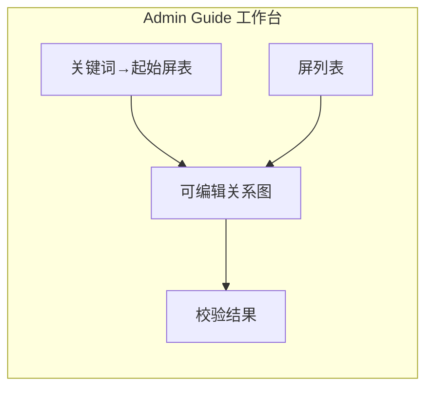

# Admin：站点管理后台

> 类 WordPress / SaaS 模块化后台：运营在固定模块里看清站点真相并直接改。  
> 对话不作为管站主路径。

## 0. 登录、工作区与同步

| 步骤 | 路由 | 说明 |
|------|------|------|
| 注册/登录 | `/login` | 本系统 `account` / `password`；注册可选 `name` |
| 工作区 | `/workspace` | 草稿列表、已发布网站、新建草稿、所有者管理 |
| 业务模块 | `/dashboard` 等 | 须已选 `draftId`；顶栏显示用户与当前草稿 |
| 发布与同步 | `/publish` | Pull/Push、commit 版本、冲突表单与 `POST .../continue`、错误展示 |

协作模型见 [site-collaboration.md](site-collaboration.md)。页面编辑与列表使用 `/api/drafts/:draftId/pages/...`；路由 `/drafts/:draftId/pages/:pageId`。

**询盘 / 报告 / 集成**按当前选中草稿决定数据源，禁止在草稿未关联网站时自动选中账户下「另一个」已发布网站：

| 草稿 `siteId` | Admin 行为 | 主要 API |
|---------------|------------|----------|
| 空（未发布 / 迁移草稿） | 展示该草稿历史询盘、报告、集成 | `GET /api/drafts/:draftId/inquiries`、`.../reports`、`GET/PATCH .../integrations`；报告 `POST /api/reports` 仅 `{ draftId, pageId }`；页面列表来自 `GET /api/drafts/:draftId/pages` |
| 已关联 | 展示关联网站的线上业务数据 | `GET /api/sites/:siteId/inquiries`、`.../reports`、`.../integrations`；创建报告可附带与草稿一致的 `siteId` |

报告页「页面」下拉始终用 `GET /api/drafts/:draftId/pages`（当前草稿 sandbox，含未发布页）。切换选中草稿时清空旧 `pageId` 并按新列表重选。`siteId` 只用于历史报告查询与 `POST /api/reports` 的关联网站字段，不得用 `GET /api/sites/:siteId/pages` 充当报告候选来源。Playwright：`apps/admin/e2e/reports-candidate-pages.spec.ts`。

总览 `GET /api/drafts/:draftId/dashboard` 的 `inquiryCount` 含草稿历史询盘。`ReportRecord.siteId` 允许为 `null`。

## 1. 总览要解决什么

打开 Admin，运营应**一眼**答出：

1. 这个站有哪些页？按 **三类**（`site` / `content` / `ads`）分得清  
2. **当前线上发布了哪些**？草稿/已发布状态清楚  
3. 某个广告页里：**屏怎么映射、Guide 怎么跳**——是图，要对运营透明  
4. 看完图后，**能改**屏关系与选项  
5. 询盘、广告/分析、报告、站点配置各有独立入口  

## 2. 信息架构（MVP）

```
Admin
├── 总览 Dashboard          # 可选：发布数 / 最近 Job
├── 页面 Pages              # 核心
│   ├── 分段或 Tab：通用站页 | 内容页 | 广告承接页
│   ├── 每行：标题、slug、状态、更新时间、操作
│   └── 筛选：仅已发布 / 仅草稿
├── 页面详情
│   ├── site / content → 内容编辑 + 预览（线上发布在发布与同步 Push）
│   └── ads → 屏列表 + Guide 关系图 + 可编辑 + 预览（线上发布在发布与同步 Push）
├── 生成 / 优化             # 固定流程：选知识库 → 生成或改写 → 进草稿
├── 询盘 Inquiries          # 筛选、查看、处理、邮件重发
├── 广告 / 分析             # 连接并调整 Google Ads / GA
├── 报告                    # 诊断结果；可跳到改页
├── 发布中心                # 「当前已发布」清单 / sitemap 公钥 URL
└── 设置                    # 语言 · 地图 · WhatsApp · 采集 · Ads/GA · 屏数上限
                              # 不设：品牌 Logo · 巡检策略 · 企业知识库区块 · Guide 展示切换
                              # 知识库：仅在生成等流程中选择
```

平台能力见 [platform-defaults.md](platform-defaults.md)；设置取舍见 [settings-scope.md](settings-scope.md)。

### 2.1 三类页面必须「分得清」

| UI 要求 | 说明 |
|---------|------|
| 默认按 `kind` 分栏或分组 | 可用总表但必须有类型列 + 强筛选 |
| 类型标签固定文案 | 通用站页 / 内容页 / 广告承接页 |
| 计数可见 | 每类旁显示「共 N · 已发布 M」 |

### 2.2 「当前发布了哪些」必须「看得见」

| UI 要求 | 说明 |
|---------|------|
| 状态列 | sandbox 内 `draft` / `published`（仅草稿编辑上下文） |
| 线上已发布 | 发布中心 / Push 成功后由远端 `publicUrl` 与已发布页面列表展示 |
| 广告页额外 | 线上版本展示：覆盖哪些关键词入口（`entryByKeyword`） |

线上发布：当前草稿整体 **Push**（`/publish`）。不提供单页 publish API。

## 3. 广告页：屏与 Guide 要对运营透明

进入某个 `ads` 页详情，除文案预览外，必须有一块 **Guide 工作台**。

### 3.1 必须可见的结构

| 视图 | 内容 |
|------|------|
| 关键词 → 起始屏 | 每个关键词映射到哪一个 entry `screenId` |
| 屏清单 | 所有屏：`screenId`、`role`（entry/content/cta）、标题；内容屏为全词共用 |
| **关系图** | 节点 = 屏；边 = Guide 选项；标注选项文案与 intent |
| 路径检查结果 | 每词 entry→CTA 是否可达、是否有环、是否存在会重复见屏的边 |

关系图是 **Guide 的主界面**。生成结果写入同一数据结构后立刻画出来。



### 3.2 必须可改

运营至少能改：

| 操作 | 说明 |
|------|------|
| 改选项文案 | 不改目标屏 |
| 改跳转目标 | 选项改指向另一屏或改为去 CTA |
| 增删选项 | 受校验约束（无环、可达等） |
| 调整关键词起始屏映射 | `entryByKeyword` 改绑 |
| 屏标题 / 排序展示名 | 方便读图；`screenId` 保持稳定 |

保存时跑与生成相同的校验器：失败则拒绝保存并标出问题边/节点。

「重新生成」可以有，但是 **改图的补充**，改图仍是主手段。

### 3.3 编辑与预览联动

- 改图保存到草稿 → 预览运行时读草稿 Guide  
- 发布 = 冻结当前屏内容 + Guide 图一并上线  
- 预览可提供「模拟关键词入口」切换，并显示 `visited` 过滤效果  

## 4. 数据与 API

Guide 的真源是 Page 上的结构化字段（`screens` + `guide`）。

```
GET    /api/drafts/:draftId/pages
POST   /api/drafts/:draftId/pages
GET    /api/drafts/:draftId/pages/:pageId
PATCH  /api/drafts/:draftId/pages/:pageId
PATCH  /api/drafts/:draftId/pages/:pageId/guide
POST   /api/drafts/:draftId/pages/:pageId/guide/validate
POST   /api/drafts/:draftId/pages/:pageId/preview
POST   /api/drafts/:draftId/push
POST   /api/drafts/:draftId/pull
POST   /api/drafts/:draftId/continue
GET    /api/sites/:siteId/pages?status=published
GET    /api/drafts/:draftId/inquiries
GET    /api/drafts/:draftId/reports
GET/PATCH /api/drafts/:draftId/integrations
GET    /api/drafts/:draftId/dashboard
POST   /api/reports              # { draftId, pageId, siteId? }
```

页面身份由 `draftId` 与 `pageId` 共同定位；同一网站的不同草稿可共享相同 `pageId`。Admin 路由为 `/drafts/:draftId/pages/:pageId`，且 URL 中的 `draftId` 须与当前选中的工作草稿一致。

## 5. MVP 范围

| 优先级 | 能力 |
|--------|------|
| P0 | 三类分组列表 + 发布状态 + 已发布筛选 |
| P0 | ads 详情：屏表 + **只读关系图** + 校验结果展示 |
| P0 | 改选项文案 / 改目标 / 保存校验 |
| P0 | 询盘列表入口（可先接已有询盘 API） |
| P1 | 拖拽改边、可视化编辑；发布中心独立页 |
| P1 | 站点设置：语言 / 地图 / WhatsApp / 屏数上限 |
| P2 | 站内 `site`↔`content` 链接关系总图 |

Slice A 至少：三类列表 + 状态。  
Slice C 至少：关系图只读 + 表单改边（边列表可接受为图的 MVP 退化，文案上仍称「关系图」）。

## 6. 与自动化的关系

| 人在 Admin | 命令行 / 技能 |
|------------|----------------|
| 看三类与发布态、改 Guide 图、配站点、处理询盘、点发布 | 复用已验证 Skill，经 CLI 调同一能力；由模块页或脚本触发 |
| 最终对线上负责 | 不另造对话工作台；不直连 Store |
