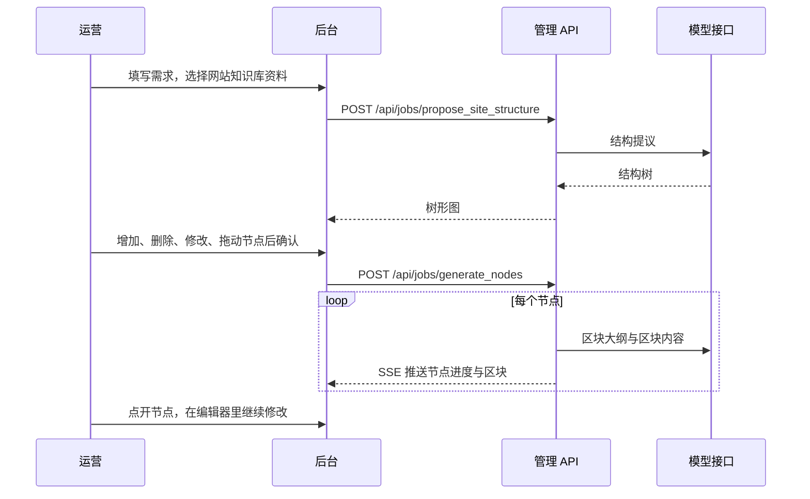

# AI 生成

AI 在固定流程里生成和修改内容，结果写入当前草稿，并在可视化编辑器或结构树上显示。模型配置见 [model-defaults.md](model-defaults.md)。

## 1. 生成操作

每种操作通过 `POST /api/jobs/<Job 类型>` 发起，请求带 `draftId`。

| 操作 | Job 类型 | 输入 | 结果 |
|------|----------|------|------|
| 整站结构提议 | `propose_site_structure` | 需求描述、网站知识库资料（可选）、语言 | 结构树：必备页面、其他页面、各内容类型的分组和条目，每个节点带标题和内容要点 |
| 按结构批量生成 | `generate_nodes` | 已确认的结构树节点 | 每个节点生成区块树和搜索引擎信息，写入草稿 |
| 生成单个页面或条目 | `generate_node` | 对象类型、标题、需求描述、网站知识库资料（可选） | 新建对象并写入区块树 |
| 按指令修改 | `revise_node` | 对象、修改指令 | 修改后的区块树；指令没有涉及的区块保持原样 |
| 重写单个区块 | `rewrite_block` | 对象、区块 ID、修改指令 | 只替换这个区块的 `props` |
| 法律页面 | `generate_legal_pages` | 公司信息、已启用的连接器和插件、语言 | 隐私政策、服务条款、Cookie 政策的区块树 |
| 单页翻译 | `translate_node` | 对象、目标语言 | 目标语言文件，写入 `sourceHash` |
| 整站翻译 | `translate_site` | 目标语言、范围（全部或只处理需要更新的） | 批量翻译结果 |
| 固定文字翻译 | `translate_strings` | 目标语言 | `source/i18n/<locale>.json` |
| 搜索引擎信息 | `generate_seo` | 对象 | 搜索结果标题和摘要 |

## 2. 区块输出

- AI 收到的区块目录来自当前主题和已启用插件：每个区块的类型名、名称、说明、字段定义。
- 生成页面分两步：
  1. 第一步输出区块大纲（区块类型和每个区块的内容要点）。
  2. 第二步按大纲逐个生成区块的 `props`。每生成完一个区块就推送给前端，所以区块在画布上逐个出现。
- 每个区块的输出都用 `ajv` 按区块字段定义校验，不通过时 Job 标为 `failed`，已写入的内容保持原样。
- 图片字段从媒体库中选择；媒体库里没有合适的图片时留空，编辑器标出需要补充图片的区块。
- 站内链接只能引用已存在的对象，或者同一次结构提议里的节点。
- 每个网站只有一个独立知识库。Job 可以通过 `knowledgeDocumentIds` 选择其中的资料；未提供时不读取知识库。资料需要供其他网站使用时先复制到目标网站。

## 3. 整站生成流程

批量生成时每个节点有自己的状态：等待、生成中、完成、失败。失败的节点显示错误原文，可以单独重新生成。

## 4. Job 与进度推送

- Job 在 API 进程内的后台任务中执行，记录在 `jobs` 表，进度事件记录在 `job_events` 表。
- 前端通过 `GET /api/jobs/:jobId/events`（Hono `streamSSE`）接收进度。连接断开后重新连接，从最后收到的事件继续。
- 生成、修改、翻译任务在执行期间持有草稿写入锁的规则与页面编辑相同，见 [site-collaboration.md](site-collaboration.md)。
- Job 与 SSE 的状态和事件类型见 [design/state-models.md](design/state-models.md)，请求响应见 [design/api-conventions.md](design/api-conventions.md)。

## 5. 写作规则

提示词要求 AI 按下面的规则写作，使内容便于搜索引擎和 AI 搜索理解与引用：

- 每个页面开头直接给出定义和结论。
- 规格、对比、价格信息用表格区块。
- 常见问题用常见问题区块。
- 数据写明来源；内容以知识库资料为准，不编造资料以外的事实。
- 每个页面只有一个主标题，标题层级连续。
- 搜索结果标题不超过 60 个字符，摘要不超过 160 个字符。
- 所有文字使用目标语言。

## 6. 法律页面

隐私政策、服务条款、Cookie 政策根据「设置 → 常规」的公司信息，以及已启用的连接器和插件生成。例如启用了 Google Analytics 时写明统计数据的收集方式，启用了 Meta Pixel 时写明广告数据的使用方式。连接器或插件变化后，后台提示重新生成法律页面。

## 7. 失败处理

模型调用失败、输出被截断、输出不是 JSON 对象、缺少字段或者校验不通过时，直接报错，Job 标为 `failed`，草稿内容保持原样，不使用模板顶替。
