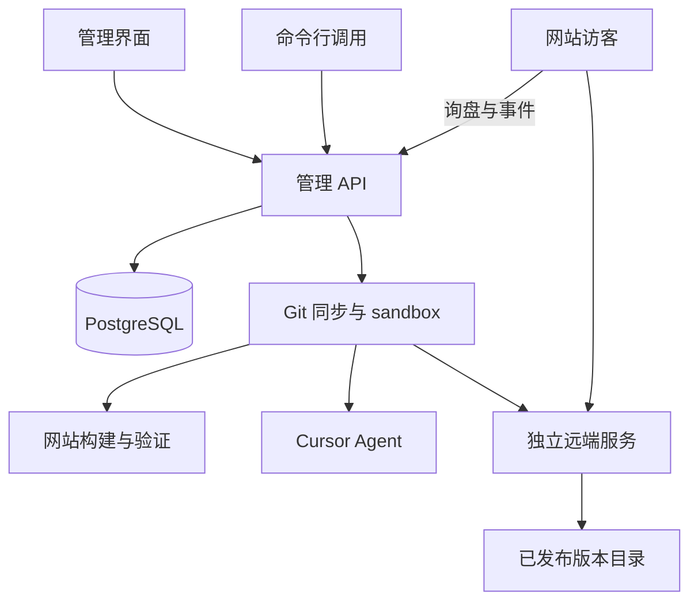

# 网站协作架构

## 用户与资源

每个用户对应一个本系统登录账号。用户与网站、用户与草稿分别建立多对多所有权关系。管理 API 根据登录会话和当前所有权检查每次操作。

`sites` 保存成功发布的网站。`site_drafts` 保存 sandbox 工作副本，同一网站可以有多份草稿。首次发布前，草稿独立存在；首次发布成功后，网站记录包含远端标识、访问地址和发布 commit。

## 服务关系

管理 API、远端服务与管理界面可以在本机运行。远端服务通过独立的服务凭据接收源码，仅公开成功发布的文件。

## 页面与版本

页面包含 `site`、`content`、`ads` 三种类型。页面源码、网站配置、资源和构建程序随 Git 版本保存。数据库页面索引用于查询，`draftId` 与 `pageId` 共同标识编辑对象。

构建器生成 HTML、SEO 信息、广告页入口和 sitemap。验证程序检查源码、页面关联及公开文件的一致性。推送的 commit 同时包含源码和已验证的公开内容。

## 多用户同步

Pull 获取当前已发布版本，与草稿修改进行三方合并。Push 保存当前修改，取得远端最新版本，完成合并、构建和验证后提交发布。

Git 无法自动合并时，Cursor Agent 读取共同起始版本及双方修改，保留能够共同存在的修改。遇到互相冲突的业务要求时，草稿保留处理状态并展示具体问题；用户回答后继续原来的操作。

远端对当前发布 commit 进行并发检查。只有验证成功的版本能够成为公开版本。发布期间发生错误时，已有网站继续提供当前成功发布的内容。

## 业务模块

管理界面包含工作区、页面、Guide、知识库与生成任务、发布与同步、询盘、报告、集成配置和网站设置。广告页使用关键词入口、共用屏幕、Guide 路径和询盘表单。

已发布网站的询盘、报告与集成配置通过 `siteId` 管理。页面编辑与预览通过 `draftId` 和 `pageId` 管理。网站所有者可以共同管理网站，并分别建立草稿进行编辑。

数据位置见 [storage.md](storage.md)，运行方式见 [services.md](services.md)，同步操作见 [site-collaboration.md](site-collaboration.md)。
