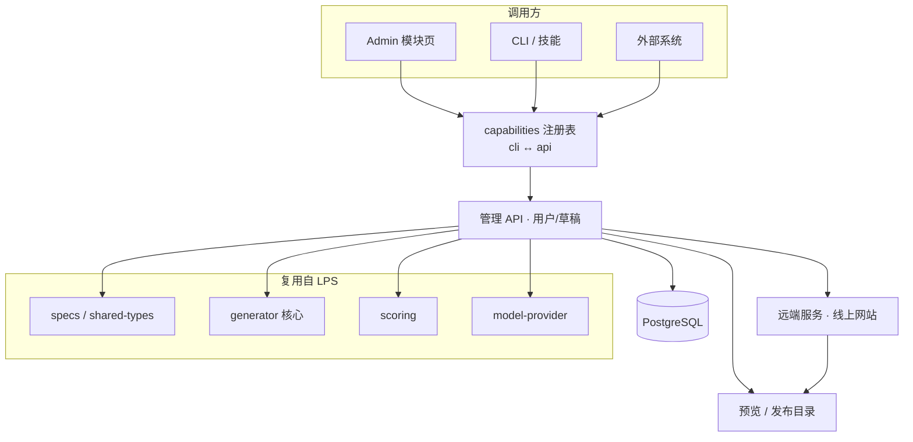

# OLPS 架构设计

> 产品定位：面向运营的落地页特化 CMS（Landing CMS）  
> 对照基线：`landing-page-system`（LPS）  
> 原则：交互与边界按 CMS 重做；算法、规格、生成管线尽量复用

相关文档：[vision](vision.md) · [packages](packages.md) · [platform-defaults](platform-defaults.md) · [page-model](page-model.md) · [admin](admin.md) · [guide-multi-keyword](guide-multi-keyword.md) · [from-lps](from-lps.md) · [mvp-happy-path](flows/mvp-happy-path.md) · [services](services.md) · [storage](storage.md)

---

## 1. 与 LPS 对照

| | LPS | OLPS |
|--|-----|------|
| 定义 | 多租户建站 + 落地页 + 对话工作台 | 用户/网站/草稿协作 Landing CMS；**Admin 模块页**主壳；独立远端服务提供线上访问 |
| 内容组织 | Site → SiteVersion → Artifact；关键词页偏薄旅程 | 三类页；广告页 **词簇 + 一词一址 + 共用一套屏 + 唯一 CTA（询盘）** |
| 交互真源 | Workbench + Agent 对话 | **Admin 模块页**；技能/CLI 挂在固定流程后 |
| 平台能力 | SEO/i18n/sitemap 非一等公民叙事 | SEO · sitemap · 三端为底座；**多语言 / 地图 / WhatsApp 运营可配置** |
| 工程策略 | 大 monorepo，含 BFF / Redis / 多进程 | 本系统账号 + Git 同步；PostgreSQL + 管理 API + 远端服务 + Admin |

---

## 2. 设计目标与非目标

### 2.1 目标

1. 跑通：生成 → Admin 可管（三类/发布态/Guide 图可改）→ 预览 → 发布（含 SEO meta + sitemap）。  
2. 广告页：多关键词起始屏、共用内容屏、无环 Guide、防重复见屏、CTA 汇聚、询盘。  
3. 最大化复用 LPS 已验证的 schema、校验器、KB、Screen/Guide 生成、评分、Google 适配、询盘对接、发布产物思路。  
4. 产品壳用 CMS 模块页，不搬对话工作台。

### 2.2 非目标

- 兼容 LPS 多租户生产数据迁移为一等需求  
- 复刻 Workbench 全站 IA / DeerFlow / Native Agent Runtime 产品壳  
- 首日上完整不可变 `SiteVersion` 审计链（语义可一致，实现可先薄）  
- 重写已有 Guide DAG 校验、Screen Plan 校验、KB retriever、model-provider  

---

## 3. 目标拓扑

要点：

- **无 BFF**：浏览器持 `accessToken` 直调管理 API。  
- **无 Redis**：队列、会话见 [storage.md](storage.md)。  
- **管理 API + 远端服务**：Push 部署与访客 HTTP 由远端承担；sandbox Git 与 Agent 在管理侧协调。  
- 能力一份：Admin / CLI / 外部走同一注册表。

---

## 4. 认证与用户

1. 本系统 **注册/登录**（密码摘要与会话存 PostgreSQL）。  
2. 登录后 **选择 sandbox 草稿**（可切换工作区）。  
3. 编辑请求关联 **draftId**；线上询盘等关联 **siteId**。  
4. Push/Pull 使用 Git 与 Cursor Agent 处理冲突。

详见 [site-collaboration.md](site-collaboration.md)。

---

## 5. 领域要点

### 5.1 三类页面

`site` | `content` | `ads`，可互相链接。见 [page-model.md](page-model.md)。

### 5.2 广告页

- `keywordCluster`；`entryByKeyword`；**一套共用 `screens`**；唯一 `cta`（询盘）。  
- 一词一独立公开地址。  
- 共用屏块数上限默认 20，站点或页可配置。  
- Guide 无环；`visitedScreenIds`；浏览器后退截断 visited 后缀。  
- Guide 在 Admin 可见可改。  

见 [guide-multi-keyword.md](guide-multi-keyword.md)。

### 5.3 站点可配置项

多语言、Google 地图、WhatsApp agent、屏数上限、行为采集、Ads/GA 连接。见 [platform-defaults.md](platform-defaults.md)、[settings-scope.md](settings-scope.md)。

### 5.4 询盘

页面表单提交；Admin 列表、筛选、处理、邮件重发。复用 LPS 对接 Site API 询盘的路径。

---

## 6. 生成与模型

- 业务 LLM（Screen Plan、Guide、文案等）在后端 Job 内，由 Admin 模块页或 CLI 启动同一入口。  
- 默认模型 DeepSeek V4（`deepseek-v4-pro` 等，可配置）。见 [model-defaults.md](model-defaults.md)。  
- 缺知识库、缺广告绑定时，API/CLI 返回明确错误，引导去模块页选择或连接。

---

## 7. 错误处理

出错就地崩溃并抛出原始错误。有业务判断的捕获改写成正常条件；只接住异常的捕获删除。见 [error-handling.md](error-handling.md)。

---

## 8. 包与进程

见 [packages.md](packages.md)、[services.md](services.md)、[design-scale.md](design-scale.md)。

---

## 9. 决策清单

1. 本系统账号 + 登录后先选草稿 + 多用户所有权。  
2. Admin 模块页为主交互；技能/CLI 为同一能力的自动化门。  
3. specs 只读；skills 直接用。  
4. PostgreSQL only；无 BFF；单后端。  
5. 广告页：一词一址、共用屏、可改 Guide、屏数可配、询盘。  
6. 多语言 / 地图 / WhatsApp 运营可配置。  
7. 默认 DeepSeek V4。  
