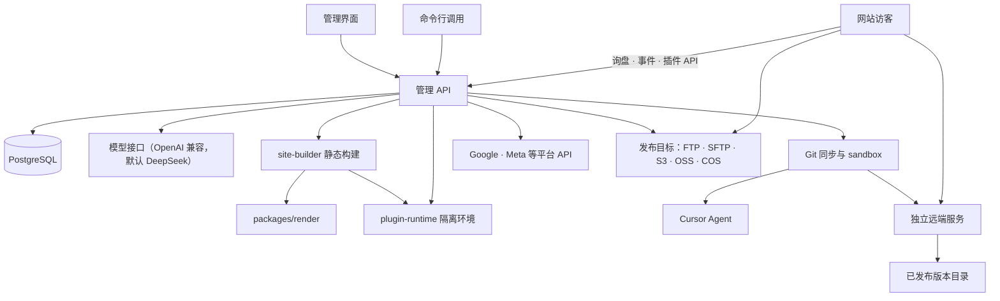

# 网站协作架构

## 用户与资源

每个用户对应一个本系统登录账号。用户与网站、用户与草稿分别建立多对多所有权关系。管理 API 根据登录会话和当前所有权检查每次操作。

`sites` 保存成功发布的网站。`site_drafts` 保存 sandbox 工作副本，同一网站可以有多份草稿。首次发布前，草稿独立存在；首次发布成功后，网站记录包含远端标识、访问地址和发布 commit。

## 服务关系

管理 API、远端服务与管理界面可以在本机运行。远端服务通过独立的服务凭据接收源码，仅公开成功发布的文件。

## 内容与版本

网站内容由页面、内容类型（列表页、分组、条目）、媒体组成，每个内容按语言保存区块树，见 [page-model.md](page-model.md)。内容源码、设置、外观、主题包、插件包、媒体文件和校验程序随 Git 版本保存。数据库内容索引用于查询，`draftId` 与内容标识共同确定编辑对象。

## 渲染与构建

`packages/render` 把区块树、主题模板、插件区块和网站设置渲染成 HTML，管理界面的编辑器画布和 API 的静态构建使用同一份实现。

构建由 `@olps/sync` 执行 API 传入的 `SyncBuildConfig.buildCommand` 完成，这条命令运行 API 安装目录下的 `@olps/site-builder` 命令行程序：读取 sandbox，调用 `packages/render` 渲染全部内容与语言版本，在 plugin-runtime 隔离环境里执行插件的构建钩子，处理图片，生成 sitemap、robots.txt、llms.txt、RSS、Pagefind 索引、跳转页和 `server-config/`，写入 `public/`。sandbox 里的 `tools/site-verify.mjs` 检查源码与 `public/` 的一致性，远端发布时再次执行。产物规则见 [static-output.md](static-output.md)。

## 多用户同步

Pull 获取当前已发布版本，与草稿修改进行三方合并。Push 保存当前修改，取得远端最新版本，完成合并、构建和验证后提交发布。

Git 无法自动合并时，Cursor Agent 读取共同起始版本及双方修改，保留能够共同存在的修改。遇到互相冲突的业务要求时，草稿保留处理状态并展示具体问题；用户回答后继续原来的操作。

远端对当前发布 commit 进行并发检查。只有验证成功的版本能够成为公开版本。发布期间发生错误时，已有网站继续提供当前成功发布的内容。远端发布成功后，API 把同一份 `public/` 按 SHA-256 增量上传到已启用的发布目标。

## 访客侧服务

静态网站通过跨域请求调用 OLPS API：询盘提交、标准事件、插件服务器接口。插件服务器接口在 plugin-runtime 隔离环境里执行。营销平台的服务器端转化由 API 后台 Job 发送，见 [integrations.md](integrations.md)。

## 业务模块

管理界面的模块和路由见 [admin.md](admin.md)。AI 建站、生成、修改、翻译通过 Job 执行，结果写入草稿 sandbox，进度通过 SSE 推送，见 [ai-generation.md](ai-generation.md)。

已发布网站的询盘、报告、营销集成、发布目标通过 `siteId` 管理。内容编辑与预览通过 `draftId` 管理。网站所有者可以共同管理网站，并分别建立草稿进行编辑。

数据位置见 [storage.md](storage.md)，运行方式见 [services.md](services.md)，同步操作见 [site-collaboration.md](site-collaboration.md)。
