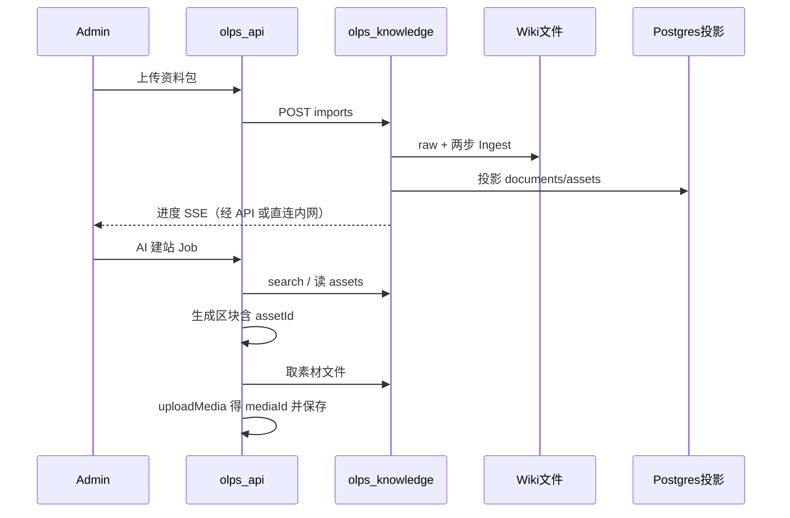

# OLPS × llm_wiki 知识库服务

本文件定义 OLPS 独立知识库服务（`@olps/knowledge`）的设计：资料包导入、素材角色识别、AI 建站素材提升与 `core/video`。流程对齐上游参考 [nashsu/llm_wiki](https://github.com/nashsu/llm_wiki) 的入库与对外接口思路；实现为 **Node 自研**，不拷贝上游 GPL-3 源码进产物。

参考仓可放在 `.intermediate/llm_wiki_ref`（已被 gitignore）供对照。进程说明见 [services/knowledge/README.md](../../services/knowledge/README.md)；Agent / MCP 操作见 [knowledge-agent-skill.md](../knowledge-agent-skill.md)。

## 1. 目标与边界

### 1.1 要解决的问题

运营提交产品资料时，实际输入是**文件夹或压缩包**（文档、表格、图片、视频），而不是仅靠标题+正文表单。系统需要：

1. 自动解析并归纳进站点知识库。
2. 在知识库层识别素材用途（Logo、产品图、证书等）。
3. 再次导入时对照已有内容，由 AI 判定新增或更新。
4. AI 建站选用图/视频时，自动写入当前草稿素材库，页面使用 `{ mediaId }`（发布后渲染为 `/assets/uploads/...`）。

### 1.2 服务定位

| 进程 | 职责 |
|------|------|
| `@olps/knowledge`（新建，`services/knowledge`） | Wiki 文件权威存储、解析、两步 Ingest、检索、导入队列、素材资产文件、对外 HTTP API；可选 MCP 与 Agent Skill |
| `@olps/api` | 站点鉴权、把站点映射到 knowledge project、投影表维护触发、AI 建站 Job、草稿媒体提升、现有 Admin 路由门面 |
| `@olps/admin` | 网站资料导入 UI、资料/素材浏览、导入进度 |
| `@olps/remote` | 不变 |

首期：**Wiki 文件为权威**；PostgreSQL 的 `knowledge_documents`（及扩展投影表）只做列表、过滤与 Job 快照用的投影/检索索引。任何手改投影而不改 Wiki 文件，视为无效，下次投影重建会覆盖。

### 1.3 明确不做（首期）

- 桌面壳（Tauri）、Chrome Clipper、Deep Research 网页抓取流水线。
- 把上游 React UI 嵌进 Admin。
- 向量库（LanceDB）；首期关键词 + 角色/路径过滤即可。向量检索可后开，接口预留。
- 数 GB 单次上传的完整分片协议（目录与队列按可扩展设计；本期上限见 §7）。

## 2. 与 llm_wiki 的对齐方式

llm_wiki 对外已有三类入口：

1. **本地 HTTP API**：`http://127.0.0.1:19828/api/v1`（项目、文件、搜索、图谱、评论队列、chat、写页、rescan、embed 等）。
2. **MCP Server**：`mcp-server` 调上述 HTTP，工具包括 `llm_wiki_status`、`projects`、`set_project`、`files`、`read_file`、`reviews`、`search`、`chat`、`graph`、`rescan_sources`、`embed_page`、`write_page`。
3. **AI Agent Skill**：面向编码代理的一键安装技能，经 MCP/API 操作知识库。

OLPS 知识库服务对齐其**能力与流程**，HTTP 路径与 MCP 工具名采用 OLPS 前缀，避免与桌面版端口/命名冲突。

### 2.1 三层存储（对齐 Karpathy / llm_wiki）

每个站点对应一个 knowledge project，目录布局：

```text
<KNOWLEDGE_ROOT>/<siteId>/
  purpose.md                 # 本站知识目标（建站用途、产品范围）
  schema.md                  # 页面类型与入库规则（含素材角色枚举）
  raw/sources/               # 不可变原件（导入的文件树）
  wiki/                      # LLM 维护的编译页
    index.md
    log.md
    overview.md
    sources/                 # 来源摘要页
    concepts/ | entities/ | …  # 按 schema 扩展
    assets-catalog.md        # 素材清单（角色、路径、assetId）
  .olps-knowledge/
    imports/                 # 导入任务状态
    fingerprints.json        # 源文件 SHA256 缓存
    reviews.json             # 待人工确认项
```

原件只增不改语义；纠错通过新版本文件或 Wiki 页修正体现。删除原件时按级联规则清理仅属于该来源的 Wiki 页，多来源共享页只剥离 `sources[]`。

### 2.2 两步 Ingest（对齐 llm_wiki）

```text
Step 1 分析：读源文件 + 已有 index/相关页 → 结构化分析
  （实体、要点、与已有页关系、矛盾、结构建议、素材角色建议）
Step 2 生成：根据分析写入/更新 Wiki 页、index.md、log.md、overview.md、assets-catalog
  并产出 review 项（低置信角色、冲突等）
```

源文件内容哈希未变则跳过（指纹缓存）。同一次文件夹导入串行入队，进度可查，崩溃可续跑。

### 2.3 HTTP API 形状（首期必做子集）

前缀：`/api/v1`。鉴权：服务间令牌（`KNOWLEDGE_SERVICE_TOKEN`）；管理 API 代用户调用时附带 `siteId` 与内部用户标识。绑定地址可配置，默认本机；生产可内网监听。

| 方法 | 路径 | 作用 |
|------|------|------|
| GET | `/health` | 存活 |
| GET | `/projects` | 已登记站点项目 |
| GET | `/projects/:siteId` | 项目摘要（页数、素材数、最近导入） |
| GET | `/projects/:siteId/files` | 列出 raw/wiki 允许路径下的文件 |
| GET | `/projects/:siteId/files/content` | 读允许的文本/元数据 |
| POST | `/projects/:siteId/imports` | 创建资料包导入（`zipBase64` 或 `files[]` 清单） |
| GET | `/projects/:siteId/imports/:importId` | 导入状态与统计 |
| GET | `/projects/:siteId/imports/:importId/events` | SSE 进度 |
| POST | `/projects/:siteId/sources/rescan` | 对 `raw/sources` 重新扫描入队 |
| POST | `/projects/:siteId/search` | 关键词检索 Wiki/来源（供建站 Job） |
| GET | `/projects/:siteId/assets` | 素材列表（可按 `role` 过滤） |
| PATCH | `/projects/:siteId/assets/:assetId` | 人工修正角色/说明 |
| GET | `/projects/:siteId/assets/:assetId/file` | 读取素材二进制 |
| GET | `/projects/:siteId/reviews` | 待审项 |
| POST | `/projects/:siteId/reviews/:id/resolve` | 处理待审 |
| GET | `/projects/:siteId/graph` | 知识关系图（Wiki 页、素材节点与结构边） |
| POST | `/projects/:siteId/pages/write` | 受控写入 Wiki 页（Agent/Skill 用） |
| POST | `/projects/:siteId/project` | 确保站点项目目录已初始化（建站时由 API 调用） |

首期不做桌面版全量：`chat`、`embed` 可列为二期；MCP/Skill 首期实现与上表对应的工具子集。

### 2.4 MCP 与 Agent Skill（首期）

- `services/knowledge/mcp-server`：stdio MCP，工具名 `olps_knowledge_*`，内部只调本服务 HTTP（与 llm_wiki mcp-server 相同模式）。
- Skill 包：说明如何对某一 `siteId` 做入库、检索、读 `assets-catalog`、处理 review；安装方式与仓库文档另行说明。
- 二者依赖 knowledge 服务已启动，不内嵌第二套解析逻辑。

## 3. 资料包导入

### 3.1 Admin 入口

「网站资料」保留手工标题+正文（写入时转为 Wiki 手写来源页，并投影到 Postgres）。新增：

- 上传 **zip**
- 选择 **文件夹**（`webkitRelativePath` 多文件）

请求经 `@olps/api` 鉴权后转发/上传到 knowledge 服务的 `POST .../imports`，并携带当前 `draftId`（审计用；Wiki 仍属站点）。

### 3.2 体积上限（本期）

- 单次合计 **100MB**
- 单文件 **20MB**（与 `MEDIA_MAX_BYTES` 一致）

目录与导入队列按日后数 GB（分片上传、按文件直写入 `raw/sources`）预留；用环境变量 `KNOWLEDGE_IMPORT_MAX_BYTES` 可调高，首期默认上述值。

### 3.3 文件分类

| 扩展名 | 处理 |
|--------|------|
| `.txt` `.md` `.csv` `.docx` `.xlsx` `.pdf` | 抽文本 → 作为源文件进入 Ingest |
| `.png` `.jpg` `.jpeg` `.webp` `.gif` `.svg` | 登记为知识库素材资产，写入 `raw/sources` 并进入角色识别 |
| `.mp4` `.webm` | 同上（视频） |
| 其他 | 记入 skipped，不中断整包 |

解析使用 Node 生态成熟库（docx / xlsx / pdf 文本抽取等），禁止手写二进制格式 parser。

### 3.4 归纳粒度

- **每个文字源文件** → 一条来源摘要 Wiki 页 + 投影为一条 `knowledge_documents`（标题默认文件名去扩展名，正文为抽出文本/Markdown 表格）。
- **每个图片/视频** → 一条资产记录；进入 `wiki/assets-catalog.md` 与投影表 `knowledge_assets`。
- 同一次导入共享 `importId`；同包文字页的 frontmatter / 投影字段记录关联 `assetIds`。

## 4. 素材用途角色（知识库层）

在 Ingest Step 1/2 写入资产元数据，供建站与外观直接使用。

| `role` | 含义 |
|--------|------|
| `logo` | 本品牌 Logo |
| `partner_logo` | 服务商/合作方 Logo |
| `locale_icon` | 语言图标 |
| `product_image` | 产品图 |
| `certificate` | 证书与资质 |
| `background` | 背景图 |
| `map_screenshot` | 地图截图 |
| `qr_code` | 二维码 |
| `video_product` | 产品视频 |
| `document_scan` | 扫描件/说明书页图 |
| `other` | 未归入上类 |

识别依据：相对路径与文件名、同包文字摘要、可选缩略图多模态描述。输出 `role`、`confidence`、`reason`。置信度低于阈值（建议 0.55）标为 `other` 并进入 reviews，Admin 可改。

资产二进制存放在站点 knowledge 目录下（例如 `raw/sources/...` 原件路径 + `.olps-knowledge/asset-meta/<assetId>.json`），**不**进入草稿 Git，直到被建站选用。

## 5. 再次导入：新增或更新

对每个文字源候选：

1. 用指纹、`source_path`、标题/正文摘要在已有 Wiki/投影中取对照集。
2. AI 输出 `create` | `update` | `skip` 及目标页/文档标识、拟定 title/content、理由。
3. 服务端强制：`update` 必须指向已存在对象；主题明显无关时拒绝更新并记入 stats（可降级为 create 并写 review）。

对素材：

- 指纹相同 → 更新角色/说明，不复制文件。
- 路径相同、指纹不同 → 替换原件，保留 `assetId`。
- 新路径新指纹 → 新 `assetId`。

## 6. Postgres 投影

### 6.1 表

保留并扩展站点知识库相关表（upgrade 迁移）：

**`knowledge_documents`（投影）**

| 字段 | 含义 |
|------|------|
| 现有 `doc_id` `kb_id` `title` `content` `source_document_id` `created_at` | 列表与 Job 快照 |
| `updated_at` | 投影更新时间 |
| `source_path` | raw 内相对路径 |
| `source_fingerprint` | 内容哈希 |
| `import_id` | 导入批次 |
| `kind` | `manual` \| `imported_text` \| `wiki_page` |
| `wiki_path` | 权威 Wiki 相对路径 |
| `asset_refs` | jsonb，关联 assetId 列表 |

**`knowledge_assets`（投影）**

`asset_id`、`kb_id`、`import_id`、`source_path`、`fingerprint`、`mime_type`、`byte_size`、`width`、`height`、`role`、`role_confidence`、`role_reason`、`caption`、`storage_key`、`promoted_media`（`{ [draftId]: mediaId }`）、时间戳。

**`knowledge_imports`（投影/任务索引）**

`import_id`、`site_id`、`user_id`、`draft_id`、`source_name`、`status`、`stats`、`error`、时间戳。权威进度也可写在 `.olps-knowledge/imports/`；Postgres 便于 Admin 列表。

### 6.2 投影规则

- Ingest 成功或人工改 Wiki/资产元数据后，knowledge 服务回调或由 API 拉取 diff，**重建受影响行**。
- Job 提交时仍可读 Postgres 快照；也可直接 `POST .../search` 取片段。大库优先 search，避免整库正文进 prompt。
- 跨站复制：复制 Wiki 子树与 raw 中必要原件到目标 `siteId`，再投影；生成新 `doc_id` / `asset_id`。

### 6.3 与现有手工 API 的关系

现有 `/api/sites/:siteId/knowledge-base/documents` 保留为门面：

- 读：来自投影表。
- 写：API 写入 knowledge 服务（更新对应 Wiki 页或手工源）→ 再投影；禁止只改 Postgres。

## 7. AI 建站与素材提升

### 7.1 Job 注入

选中文档时附带关联 `knowledgeAssets`（`assetId`、`role`、`sourcePath`、`mimeType`、`caption`、宽高）。系统提示：事实以知识库为准；媒体字段只能引用清单中的资产；按角色选用（例如禁止把 `qr_code` 当产品主图）。

### 7.2 生成期占位与保存前映射

1. 生成中间态媒体字段允许 `{ assetId }` 或已有 `{ mediaId }`。
2. 保存前 `promoteKnowledgeAssets`：从 knowledge 服务拉二进制 → 现有 `uploadMedia` → 写入 `promoted_media[draftId]` → props 改为 `{ mediaId }`。
3. 再跑现有校验与 `assertReferencesExist`。

页面 JSON **只存 `mediaId`**；公开路径由渲染层解析为 `/assets/uploads/...`。

### 7.3 `core/video`

新增核心区块 `core/video`：字段 `video`（media，必填）、`poster`（media，可选）、`caption`（可翻译）、`autoplay` / `muted` / `controls`。`prepareProps` 解析为 `src` / `posterSrc`。编辑器媒体选择器对视频字段过滤 `mp4`/`webm`。

## 8. 管理 API 与进程关系



环境变量（与 [services/knowledge/README.md](../../services/knowledge/README.md) 一致）：

| 变量 | 说明 |
|------|------|
| `KNOWLEDGE_SERVICE_TOKEN` | 服务间鉴权令牌（必填）；管理 API 以 `KNOWLEDGE_SERVICE_URL` + 同一令牌调用本服务 |
| `KNOWLEDGE_SERVICE_URL` | 管理 API 侧配置，指向本服务根地址（不含路径后缀） |
| `KNOWLEDGE_ROOT` | 项目根目录，默认 `.intermediate/knowledge-data` |
| `KNOWLEDGE_IMPORT_MAX_BYTES` | 单次导入合计上限，默认 `104857600`（100MB） |
| `MEDIA_MAX_BYTES` | 单文件上限，默认 `20971520`（20MB），与 API 媒体上传一致 |
| `KNOWLEDGE_HOST` | 监听地址，默认 `127.0.0.1` |
| `KNOWLEDGE_PORT` | 监听端口，默认 `19828` |
| `DATABASE_URL` | PostgreSQL 连接串；导入完成后写入投影，并供 `POST .../projection/rebuild` 重建 |
| `AI_API_KEY` | 导入两步 Ingest 调用模型（必填之一，见下行） |
| `AI_BASE_URL` | OpenAI 兼容接口地址，默认 `https://api.deepseek.com` |
| `AI_MODEL` | 模型名，默认 `deepseek-v4-pro` |
| `KNOWLEDGE_AI_API_KEY` | 可选；若设置则覆盖 `AI_API_KEY` |
| `KNOWLEDGE_AI_BASE_URL` | 可选；若设置则覆盖 `AI_BASE_URL` |
| `KNOWLEDGE_AI_MODEL` | 可选；若设置则覆盖 `AI_MODEL` |

本地开发：在远端、管理 API、管理后台之外另开终端执行 `npm run dev -w @olps/knowledge`（或根脚本 `npm run dev:knowledge`），见根 [README.md](../../README.md) 与 [services.md](../services.md)。

## 9. Admin 界面要点

- 导入区：zip / 文件夹、进度、结果摘要（文档新增/更新、角色分布）。
- 文档列表：来源路径、Wiki 链接或路径、关联素材缩略图。
- 素材面板：按角色筛选、改角色、预览。
- AI 建站选资料时展示素材统计。
- 编辑器可插入 `core/video`。

## 10. 实施顺序（确认设计后）

1. 脚手架 `@olps/knowledge`：目录初始化、health、project 创建、读写 files。
2. 导入 + 解析 + 指纹队列；投影 documents/assets；Admin 上传。
3. 两步 Ingest（增更判定 + 角色识别）与 reviews。
4. search API；Job 注入资产；promote → mediaId；`core/video`。
5. MCP 子集 + Skill 说明；文档与 mvp/e2e 补强。

## 11. 测试要点

1. 以「产品1」类结构（docx + xlsx + 多 jpg）打 zip：投影出对应文档与产品图角色。
2. 文件夹多文件保持相对路径。
3. 二次导入微调 docx → update，不无故复制。
4. 生成含 image/video 的页面：最终 props 为 mediaId，sandbox 有文件与 `source/media/*.json`。
5. 超限、坏路径、不支持类型 → 明确错误。
6. 只改 Postgres 后触发投影重建 → 与 Wiki 一致。
7. MCP：`olps_knowledge_search` / `read_file` 在服务启动后可用。

## 12. 相关文档

- [services.md](../services.md) — 第四进程、环境变量、与 API 关系
- [storage.md](../storage.md) — Wiki 权威与 Postgres 投影表
- [admin.md](../admin.md) — 网站资料、导入、reviews、素材修正、AI 页素材统计
- [ai-generation.md](../ai-generation.md) — Job `knowledgeAssets` 与 `promoteKnowledgeAssets`
- [domain-model.md](domain-model.md) — 知识库 / 素材领域类型
- [page-model.md](../page-model.md) — `core/video`
- [api-conventions.md](api-conventions.md) — 管理 API 知识库门面
- 根 [README.md](../../README.md) — 本地四个进程启动
- [knowledge-agent-skill.md](../knowledge-agent-skill.md) — MCP / Skill 操作说明

## 13. 已确认决策摘要

| 项 | 决策 |
|----|------|
| 实现路线 | Node 重写独立服务，流程对齐 llm_wiki |
| 上游定位 | HTTP API + MCP + Agent Skill 作为对外能力对齐对象；桌面 UI 不引入 |
| 权威数据 | Wiki 文件；Postgres 仅投影/检索 |
| 导入入口 | zip 与文件夹 |
| 归纳 | 每文字文件一条文档 + 素材清单 |
| 重复导入 | AI 对照已有内容判定 create/update/skip |
| 素材角色 | 知识库层识别固定枚举 |
| 体积本期 | 100MB / 20MB，结构预留更大包 |
| 视频 | 增加 `core/video`；选用后提升到素材库 |
| 许可 | 不拷贝上游 GPL 源码；自研 Node 实现 |
