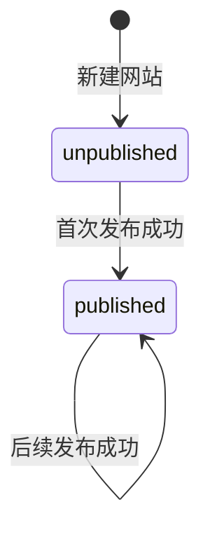
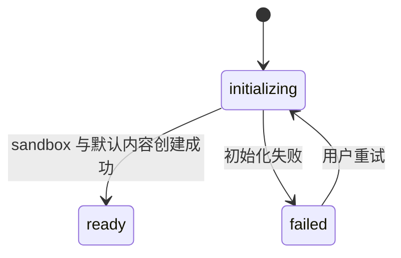
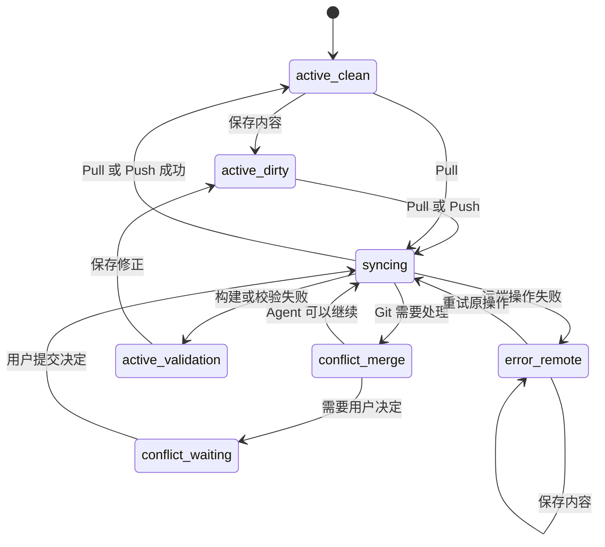
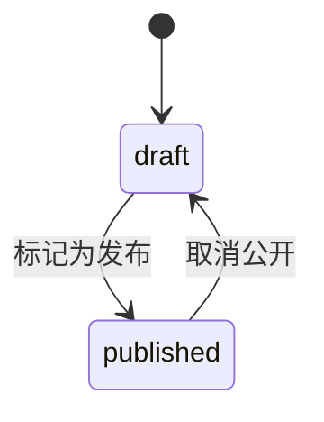
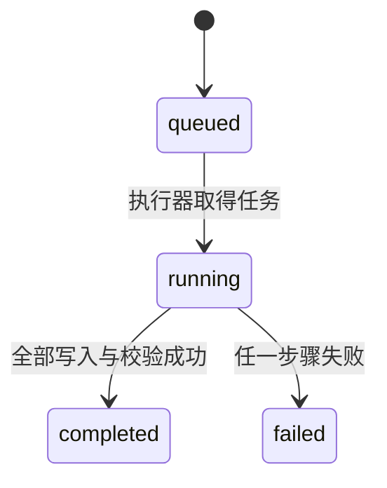
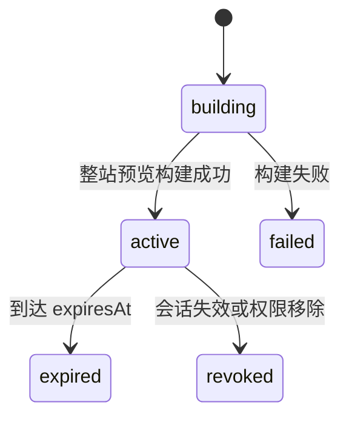
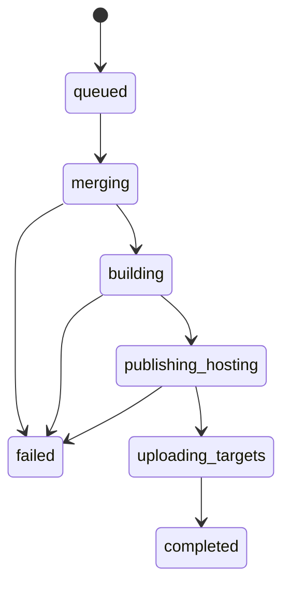
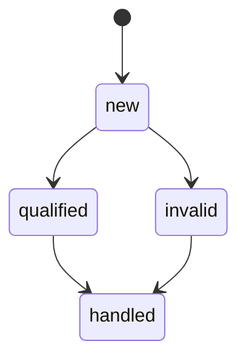

# 状态模型

本文件定义网站、草稿、内容、Job、预览和发布的状态变化。数据库和界面必须使用同一组状态。

## 1. 网站



- `unpublished` 网站已有 `siteId`、成员、草稿、知识库、营销配置和发布目标，没有公开版本。
- `published` 网站至少有一个成功发布的 commit 和公开地址。
- 删除网站不在当前范围内。归档草稿不会改变网站状态。

## 2. 草稿初始化



- `initializing` 期间只能查看初始化进度和取消返回「我的网站」。
- `failed` 保存原始错误；重试复用同一 `draftId` 和 `siteId`，重新创建 sandbox。
- 只有 `ready` 草稿可以进入后台模块。

## 3. 草稿业务状态与同步状态

`DraftStatus` 表示当前能否编辑，`DraftSyncStatus` 表示草稿与已发布版本的关系。两者必须使用下面的组合：

| `status` | 允许的 `syncStatus` | 是否允许普通编辑 |
|----------|----------------------|------------------|
| `active` | `clean`、`dirty`、`validation_failed` | 允许 |
| `syncing` | `clean`、`dirty` | 禁止 |
| `conflict` | `merge_conflict`、`awaiting_user` | 禁止 |
| `error` | `clean`、`dirty` | 允许普通编辑与重试同步 |
| `archived` | `clean`、`dirty` | 禁止 |



对应值：

- `active_clean`：`status=active`、`syncStatus=clean`
- `active_dirty`：`status=active`、`syncStatus=dirty`
- `conflict_merge`：`status=conflict`、`syncStatus=merge_conflict`
- `conflict_waiting`：`status=conflict`、`syncStatus=awaiting_user`
- `active_validation`：`status=active`、`syncStatus=validation_failed`
- `error_remote`：`status=error`、`syncStatus` 保留 sandbox 的 `clean` 或 `dirty`

规则：

- `pendingOperation` 只在 `syncing` 和 `conflict` 状态保存 `pull` 或 `push`。
- 远端暂时不可用时进入 `error_remote`，保存 `lastError` 和 `pendingOperation`。普通编辑仍可保存，重试时包含当前草稿的最新修改。
- `validation_failed` 允许修改内容；下一次保存后改为 `dirty`。
- 处于 `syncing`、`merge_conflict` 或 `awaiting_user` 时，内容写接口返回 409 `DRAFT_BUSY` 或 `DRAFT_CONFLICT`。
- 进程重新启动后根据 `pendingOperation`、远端版本和 sandbox 状态继续或恢复操作。

## 4. 内容状态

内容文件只保存 `draft | published`：



后台展示状态由内容状态和当前发布版本共同计算：

| 内容状态 | 当前草稿是否等于公开版本 | 后台文案 |
|----------|--------------------------|----------|
| `draft` | 任意 | 草稿 |
| `published` | 是 | 已发布 |
| `published` | 否 | 已发布但有修改未发布 |

- 「标记为发布」只修改草稿文件，不执行网站发布。
- 网站发布成功后，公开版本与该 commit 中的内容一致。
- 取消公开后，在下一次网站发布时从公开产物移除该对象并产生必要跳转。

## 5. Job

```ts
type JobStatus = 'queued' | 'running' | 'completed' | 'failed'

type JobEventType =
  | 'job_queued'
  | 'job_started'
  | 'node_started'
  | 'outline_completed'
  | 'block_completed'
  | 'node_completed'
  | 'node_failed'
  | 'job_completed'
  | 'job_failed'
```



- Job 创建时保存请求快照、`userId`、`siteId`、`draftId` 和幂等键。
- 执行器开始前重新检查权限与草稿状态。
- `propose_site_structure` 只写 Job 结果，不修改草稿。
- 其他内容 Job 在模型输出、Schema 校验和全部文件准备完成后取得草稿写入锁；只有全部文件写入和索引更新成功，Job 才能变为 `completed`。
- `generate_nodes` 的单个节点可以独立失败。所有可生成节点完成后，若存在失败节点，父 Job 为 `failed`，成功节点保持已写入状态；重试请求只包含失败节点。
- `revise_node` 与 `rewrite_block` 使用创建 Job 时读取的对象 `revision`。写入前 revision 变化则 Job 失败并返回 `REVISION_CONFLICT`。

### 5.1 SSE 事件

```ts
type JobEvent = {
  eventId: number
  jobId: EntityId
  type: JobEventType
  occurredAt: IsoDateTime
  payload: Record<string, unknown>
}
```

- `eventId` 在单个 Job 内递增。
- 客户端使用 `Last-Event-ID` 继续接收。
- `block_completed` 的 payload 含 `nodeId`、`blockId`、`blockType` 和已校验的 `props`。
- `job_failed` 与 `node_failed` 的 payload 含 API 错误格式中的 `code`、`error` 和 `details`。

## 6. 整站生成节点

```ts
type GenerationNodeStatus =
  | 'waiting'
  | 'generating'
  | 'completed'
  | 'failed'
```

- 结构提议中的临时节点 ID 使用 UUID，只在该结构提议和 `generate_nodes` 请求中有效。
- 写入草稿后，每个节点取得正式内容 ID，结果保存临时 ID 到正式 ID 的映射。
- 父节点失败不自动阻止无依赖的其他节点；依赖父分组地址的节点等待父节点成功。

## 7. 预览

```ts
type PreviewCapabilityState = 'active' | 'expired' | 'revoked'
```



- `building` 和 `failed` 是请求处理状态，不写入 capability 表。
- 只有完整构建成功后才写入 capability，防止返回部分可访问的预览。
- 每次预览读取请求当时的草稿快照。之后的编辑不会改变已有预览，用户点击「预览」会生成新 capability。
- capability 目录在过期后由后台清理任务删除。
- 预览包含 `draft` 内容，公开构建只包含 `published` 内容。
- 预览询盘保存到草稿，状态为 `preview`，不会触发邮件和营销发送。

## 8. 发布

```ts
type PublishStatus =
  | 'queued'
  | 'merging'
  | 'building'
  | 'publishing_hosting'
  | 'uploading_targets'
  | 'completed'
  | 'failed'

type PublishType = 'full' | 'assets_only'
```



- OLPS 托管成功是网站发布成功的必要条件。
- OLPS 托管成功后，单个附加发布目标失败不会把发布记录改为 `failed`；记录保持 `completed`，对应目标结果为 `failed`，允许单独重试。
- `publishing_hosting` 失败时，网站继续提供上一个公开版本。
- 首次 `completed` 把 `sites.status` 从 `unpublished` 改为 `published`。
- 发布记录保存本次 commit、构建摘要、产物清单摘要和每个目标结果。
- `assets_only` 只在变更集合完全符合静态资源条件时使用；判定失败时执行 `full`。

## 9. 询盘

```ts
type InquiryStatus = 'new' | 'qualified' | 'invalid' | 'handled'
type InquirySource = 'public' | 'preview'
```



- `public` 询盘可以触发邮件、标准事件和连接器发送。
- `preview` 询盘只用于验证草稿表单，不能触发外部发送。
- 第一次变为 `qualified` 时创建离线转化任务；重复保存同一状态不能重复创建。

## 10. 状态写入边界

- 状态变化与对应业务数据在同一个数据库事务中写入。
- 文件写入成功、Git commit 成功、数据库索引成功后，内容操作才返回成功。
- 数据库索引失败时保留 Git commit 以供诊断，草稿进入 `error`；重试按同一 commit 重建索引。
- 远端发布与本地数据库无法使用单个事务时，以发布操作记录和幂等键保证重试不会重复创建网站或发布记录。
