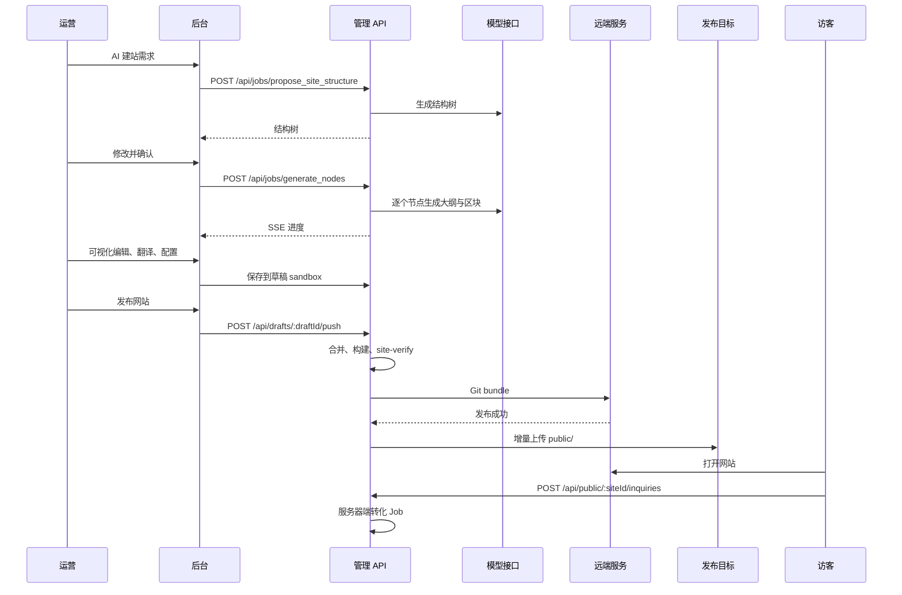

# 主流程验收

> 目标：证明「登录选草稿 → AI 建站 → 可视化编辑 → 媒体 · 外观 · 插件 · 营销集成 → 多语言 → 发布纯静态网站 → 访客询盘带广告来源」整条路径成立。

## 1. 验收剧本

| 步 | 操作方 | 动作 | 可见结果 |
|----|--------|------|----------|
| 1 | 运营 | 注册、登录，在「我的网站」新建网站 | 进入仪表盘；页面列表有八个必备页面，菜单有新闻、产品、解决方案 |
| 2 | 运营 | 「设置 → 常规」填写公司信息，语言选择英文（默认）和简体中文 | 页面列表的每一行显示两种语言的状态 |
| 3 | 运营 | 「工具 → AI 建站」写需求、选知识库 | 显示结构树：必备页面、两个产品系列、每个系列两个分类、每个分类三个产品、三条新闻、两个解决方案 |
| 4 | 运营 | 在树上删除一个产品、增加一个分类，确认生成 | 树上逐个显示生成进度；完成后每个节点可以点开 |
| 5 | 运营 | 打开一个产品详情，在画布上改标题、拖动区块顺序、在右侧修改规格表 | 画布实时显示修改；保存后列表显示「已发布但有修改未发布」 |
| 6 | 运营 | 选中一个区块，「AI 重写这一块」 | 只有这个区块的内容变化 |
| 7 | 运营 | 把这个产品再放进另一个分类 | 两个分类的列表都显示它；地址仍为 `/en/products/<slug>/`，面包屑按主分类显示 |
| 8 | 运营 | 媒体库上传产品图，在产品详情里引用，填写替代文字 | 画布显示图片；媒体详情的「使用位置」列出这个产品 |
| 9 | 运营 | 「外观 → 自定义」改主色和 Logo，「外观 → 菜单」增加一个分组菜单项 | 右侧预览与画布同时更新 |
| 10 | 运营 | 「插件」启用 WhatsApp，填写号码 | 预览页面出现 WhatsApp 按钮 |
| 11 | 运营 | 「营销集成」授权连接 Google，选择 Ads 账户和 GA4 媒体资源；授权连接 Meta，选择 Pixel | 卡片显示「已连接」；Google Ads 里出现自动创建的转化操作 |
| 12 | 运营 | 在产品详情点「翻译到其他语言」 | 中文版本生成；该产品的中文状态为「已翻译」 |
| 13 | 运营 | 点击「发布网站」 | 弹窗显示修改数量、检查通过、发布进度；完成后显示网站地址 |
| 14 | 运营 | 在「设置 → 发布目标」添加本机 SFTP 和一个 S3 存储桶，再次发布 | 两个目标都显示成功；第二次发布只上传变化的文件 |
| 15 | 运营 | 只替换一张图片，发布 | 发布类型显示「只发布静态资源」 |
| 16 | 访客 | 用带 `gclid` 和 `utm_*` 的地址打开英文首页，接受 Cookie，浏览产品，提交询盘 | 跳到询盘提交成功页 |
| 17 | 运营 | 打开询盘列表 | 询盘显示来源页面、语言、来源平台 Google Ads、广告系列、关键词 |
| 18 | 运营 | 把询盘标为「有效」 | 转化发送记录显示 Google Ads、GA4、Meta 都已发送成功 |
| 19 | 运营 | 「工具 → 报告」做全站体检 | 按页面列出问题，点击进入对应编辑器 |
| 20 | 运营 | 下载发布记录里的 zip，解压到本机 nginx、IIS 和 `npx serve` | 三个服务器上：根地址跳到 `/en/`，中英文切换、站内搜索、分组列表、产品详情、404 页、旧地址跳转都正常；`sitemap.xml`、`robots.txt`、`llms.txt`、`feed.xml` 可以打开；套用 `server-config/` 后 404 返回 404 状态码 |

## 2. 构建产物检查

在第 13 步的产物上检查：

- 每个页面有 `title`、`description`、`canonical`、全部语言的 `hreflang` 与 `x-default`、Open Graph。
- 产品详情有 `Product` 与 `BreadcrumbList`，分组页有 `ItemList`，联系我们有 `LocalBusiness`，全站有 `Organization` 与 `WebSite`。
- `sitemap.xml` 含全部已发布内容的两种语言地址与 `xhtml:link`，不含询盘提交成功页和 404 页。
- 所有站内链接都是相对地址，在 `/s/<remoteSiteId>/` 下和域名根目录下都可以访问。
- 图片输出 WebP 与 `srcset`。
- 页面在 375、768、1280 三种宽度下可以完整浏览和操作。
- 访客拒绝 Cookie 时，不加载任何广告与分析平台的脚本。

## 3. 主流程时序

## 4. 完成定义

- [ ] 本地可以启动后台、管理 API、远端服务
- [ ] 第 1 节第 1–20 步可以录屏演示
- [ ] AI 生成、修改、翻译使用真实模型接口；Google、Meta 使用真实测试账户；发布目标使用真实服务器与存储桶
- [ ] 集成测试与 e2e 测试通过
- [ ] 文档与实现不一致时，当场修改文档或代码
