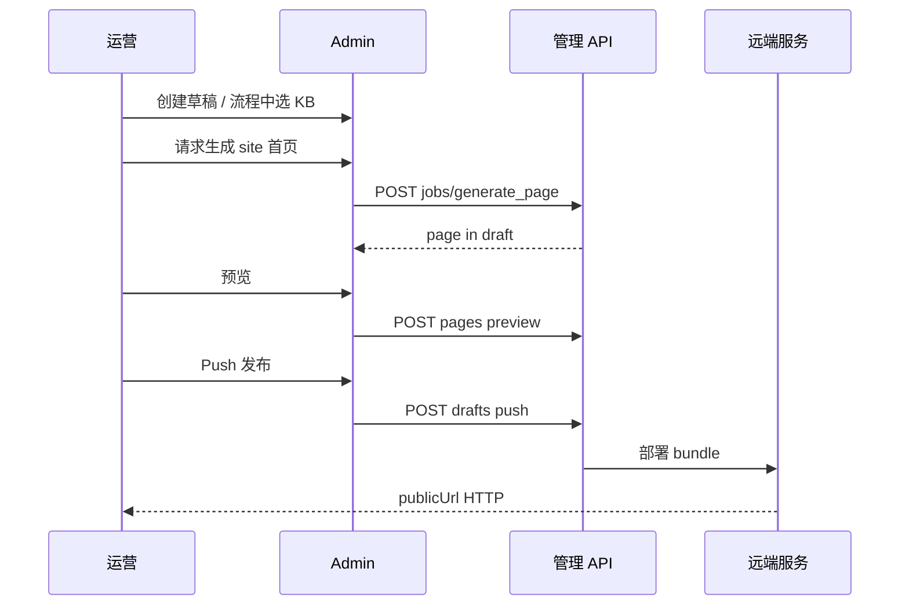

# MVP Happy Path：首要跑通的流程

> 目标：用最少对象证明「当前草稿 + 三类页雏形 + Admin 模块页 + 生成 + 预览 + Push 发布」成立。

## 1. 验收剧本

| 步 | 操作方 | 动作 | 可见结果 |
|----|--------|------|----------|
| 1 | 人 | 注册/登录 → **选择或创建草稿**（可切换） | 进入后台时草稿上下文明确 |
| 2 | Admin | 在草稿内配置连接（行为采集等） | 草稿 sandbox 可用 |
| 3 | Admin | 生成 1 个 `site` 首页（模块页触发生成流程） | 列表出现草稿；可预览 |
| 4 | Admin | 生成 1 个 `content` 产品/案例页 | 列表出现；首页有链到它 |
| 5 | Admin | 生成 1 个 `ads` 页：≥2 个关键词、共用一套屏、**每词一起始屏**、共享 CTA（询盘）；Guide 无环 | 预览从不同词入口进入，能到 CTA 且不绕回已看屏 |
| 5b | Admin | 打开该 ads 详情：屏列表 + 关系图；改一条跳转边并保存通过校验 | 图与预览行为一致 |
| 6 | Admin | 在发布中心 **Push** 当前草稿；发布中心列出线上已发布页 | 远端 `publicUrl` 可打开 |
| 6b | 系统 | Push 成功后写出基础 SEO meta；更新 `sitemap.xml`；页面窄屏可浏览 | 页源与 sitemap；预览切手机宽 |
| 7 | Admin | 改标题/文案后再次 Push | 线上内容更新 |

平台能力见 [platform-defaults.md](../platform-defaults.md)。第二语言、真 Maps key、WhatsApp 启用不挡 1–7，但模型从 Slice A 起就要带 `locale` / `seo` / `map` 等字段。

Ads/GA 真实连接、报告流水线、询盘全链路：标为 **MVP+**，不挡本剧本；询盘模块入口在 Admin 信息架构中预留。

## 2. 实现切片

### Slice A — 空壳可跑

- 仓库脚手架（见 [packages.md](../packages.md)）  
- 管理 API：草稿与 `Page` CRUD（按 `draftId`）  
- Admin：按三类分组的页面列表 + sandbox 发布态 + 新建空白页 + 预览  
- 发布：草稿 **Push** 到远端；发布中心展示线上已发布页  
- 每页带 `locale` + `seo`；发布 HTML 含 title/description；生成 `sitemap.xml`  
- 页面骨架默认响应式  
- Guide 访客展示固定为**悬浮**  
- 站内行为采集能力预留/可开关  
- 知识库：无设置页区块；生成流程中**选择**  

**验收**：手写两页 HTML，Admin 按类型分得清；Push 后远端 URL 可开、有 meta、sitemap 有条目、窄屏可用。

### Slice B — 生成进线

- `Job.generate_page`：输入 kind + brief  
- 产出写入 Page draft  
- Admin 模块页触发；CLI 亦可：`generate` / `list` / `push`  

**验收**：模块页或 CLI 能走完「生成首页 → Push 发布」。

### Slice C — 广告页最小 Guide + Admin 可看可改

- `ads` Page：`screens` + `guide`（含 `entryByKeyword`）；共用一套屏  
- 运行时：按 Guide 选项切屏，最终 CTA；会话 `visited`  
- Admin：屏表 + 关系图（或等价边列表）+ 校验；可改选项并保存  

**验收**：预览跨词到 CTA；Admin 改一条边后预览跟随。细则见 [guide-multi-keyword.md](../guide-multi-keyword.md)。

### Slice D — KB 真检索

- 真实 KB 检索进生成  
- 失败时 Job 明确报错  

### Slice E — 报告 / Ads·GA / 询盘（MVP+）

- 报告进 Admin；从报告跳到改页  
- Ads/GA：绑定与调整  
- 询盘：列表、筛选、处理、邮件重发  

## 3. 主路径时序（Slice A–C）



## 4. API 草图

```
POST   /api/drafts
GET    /api/drafts/:draftId
PATCH  /api/drafts/:draftId/settings
GET    /api/drafts/:draftId/pages
POST   /api/drafts/:draftId/pages
GET    /api/pages/:pageId
PATCH  /api/pages/:pageId
POST   /api/drafts/:draftId/push
POST   /api/drafts/:draftId/pull

POST   /api/jobs/generate_page
GET    /api/jobs/:id

GET    /preview/...
GET    /s/:remoteSiteId/...
```

CLI 命令与上表能力 id 对应即可。

## 5. 刻意延后的清单

- 完整不可变 SiteVersion 链与 rollback UI（可先文件备份）  
- 旧 LPS 全套 picker / 对话门禁文案  
- 访客 Guide 在线再生成答案  
- Ads 自动改出价/加词  
- 精美块编辑器（MVP 用 HTML/MD 或生成覆盖）  

## 6. 完成定义（DoD）

- [ ] 本地可起 Admin + 管理 API + 远端服务  
- [ ] Happy Path 剧本 1–7 可录屏演示（7 可用 CLI）  
- [ ] `ads` 预览具备跨关键词屏跳转 + CTA  
- [ ] 文档与实现不一致时，当场改文档或改代码，不堆第二套真相  
