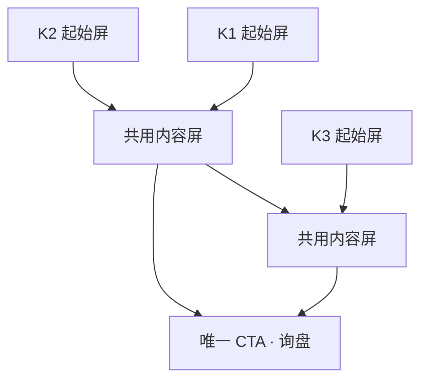
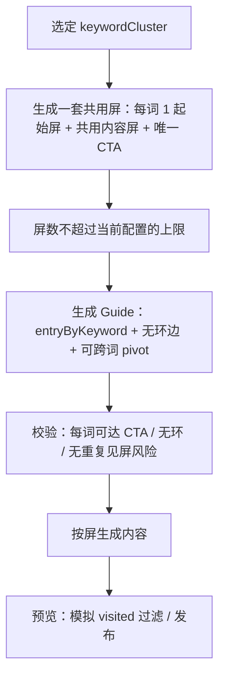

# 多关键词分屏 + Guide 跳转

> 针对旧 LPS 痛点：单关键词屏偏少，旅程薄。  
> 目标：一个广告承接页服务**一组相关关键词**；每个词有明确起点，全页以 CTA 为终点；Guide 形成完整路径，并**尽量避免访客在同一路径上重复见到同一屏**。

## 1. 问题

旧模型常见形态：

- 一个 keyword → 一份 Screen Plan → 少量屏 → Guide 只在该词屏内跳
- 访客意图稍偏就「无屏可去」，或过早进 CTA
- 路径含糊时，选项容易绕回已看过的屏

期望：

- 选中一组词（例如 3～8 个相关搜索意图）
- **屏的内容整页共用一套**。关键词再多，也不按词各复制一套内容屏
- **每个关键词有自己的起始屏**，作为该词广告地址打开后的入口；起始屏属于这套共用屏
- 整页共享**唯一 CTA 屏**，作为旅程重点与终点；CTA 上承接询盘
- Guide 在这套共用屏上形成**完整、明确的路径**（可分支，但每条有效路径语义清楚）
- 跳转设计上**计量避免**同一访客路径上再次看到已经出现过的屏

## 2. 路径哲学（硬约定）

硬约定：**一词一入口，全页一 CTA；路径向前汇聚，不回头刷屏。**

| 约定 | 含义 |
|------|------|
| 共用一套屏 | 一张广告承接页只有一套 `screens`。各关键词的公开地址都进入这一套，屏里的正文、证明、询盘内容共用 |
| 一词一起始屏 | `keywordCluster` 中每个 `Ki` 恰好有一个 `role=entry` 的屏，作为从该词进来的唯一起点。起始屏计在这套共用屏里 |
| CTA 为全页重点 | 整页恰好一个 CTA 屏；所有有效路径最终汇入该屏；转化动作为询盘 |
| 路径完整明确 | 从任一关键词起始屏出发，必须存在至少一条可走完的路径到达 CTA；分支选项的目标意图可读（深挖 / 换意图 / 去转化） |
| 避免重复见屏 | Guide 边与运行时共同保证：单次会话路径上同一 `screenId` 至多出现一次（见 §4） |



跨词跳转仍然允许，但目标应是**访客尚未走过的屏**，且整体仍朝 CTA 前进。

## 3. 概念模型

```
AdsPage
  keywordCluster: [K1, K2, K3]
  screens: [                                  // 全词共用这一套，块数受上限约束
    { screenId, role: entry, entryFor: [K1] },      // K1 起始屏
    { screenId, role: entry, entryFor: [K2] },      // K2 起始屏
    { screenId, role: content },                    // 内容屏，各词共用
    { screenId, role: cta }                         // 全页唯一 CTA，承接询盘
  ]
  guide: {
    // 按「广告带来的关键词」选择起始屏；不再使用单一全局 entryScreenId 覆盖所有词
    entryByKeyword: { K1: screenId, K2: screenId, K3: screenId },
    nodes: {
      [screenId]: {
        options: [
          { label, action: navigate, targetScreenId },  // 可跨 keywordId；不得指向已访屏（见校验）
          { label, action: go_cta },                    // 进入唯一 CTA 屏
          { label, action: link_page, pageId }          // 跳出到 site/content（可选；仍算离开屏旅程）
        ]
      }
    }
  }
```

广告打开时：**一词一个独立公开地址**（适配 Google 广告「一关键词一最终到达页」）。  
每个地址绑定对应关键词，打开即进入该词的起始屏（`entryByKeyword[Ki]`）。  
策划/生成仍可按词簇一起做；**投放与 SEO 对外是一词一址**，不用共享 URL + `?kw=`。

无法解析关键词时，可回退到页面配置的主词起始屏。

### 3.1 屏的归属

| 规则 | 说明 |
|------|------|
| 一套共用屏 | 内容屏没有「属于某一个关键词」的副本。K1 与 K2 走到同一块内容屏，看到的是同一份内容 |
| 每个关键词恰好 1 个起始屏 | `role=entry`，且 `entryByKeyword[Ki]` 指向它。起始屏可以带该词的入口差异，它仍然是共用屏列表中的一块 |
| CTA 全页唯一 | `role=cta`；是路径终点。询盘表单在这一屏 |
| 屏数上限 | 限制的是这一套 `screens` 的块数，含起始屏、内容屏、CTA。默认 20，站点或该页可改。关键词个数、一词一址的地址个数不受这个数字限制 |

### 3.2 Guide 选项语义

| `intent` | 含义 | 约束 |
|----------|------|------|
| `deepen` | 沿共用屏继续看 | 目标为这套屏里尚未出现在当前路径上的内容屏，并更靠近 CTA |
| `pivot` | 换到另一词的入口 | 目标为另一关键词的起始屏，或尚未访问的共用内容屏 |
| `proof` | 证明/案例 | 可同词未访屏，或 `link_page` 到 content |
| `convert` | 去 CTA | `go_cta`；可从较浅层直接转化，但不应是唯一出口导致路径过短（生成侧偏好） |

## 4. 「避免重复见屏」——计量规则

「计量避免」分两层：**生成时图约束**（主）+ **运行时会话护栏**（辅）。

### 4.1 生成 / 校验（必须）

把 Guide 看成有向图。对每个关键词起始屏 `Ei`：

1. **可达**：存在至少一条从 `Ei` 到 CTA 的路径。
2. **无环**：图中不存在有向环（强约束）。无环 ⇒ 任意简单路径上不会重复 `screenId`。
3. **边合法**：`navigate` 目标存在；不得 `navigate` 到 CTA 以外又从 CTA 返回内容屏（CTA 无回到内容屏的边）。
4. **一词一入口一致**：每个 `Ki` 的 entry 屏唯一，且只作为该词广告进入点（其它词可通过 pivot 进入该词的**未作为「已访」冲突的**屏，但 pivot 目标优先为对方 entry 或明确标注的桥接屏）。
5. **重复边惩罚 / 禁止**：同一节点对同一 `targetScreenId` 不得重复选项；生成 QC 统计「可能汇合后再分叉导致的潜在重入」——若静态图无环则重入为 0。

MVP 最低门禁：**无环 + 每词 entry→CTA 可达 + 单 CTA**。

### 4.2 运行时会话护栏（建议 MVP 就做）

访客会话维护 `visitedScreenIds`：

| 行为 | 处理 |
|------|------|
| 即将 `navigate` 到已在 `visited` 中的屏 | **不展示该选项**（或等价降级到 CTA）；默认隐藏 |
| 浏览器后退回到已访屏 | **重新开放**：截断「当前屏之后」的 visited，使已看过的屏可再次作为向前选项；允许回看后再选别的路 |
| 所有 navigate 选项都被过滤 | 只保留 `go_cta` / `link_page`，保证总能结束 |

这样即使生成图有疏漏，访客也不会在同一次旅程里反复刷同一内容屏。

### 4.3 与「完整明确路径」的关系

- **完整**：每个词入口都能走到 CTA；不依赖访客运气。
- **明确**：选项意图少而清晰（深挖 / 换意图 / 转化），避免「三个选项看起来都像下一屏随机文案」。
- **向前**：路径长度有软目标（如 3～6 步到 CTA），过短/过长由生成偏好与 QC 提示，不作为首版硬失败。

## 5. 生成流水（建议）



可搬的旧经验：先 Plan → Guide → Content；访客侧不现场重算答案。  
关键差异：多入口（按词）代替单一 `entryScreenId`；无环与 visited 护栏写入规范。

## 6. MVP 范围简化

| 项 | MVP | 以后 |
|----|-----|------|
| 关键词数量 | 2～3 个 fixture | Admin 多选 Ads 词；**一词一独立地址发布** |
| 每词结构 | 1 entry + 1 content | 按意图加长 |
| 共用屏块数上限 | 默认 20，**站点或该页可配置**。限制这一套共用屏的块数 | 按业务调高或调低。不按关键词相乘 |
| CTA | 1 个共享 | 仍保持唯一 |
| Guide | 手写无环图 + 校验器 | 模型生成 + Exemplar |
| 防重复 | 校验无环 + 运行时 visited；**后退则截断 visited 后缀并重新开放** | 更细语义去重 |
| 内容 | 模板 / 假 LLM | KB + 真 LLM（默认 DeepSeek V4） |
| Guide 展示 | **仅悬浮** | 不提供文档流 |
| 默认模型 | DeepSeek V4（可配置） | 见 model-defaults.md |

**最小可演示（两词，无环，不重复屏）：**

```
广告词 K1 → K1-Entry → 共用内容屏 → CTA（询盘）
                └pivot→ K2-Entry → 同一套共用内容屏 → CTA

广告词 K2 → K2-Entry → 共用内容屏 → CTA
                └pivot→ K1-Entry → …（仅当 K1-Entry 尚未 visited；
                         若从 K2 来已 pivot 过则运行时隐藏回跳）
```

注意：静态图若允许 `K1-Entry ↔ K2-Entry` 互跳会成环——**禁止双向互跳**。跨词只允许单向桥，或桥接到对方尚未出现在「从当前入口可达的祖先集」中的屏；MVP 直接规定：**pivot 边不可逆**（A→B 则禁止 B→A）。

## 7. Admin：图可见、可编辑

Guide 对运营要透明。Admin 广告页详情必须提供：

1. **关键词 → 起始屏**映射表  
2. **屏列表**（含 role / 所属词）  
3. **跳转关系图**（节点=屏，边=选项；见 [admin.md](admin.md)）  
4. **人工修改**入口：改文案、改目标、增删选项、改 entry 映射；保存前跑 §4 校验  

「重新生成 Guide」可以是辅助，不能是唯一修改手段。结构化 `guide` 为唯一真源，预览与发布都读它。

## 8. 与三类页面的关系

- 本模型只描述 `kind=ads` 页内部结构
- CTA 可额外 `link_page` 到 `content` / `site`（离开分屏旅程）
- 优化时保持 `screenId` 稳定，避免 Guide 边与 visited 语义断裂

## 9. 已拍板

1. **一词一独立公开地址**（Google 广告规则）；词簇只用于一起策划/生成。  
2. **共用屏块数上限默认 20，必须可配置**（站点或该页设置）。限制这一套共用屏一共多少块，不限制关键词个数。  
3. **浏览器后退 = 重新开放已看过的屏**（截断当前点之后的 visited）。
