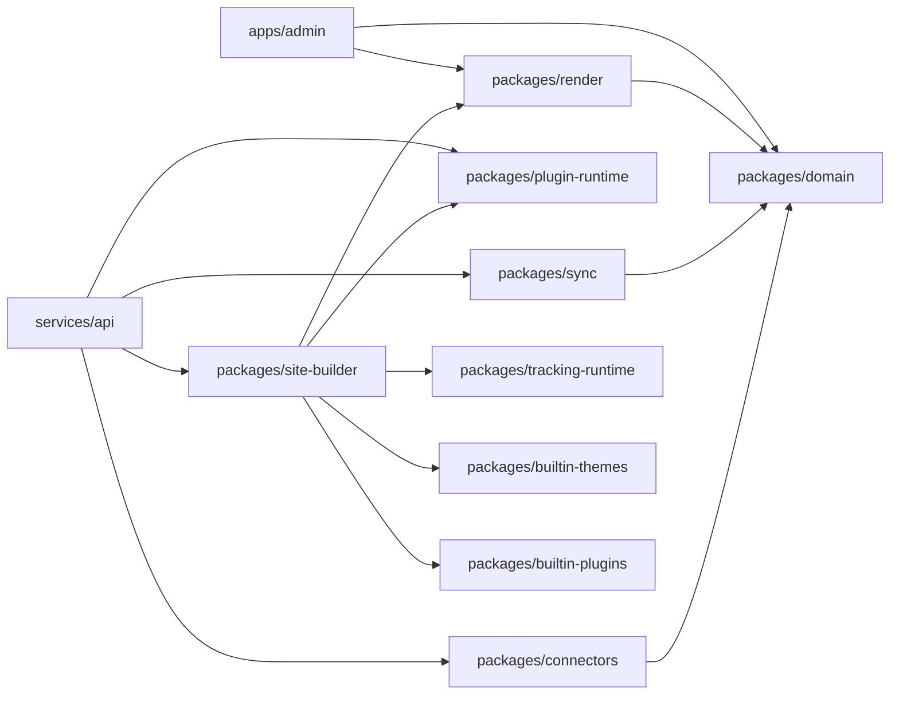

# 包与服务职责

| 目录 | 职责 |
| --- | --- |
| `apps/admin` | 账号登录、我的网站、WordPress 式后台模块、可视化区块编辑器、AI 建站、发布对话框 |
| `services/api` | 用户与会话、资源权限、数据库操作、草稿业务、AI Job、静态构建、营销平台连接、发布目标上传、访客侧接口 |
| `services/remote` | 接收 Git bundle、保存网站版本、执行校验程序并提供 HTTP 访问（含 404 状态码与产物 zip） |
| `packages/domain` | 用户、网站、草稿、页面角色、内容类型、媒体、区块树、语言、站点设置的类型与校验 |
| `packages/sync` | Git 工作目录、版本保存、Pull/Push、Agent 冲突处理及同步状态 |
| `packages/render` | 区块树与 Liquid 主题模板渲染、SEO 头、JSON-LD、追踪配置注入；浏览器与 Node 共用 |
| `packages/site-builder` | 整站静态构建、图片处理、隐藏文件、Pagefind、`server-config/`、校验程序 |
| `packages/plugin-runtime` | 基于 isolated-vm 的插件隔离环境：构建钩子、HTML 处理、插件服务器接口 |
| `packages/tracking-runtime` | 网站页面里运行的追踪脚本：Cookie 同意、标准事件、广告来源记录、平台代码加载 |
| `packages/builtin-themes` | 内置主题 `starter` |
| `packages/builtin-plugins` | 内置插件：询盘表单、WhatsApp、Google 地图 |
| `packages/connectors` | 营销平台连接器：Google Ads、GA4、Search Console、Meta、TikTok、LinkedIn、Microsoft Clarity、Bing UET |

这些目录通过本仓库的 npm workspaces 组织。依赖使用正式包名与版本，测试和运行配置均使用仓库相对路径。

## 依赖方向

管理界面与命令行通过相同的管理 API 操作用户资源。远端代码接口使用独立服务凭据，公开网站接口直接服务浏览器。
