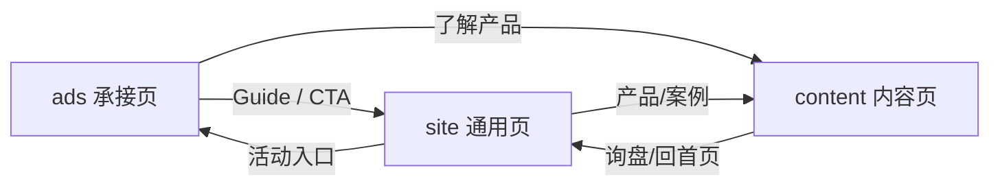

# 页面模型：三类页面

一个 Site 下所有访客可见内容都归为三类。类与类之间**允许互相跳转**（导航、Guide 选项、CTA、内链）。

## 1. 三类定义

| 类型 | 代号 | 典型页面 | 特点 |
|------|------|----------|------|
| 通用站页 | `site` | 首页、产品列表、关于我们、联系 | 站点骨架；偏稳定；SEO 常驻 |
| 内容页 | `content` | 产品详情、案例、Blog/文章 | 条目多；可从列表进详情；可被广告页引用 |
| 广告承接页 | `ads` | 关键词/意图千人千面 LPS | 分屏 + Guide；从广告进来；最终到 CTA |

## 2. 统一页面对象（概念）

每条页面至少有：

| 字段 | 说明 |
|------|------|
| `pageId` | 稳定 ID |
| `kind` | `site` \| `content` \| `ads` |
| `slug` / 路径 | 发布后的公开路径 |
| `title` | 展示与 SEO 标题 |
| `status` | `draft` \| `preview` \| `published`（MVP 可合并 preview） |
| `links[]` | 显式外链到本站其它页（可选；也可在 HTML/Guide 里隐式存在） |
| `source` | 生成来源：`kb` / `manual` / `agent` / `import` |
| `locale` | 语言版本（原生多语言；与 Site.locales 一致） |
| `seo` | `title` / `description` / `canonical` 等（默认必填策略见平台默认） |
| `blocks` | 内容块；可含原生 `map`（Google 地图）等 |

广告页额外：

| 字段 | 说明 |
|------|------|
| `keywordCluster` | 本页服务的关键词组（1..N） |
| `screens[]` | 全词共用的一套分屏。每个关键词恰好一个起始屏；内容屏不按词复制；全页唯一 CTA 屏承接询盘。块数默认上限 20，站点或该页可配置 |
| `guide` | `entryByKeyword` + 屏间跳转；路径完整可达 CTA；**无环**，并配合会话 `visited` 避免重复见同一屏 |

细则见 [guide-multi-keyword.md](guide-multi-keyword.md)。

## 3. Admin 视角（类 WordPress / SaaS 模块页）

后台按**当前草稿**编辑页面（登录后已选草稿，可切换工作区）。详细交互见 [admin.md](admin.md)、[site-collaboration.md](site-collaboration.md)：

- **三类分得清**：列表按 `site` / `content` / `ads` 分组或分栏，并显示「共 N · 已发布 M」
- **发布态看得见**：状态列 +「仅已发布」视图 + 公开 URL
- **广告 Guide 不黑盒**：屏清单、关键词→起始屏映射、**跳转关系图**、校验结果都必须可见
- **Guide 可改**：改选项文案/目标/增删边，保存走同一校验（无环、可达 CTA、防重复见屏）
- 新建与正文：模块页向导或触发生成流程；写同一套 Page/Guide 数据

Admin 模块页是管站主路径。

## 4. 跳转约定（MVP 从简）

- `site` ↔ `content`：常规站内导航 / 卡片链接即可。
- `ads` → `site`/`content`：CTA 或 Guide 选项可带「站内页」目标（不只是屏 ID）。
- `site`/`content` → `ads`：可选；用于活动入口，非必须。

首版实现可以只保证：**广告页 Guide 能到 CTA**，以及 **CTA/按钮能链到一个 content 或 site 页**。其余链接形态后补。
