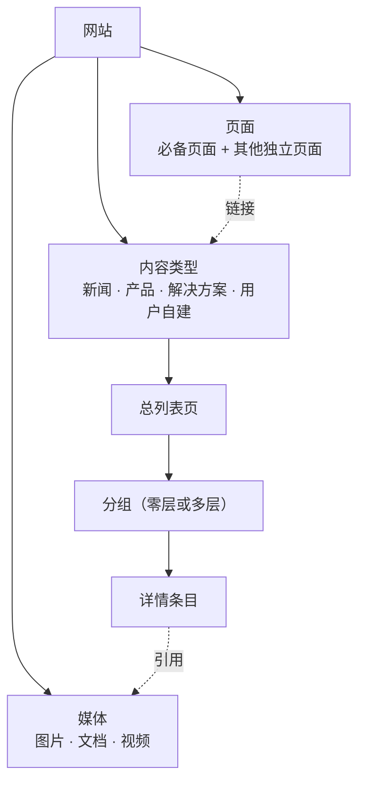

# 内容模型

网站内容分为三种：**页面**、**内容类型**、**媒体**。三者在后台分别管理，页面和内容类型的正文都由区块组成，可以互相链接，也可以引用媒体。



各语言版本的存放方式与翻译规则见 [localization.md](localization.md)。区块由主题和插件提供，见 [themes.md](themes.md)、[plugins.md](plugins.md)。

## 1. 页面

页面是独立的单页，例如首页、关于我们、联系我们、活动页。

页面目录 `source/pages/<pageId>/` 下有一个共用文件和每种语言一个内容文件。

`page.json`（各语言共用）：

| 字段 | 说明 |
|------|------|
| `pageId` | 稳定 ID，各语言版本共用 |
| `role` | 必备页面职责，见下一节；其他页面为 `null` |
| `template` | 主题提供的页面模板名，默认 `page` |
| `status` | `draft` \| `published` |
| `createdAt` / `updatedAt` | 时间 |

`<locale>.json`（每种语言一个）：

| 字段 | 说明 |
|------|------|
| `locale` | 语言代码，例如 `en`、`zh-CN` |
| `slug` | 固定链接，由标题自动生成，可以修改 |
| `title` | 页面标题 |
| `summary` / `cover` | 摘要与封面媒体引用 |
| `seo` | `title`、`description`、`ogImage`（媒体引用）；默认由标题、摘要和封面自动填写 |
| `blocks` | 区块树 |
| `sourceHash` | 翻译时默认语言原文的哈希值；默认语言文件为 `null` |
| `updatedAt` | 时间 |

公开地址为 `/<locale>/<slug>/`，首页为 `/<locale>/`。

### 1.1 必备页面

新建网站时，每种语言自动创建下面八个必备页面。必备页面可以编辑，不能删除；每种职责在每种语言下只有一个页面。职责可以在页面设置里转给另一个页面。

| `role` | 名称 | 默认 `slug` | 规则 |
|--------|------|-------------|------|
| `home` | 首页 | （无） | 地址为 `/<locale>/` |
| `about` | 关于我们 | `about` | |
| `contact` | 联系我们 | `contact` | 默认带询盘表单、地图、WhatsApp 区块（由内置插件提供） |
| `privacy` | 隐私政策 | `privacy-policy` | 询盘表单的同意勾选框和页脚自动链接到这里 |
| `terms` | 服务条款 | `terms` | 页脚自动链接 |
| `cookies` | Cookie 政策 | `cookie-policy` | Cookie 同意提示条和页脚自动链接到这里 |
| `thank-you` | 询盘提交成功页 | `thank-you` | 询盘提交后跳转到这里；`noindex`，不进入 sitemap |
| `not-found` | 404 页 | （无） | 输出为 `/<locale>/404.html`，默认语言的版本同时输出为根目录 `404.html`；`noindex`，不进入 sitemap |

该表由 `packages/domain` 的 `requiredPages` 与 `createDefaultSiteContent` 提供；每种语言各生成一份语言文件，共 16 份。

主题可以为某种职责提供专用模板 `page-<role>.liquid`，没有提供时使用 `page.liquid`。

构建时缺少必备页面，或者必备页面没有任何区块，直接报错终止，并指出语言和职责。

## 2. 内容类型

内容类型是带列表关系的一组页面，形式为一棵树：总列表页 → 分组（零层或多层）→ 详情条目。每个内容类型在后台左侧菜单里各占一项。

### 2.1 定义

定义文件为 `source/collections/<collectionId>.json`：

| 字段 | 说明 |
|------|------|
| `collectionId` | 稳定 ID |
| `name` | 后台显示的名称，例如「产品」 |
| `labels` | 网站上显示的名称，按语言填写，例如 `{ "en": "Products", "zh-CN": "产品" }` |
| `prefix` | 地址前缀，例如 `products`；各语言共用 |
| `status` | `draft` \| `published`；决定总列表页及其下内容能否公开 |
| `levels` | 分组层级列表，每项为 `{ levelId, name }`；空列表表示没有分组 |
| `fields` | 条目字段定义，见 2.2 |
| `structuredData` | 详情页输出的 JSON-LD 类型，例如 `Product`、`NewsArticle`、`Service` |
| `feed` | 是否为这个内容类型生成 RSS |
| `createdAt` / `updatedAt` | 时间 |

内置三个预设，新建网站时自动创建。领域定义见 `packages/domain` 的 `collectionPresets` 与 `createDefaultSiteContent`：

| 预设 | `prefix` | 层级 | 主要字段 | `structuredData` | `feed` |
|------|----------|------|----------|------------------|--------|
| 新闻 | `news` | 无 | 发布日期、作者、封面 | `NewsArticle` | 是 |
| 产品 | `products` | 产品系列 → 产品分类 | 型号、规格参数表、图集 | `Product` | 否 |
| 解决方案 | `solutions` | 无 | 适用行业、相关产品 | `Service` | 否 |

用户可以在「设置 → 内容类型」里新建类型，修改层级和字段。

内容类型已有分组或条目时，减少层级、删除字段、改变字段类型或改变 `translatable` 会被拒绝，并列出受影响内容。增加可选字段以及修改名称、标签和结构化数据类型可以直接保存。

### 2.2 字段

每个字段为 `{ key, type, label, translatable, required }`。`label` 是后台显示的字段名。`translatable` 为 `true` 的字段每种语言单独填写，为 `false` 的字段各语言共用。

| `type` | 用途 |
|--------|------|
| `text` | 单行文字 |
| `richtext` | 富文本 |
| `number` | 数字 |
| `boolean` | 是或否 |
| `select` | 从选项中选择 |
| `date` | 日期 |
| `media` / `mediaList` | 单个媒体 / 多个媒体 |
| `link` | 站内引用或外部地址 |
| `table` | 表格，例如规格参数 |
| `reference` | 引用其他内容类型的条目，例如解决方案的「相关产品」 |

所有条目另有通用字段：标题、摘要、封面、正文区块、搜索引擎信息。

### 2.3 总列表页、分组与条目

| 对象 | 共用文件 | 语言文件 | 共用字段 | 语言字段 |
|------|----------|----------|----------|----------|
| 总列表页 | — | `source/collections/<collectionId>/index/<locale>.json` | — | `title`、`summary`、`cover`、`seo`、`blocks`、`sourceHash` |
| 分组 | `source/collections/<collectionId>/groups/<groupId>/group.json` | 同目录 `<locale>.json` | `parentGroupId`、`levelId`、`order`、`status` | `slug`、`title`、`summary`、`cover`、`seo`、`blocks`、`sourceHash` |
| 条目 | `source/collections/<collectionId>/items/<itemId>/item.json` | 同目录 `<locale>.json` | `primaryGroupId`、`groupIds`、`order`、`publishedAt`、`status`、`translatable: false` 的字段值 | `slug`、`title`、`summary`、`cover`、`seo`、`blocks`、`translatable: true` 的字段值、`sourceHash` |

规则：

- 分组的层数等于 `levels` 的长度，每个分组的 `levelId` 和它在树里的深度一致。
- 条目只能放在最后一层分组里。一个条目可以属于多个分组（`groupIds`），其中 `primaryGroupId` 决定面包屑和上一篇、下一篇的范围，必须包含在 `groupIds` 里。
- 没有分组层级的内容类型，条目的 `groupIds` 为空。

### 2.4 地址

| 对象 | 地址 |
|------|------|
| 总列表页 | `/<locale>/<prefix>/` |
| 分组 | `/<locale>/<prefix>/<第一层分组 slug>/<第二层分组 slug>/` |
| 条目 | `/<locale>/<prefix>/<条目 slug>/` |
| 列表分页 | 在列表地址后加 `page/<n>/` |

条目地址只带类型前缀，移动分组后不变。条目和第一层分组都在 `/<locale>/<prefix>/` 目录下，两者的 `slug` 不能重复；`page` 是保留字。页面的 `slug` 不能和任何内容类型的 `prefix` 相同。构建时发现地址重复，直接报错终止，并列出冲突的对象。

### 2.5 列表与详情页的自动内容

- **列表区块**（`core/collection-list`）：总列表页和分组页在区块树里放置这个区块，自动显示下一层分组或者条目。属性包括数据来源、每页数量、排序方式（手动顺序、发布时间、标题）。列表样式由主题决定。
- **面包屑**：根据主分组生成，输出 `BreadcrumbList` 结构化数据。
- **上一篇和下一篇**：在主分组内按排序方式计算。
- **相关条目**：同一主分组内的其他条目。
- **列表结构化数据**：列表页输出 `ItemList`。

## 3. 媒体

媒体文件存放在 `assets/uploads/<年>/<月>/<文件名>`，文件名重复时自动加序号。每个文件对应一个元数据文件 `source/media/<mediaId>.json`：

| 字段 | 说明 |
|------|------|
| `mediaId` | 稳定 ID |
| `path` | 文件路径 |
| `mimeType` / `size` | 文件类型与大小 |
| `width` / `height` | 图片宽高 |
| `title` / `alt` / `caption` | 标题、替代文字、说明，按语言填写 |
| `uploadedBy` / `uploadedAt` | 上传人与时间 |

规则：

- 允许的类型：图片（jpg、png、webp、avif、gif、svg）、文档（pdf、docx、xlsx、pptx）、视频（mp4、webm）。单个文件的大小上限由环境变量 `MEDIA_MAX_BYTES` 配置。
- SVG 上传时用 DOMPurify 清理脚本和事件属性。
- 区块和字段通过 `mediaId` 引用媒体，不直接写文件路径。
- 替换文件时保留 `mediaId`，引用方不用修改。
- 删除被引用的媒体时直接拒绝，并返回引用的位置。
- 图片的 WebP 和多种尺寸在构建时生成，见 [static-output.md](static-output.md)。

## 4. 区块

页面、总列表页、分组、条目的正文都是区块树。每个节点为：

```json
{ "id": "b_3k2j", "type": "theme/hero", "props": { "heading": "...", "image": { "mediaId": "m_1" } }, "children": [] }
```

区块类型分三类：

| 前缀 | 来源 | 例子 |
|------|------|------|
| `core/` | 系统内置 | 文字、标题、图片、按钮、分栏、列表区块、常见问题、自定义 HTML |
| `theme/` | 当前主题的 `sections/` | 主视觉、特性列表、规格表、价格表、客户案例、行动号召 |
| `plugin/<pluginId>/` | 已启用插件的 `sections/` | 询盘表单、地图 |

规则：

- 每个区块定义都带字段定义。保存和构建时用 `ajv` 按字段定义校验 `props`，校验失败直接报错。
- `children` 只能出现在定义中声明了可以包含子区块的类型上，例如 `core/columns`。
- 富文本以 TipTap JSON 保存，构建时用 `@tiptap/html` 生成 HTML，只保留白名单标签和属性。
- 自定义 HTML 区块的内容按原样输出，后台只在这个区块里显示源码。
- 构建时遇到没有定义的区块类型（例如切换主题后旧主题的区块），直接报错终止，并列出使用这些区块的页面。切换主题前，后台会列出受影响的页面。

## 5. 站内链接

站内链接保存为引用：`{ "ref": "page" | "collection" | "group" | "item", "id": "..." }`，其中 `collection` 表示总列表页。构建时按当前语言换成相对地址。

- `publish` 模式要求引用对象存在、状态为 `published` 且具有当前语言文件。
- `preview` 与 `canvas` 模式允许引用当前草稿里的 `draft` 对象；缺少目标语言时链接到该语言首页。
- 外部链接保存为带 `kind: "external"` 的完整 URL。

## 6. 发布状态

页面、分组、条目各有一个 `status`，各语言共用：

- `draft`：不进入网站。
- `published`：下一次「发布网站」时进入网站。

后台显示三种状态：草稿、已发布、已发布但有修改未发布。第三种通过比较草稿内容和网站当前发布版本得出。

字段的完整 TypeScript 定义、翻译哈希与强制规则见 [design/domain-model.md](design/domain-model.md)，全部 JSON 示例见 [design/sandbox-formats.md](design/sandbox-formats.md)。

## 7. 数据库索引

sandbox 里的文件是内容的依据。PostgreSQL 的 `pages`、`collection_groups`、`collection_items`、`media` 表是查询索引，Pull、Push 和每次编辑之后由 sandbox 文件重建，按 `draft_id` 与对象 ID 共同标识。已发布内容的查询表对应网站的 `publishedCommitId`。
