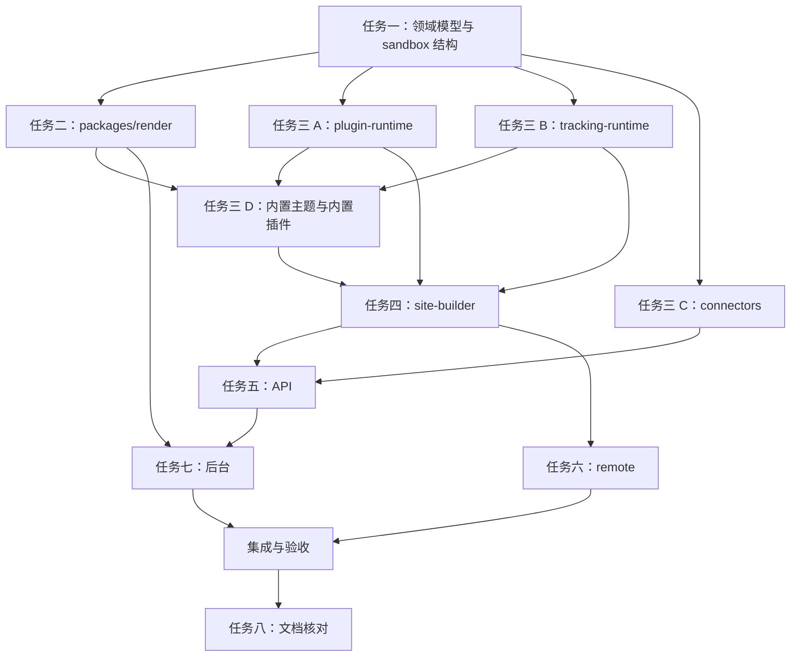

# WordPress 式 AI 原生 CMS 实施计划

分支：`sean/wp-style-cms`。

执行顺序、Task 边界、量化验收和验证门禁以 [2026-11-20-wp-style-cms-wave-plan.md](2026-11-20-wp-style-cms-wave-plan.md) 为准；本文件用于说明文件级实施范围和设计依据。

## 目标

按以下设计文档实现完整系统，并通过 [flows/mvp-happy-path.md](../flows/mvp-happy-path.md) 的全部验收步骤：

| 文档 | 范围 |
|------|------|
| [page-model.md](../page-model.md) | 必备页面、内容类型树、媒体、区块树、站内链接、发布状态 |
| [localization.md](../localization.md) | 网站语言、地址前缀、翻译状态、固定文字 |
| [themes.md](../themes.md) | Liquid 主题、区块、外观设置、zip 安装 |
| [plugins.md](../plugins.md) | 插件包、isolated-vm 服务器代码、内置插件 |
| [integrations.md](../integrations.md) | 连接器、授权登录、标准事件、Cookie 同意、广告来源、服务器端转化、投放数据 |
| [platform-defaults.md](../platform-defaults.md) | SEO、结构化数据、GEO、robots、sitemap、三端适配 |
| [static-output.md](../static-output.md) | 纯静态产物、隐藏文件、构建位置、发布前检查、发布目标 |
| [ai-generation.md](../ai-generation.md) | AI 建站、区块生成、修改、翻译、Job 与 SSE |
| [admin.md](../admin.md) | 后台菜单、模块、编辑器、发布对话框、API |
| [storage.md](../storage.md) | sandbox 目录、数据库表、旧数据转换 |
| [design/domain-model.md](../design/domain-model.md) | 领域类型、对象关系与强制规则 |
| [design/sandbox-formats.md](../design/sandbox-formats.md) | sandbox 文件与 JSON Schema |
| [design/api-conventions.md](../design/api-conventions.md) | 请求响应、错误、并发、预览与知识库 |
| [design/state-models.md](../design/state-models.md) | 网站、草稿、内容、Job、预览与发布状态 |
| [design/code-disposition.md](../design/code-disposition.md) | 现有文件的复用、修改、新开发与移除 |

账号、所有权、草稿、Pull/Push、Cursor Agent 冲突处理、远端服务保持 [site-collaboration.md](../site-collaboration.md) 的现有实现，只按本计划修改涉及内容模型的部分。

## 执行规则

- 每项行为先编写测试并运行，确认由于缺少该行为而失败，然后实现，再执行测试与回归检查。依赖缺失、测试准备错误和超时不能代替目标行为的失败证据。
- 每轮测试命令、失败原因和通过结果保存到 `.intermediate/tdd.md`，验收记录使用最终结果。
- 禁止 mock、伪造模型响应、伪造平台 API、伪造远端服务和仅用于通过测试的绕过逻辑。
- 使用真实 PostgreSQL 测试数据库、真实 Git 仓库、真实 HTTP 服务、真实 Cursor Agent、真实模型接口、真实 Google 与 Meta 测试账户、真实 FTP/SFTP 服务器与对象存储桶、真实浏览器。
- 测试用的主题、插件、网站源码是放在 `test-fixtures/` 下的真实文件。
- 通过文件编辑工具修改源码；禁止通过脚本批量改写源码。
- 禁止 Git 恢复代码操作及 cherry-pick。并行的 worktree 通过 merge 集成，冲突用文件编辑工具解决。
- 出错位置直接抛出原始错误，按 [error-handling.md](../error-handling.md) 处理；不写 fallback。
- 新增的库使用 npm 上的当前稳定版本，安装后写入对应 `package.json`；使用前阅读该库的官方文档，只调用文档里存在的接口。
- 重复出现的 TypeScript 类型放进 `packages/domain` 或所在包的 `types.ts`。
- 每个任务完成后运行 `npm run build`、`npm run typecheck`、`npm run test`，提交负责的文件，报告 commit、测试结果和未解决事项。

## 需要用户提供的条件

| 条件 | 用途 | 使用的任务 |
|------|------|------------|
| Google Cloud OAuth 客户端（Web 类型），回调地址 `<OAUTH_REDIRECT_BASE_URL>/api/integrations/oauth/google/callback` | Google 授权连接 | 任务三、任务五 |
| Google Ads 开发者令牌，以及一个测试经理账户和其下的测试广告账户 | Google Ads 转化操作、增强型转化、离线转化、投放数据 | 任务三、任务五 |
| 一个 GA4 测试媒体资源、一个可以验证的 Search Console 测试域名 | GA4 关键事件与数据、Site Verification、sitemap 提交 | 任务三、任务五 |
| Meta 应用（含 Facebook Login for Business）、测试商务账户、测试像素与 Conversions API 测试事件代码 | Meta 授权连接、Pixel、Conversions API | 任务三、任务五 |
| FTP、SFTP 服务器各一个；S3、阿里云 OSS、腾讯云 COS 测试存储桶各一个 | 发布目标 | 任务五 |
| 本机 nginx、IIS（启用 URL Rewrite 模块） | 产物在真实服务器上的验收 | 集成与验收 |
| `.env` 中的 `AI_API_KEY` | AI 生成、修改、翻译 | 任务五 |

凭据写入仓库根 `.env`（已被 Git 忽略），变量名见 [services.md](../services.md)。缺少某项条件时，对应的测试失败并指出缺少的变量，不能当作验收通过。

## 任务依赖

任务三 A、B、C 互相独立，可以在各自的 worktree 中并行，完成后 merge 回 `sean/wp-style-cms`。

根目录 `package.json` 的 `build`、`test` 脚本按 [services.md](../services.md) 的构建顺序加入新包，在每个新包建立时同步修改。

---

## 任务一：领域模型与 sandbox 结构

负责：`packages/domain/**`、`packages/sync/**`。

### 新增文件

| 文件 | 内容 |
|------|------|
| `packages/domain/src/content.ts` | [domain-model.md](../design/domain-model.md) 定义的 `SiteStatus`、`PageRole`、`PageMeta`、`PageLocaleFile`、`ContentStatus`、`SeoFields`、`CollectionDefinition`、`CollectionLevel`、`FieldDefinition`、`FieldType`、`CollectionIndexLocaleFile`、`GroupMeta`、`GroupLocaleFile`、`ItemMeta`、`ItemLocaleFile`、`ContentRef`、`ContentTarget` |
| `packages/domain/src/blocks.ts` | `BlockNode`、`BlockDefinition`、`BlockFieldDefinition`、`BlockFieldType`、区块类型名的前缀规则 |
| `packages/domain/src/media.ts` | `MediaMeta`、允许的文件类型表 |
| `packages/domain/src/locales.ts` | `LocaleDefinition`（`{ code, dir }`）、BCP 47 校验（`Intl.getCanonicalLocales`）、`rtl` 语言表、内置语言 `en` 与 `zh-CN` |
| `packages/domain/src/required-pages.ts` | 八个必备页面：`role`、名称、默认 `slug`、是否 `noindex`、是否进入 sitemap |
| `packages/domain/src/collection-presets.ts` | 新闻、产品、解决方案三个预设定义 |
| `packages/domain/src/site-defaults.ts` | `defaultManagedSiteSettings`、`createDefaultSiteContent`、`validateSiteContent`；默认 `en` + `zh-CN`、16 个必备页面语言文件、3 个内容类型、`starter` 外观、三个内置插件 |
| `packages/domain/src/appearance.ts` | `AppearanceConfig`（`themeId`、`themeSettings`、`menus`）、`MenuItem` |
| `packages/domain/src/plugins-config.ts` | `PluginsConfig`（每个插件的启用状态与普通设置） |
| `packages/domain/src/redirects.ts` | `RedirectEntry` |
| `packages/domain/src/publish-config.ts` | `PublishConfig`：OLPS 托管地址、公开 API 地址、`siteId`、连接器公开 ID 与转化设置、IndexNow 密钥 |
| `packages/domain/src/schemas/*.json` | 上述每种文件的 JSON Schema，以及 `theme.json`、`plugin.json`、`section.json` 的 JSON Schema |
| `packages/domain/src/validate.ts` | 用 `ajv` 编译上述 Schema，导出 `assertValid<文件类型>` 系列函数；校验失败抛出带文件路径与字段路径的错误 |
| `packages/domain/vitest.config.ts` | 测试配置 |

### 修改文件

| 文件 | 修改 |
|------|------|
| `packages/domain/src/types.ts` | 删除 `PageKind`、`PageBody`；保留用户、网站、草稿类型；从新文件重新导出内容类型 |
| `packages/domain/src/site-settings.ts` | `SiteSettings` 改为：`siteName`、`siteUrl`、`company`（名称、地址、电话、邮箱）、`iconMediaId`、`socialLinks`、`locales`、`defaultLocale`、`search`（`allowIndexing`、`allowAiSearch`、`allowAiTraining`）；删除地图与 WhatsApp 字段；默认值为 `en` + `zh-CN`、默认语言 `en`、`allowAiTraining: false` |
| `packages/domain/src/index.ts` | 导出新增模块 |
| `packages/domain/package.json` | 增加依赖 `ajv`、`test` 脚本 |
| `packages/sync/src/paths.ts` | `SITE_PATHS` 增加 `source/appearance.json`、`source/plugins.json`、`source/collections/`、`source/media/`、`source/i18n/`、`source/redirects.json`、`assets/uploads/`、`themes/`、`plugins/`、`tools/site-verify.mjs`、`server-config/`、`.olps-cache/` |
| `packages/sync/src/validation.ts` | `assertSourceStructure` 检查新目录结构；构建命令只来自 `SyncBuildConfig.buildCommand`，缺少时直接报错 |
| `packages/sync/src/workspace.ts` | 新建 sandbox 时 `olps.manifest.json` 只写 `verifyCommand`；`.gitignore` 写入 `.olps-cache/` |
| `packages/sync/src/git-line-endings.ts` | 图片、字体、视频、文档按二进制处理 |
| `packages/sync/test-fixtures/*.mjs` | 按新目录结构生成与校验 `public/` |

### 测试

- `packages/domain`：每种文件的合法样例通过校验；缺少必填字段、`primaryGroupId` 不在 `groupIds` 里、语言代码不符合 BCP 47、默认语言不在列表里、区块类型名前缀错误时抛出错误，错误信息含字段路径。
- `packages/sync`：新建 sandbox 的目录与 manifest；缺少 `buildCommand` 时报错；PNG、WOFF2 文件经过 bundle 推送和 Pull 后字节完全相同；现有同步测试在新目录结构下全部通过。

---

## 任务二：`packages/render`

负责：`packages/render/**`。浏览器与 Node 共用，不使用 Node 专有模块。

### 新增文件

| 文件 | 内容 |
|------|------|
| `package.json`、`tsconfig.json`、`vitest.config.ts` | W2-T1 依赖 `@olps/domain`；W2-T2 再引入 `liquidjs`、`@tiptap/html`、`@tiptap/starter-kit`、`@tiptap/extension-link` |
| `src/source-reader.ts` | `SourceReader` 接口：按相对路径读取 sandbox 文件、列出目录；Node 端由 site-builder 用文件系统实现，浏览器端由后台用 API 实现 |
| `src/site-model.ts` | 从 `SourceReader` 读取并校验全部内容、设置、外观、插件配置、固定文字，构造内存中的 `SiteModel`（W2-T1 已完成） |
| `src/urls.ts` | 每个对象在每种语言下的地址；任意两个地址之间的相对路径；地址重复与保留字检查（W2-T1 已完成） |
| `src/links.ts` | 站内引用 `{ ref, id }` 换成相对地址；引用不存在或未发布时抛出错误（W2-T1 已完成） |
| `src/i18n.ts` | 固定文字查找（`source/i18n` → 主题或插件 `languages/`）；缺少时抛出带语言、来源、键名的错误（W2-T3 已完成） |
| `src/liquid.ts` | `Liquid` 实例：`strictVariables`、`strictFilters`；通过 `liquidjs` 的自定义 `fs` 选项只读取主题目录与插件目录（W2-T2 已完成） |
| `src/filters.ts` | `asset_url`、`media_url`、`image_srcset`、`link`、`t`、`format_date`、`format_number`（W2-T2 已完成） |
| `src/richtext.ts` | TipTap JSON 用 `@tiptap/html` 生成 HTML，按白名单保留标签和属性（W2-T2 已完成） |
| `src/blocks/registry.ts` | 汇总核心区块、当前主题区块、已启用插件区块的定义；未定义的类型抛出错误并带上对象与区块 ID（W2-T2 已完成） |
| `src/blocks/core/*` | 核心区块定义与模板：`core/text`、`core/heading`、`core/image`、`core/button`、`core/columns`、`core/collection-list`、`core/faq`、`core/html`（W2-T2 已完成） |
| `src/blocks/render-tree.ts` | 用 `ajv` 校验 `props` 后渲染区块树；`children` 只允许出现在声明了 `accepts` 的区块上；`canvas` 模式输出 `data-olps-block`（W2-T2/W2-T3 已完成） |
| `src/navigation.ts` | 面包屑、上一篇与下一篇、相关条目、列表与分页数据（W2-T3 已完成） |
| `src/template-context.ts` | 模板数据：`site`、`locale`、`locales`、`alternates`、`appearance`、`menus`、当前对象、`content`、导航数据、`list`（W2-T3 已完成） |
| `src/seo-head.ts` | `title`、`description`、`canonical`、`hreflang` 与 `x-default`、Open Graph、Twitter 卡片、`noindex`（W2-T3 已完成） |
| `src/structured-data.ts` | `Organization`、`WebSite`、`LocalBusiness`、内容类型的 `structuredData`、`ItemList`、`BreadcrumbList`、`FAQPage`；按 schema.org 必需属性检查（W2-T3 已完成） |
| `src/render-document.ts` | `renderTarget(model, target, locale, options)`：选择模板、渲染完整 HTML；`options.mode` 为 `publish`、`preview`、`canvas`，`canvas` 模式给区块加上编辑器使用的 `data-olps-block` 属性，不输出追踪配置（W2-T3 已完成） |
| `src/index.ts` | 导出 |
| `test-fixtures/sites/*`、`test-fixtures/themes/minimal/` | 测试用网站源码与主题 |

### 测试

- 模板查找顺序、四个必需模板缺少时报错。
- `strictVariables` 与 `strictFilters` 生效；模板读取主题目录以外的文件时报错。
- 页面、总列表页、两层分组、条目、分页的地址；条目属于两个分组时地址不变，面包屑按主分组生成；条目与第一层分组 `slug` 重复、页面 `slug` 与 `prefix` 相同时报错。
- 相对链接从任意深度的页面都指向正确文件。
- 两种语言的 `hreflang` 与 `x-default`；未发布的语言版本不输出。
- 每种结构化数据的输出；缺少必需属性时报错。
- 富文本白名单移除 `script` 与事件属性；`core/html` 原样输出。
- 缺少固定文字翻译时报错。
- 同一份测试网站在 Node 与浏览器（Vitest 浏览器模式，Playwright Chromium）渲染出相同的 HTML。

---

## 任务三：运行时、连接器与内置包

### A. `packages/plugin-runtime`

负责：`packages/plugin-runtime/**`。依赖 `isolated-vm`（当前稳定版）。

| 文件 | 内容 |
|------|------|
| `src/isolate.ts` | 每次调用新建 128 MB 的 isolate，编译插件脚本，注入 `ctx` |
| `src/context.ts` | `ctx.settings`、`ctx.store`、`ctx.fetch`（只允许 `permissions.fetch` 声明的域名）、`ctx.inquiries.create`、`ctx.log`；`store`、`inquiries`、`log` 的实现由调用方传入 |
| `src/build-hooks.ts` | `runOnBuild`、`runTransformHtml`；全部构建钩子总时长 60 秒；`onBuild` 返回的文件路径限制在 `public/plugins/<pluginId>/` |
| `src/api-handler.ts` | `runPluginApi(request)`：执行 `handle`，单次 5 秒 |
| `src/compile-check.ts` | 安装插件时检查 `server/*.js` 可以编译 |
| `test-fixtures/plugins/*` | 测试插件 |

测试：正常的 `onBuild`、`transformHtml`、`handle`；超出内存、超出时间、访问未声明的域名、使用未声明的权限、写入目录以外的路径、脚本抛出错误时分别报错，错误信息带插件 ID。根目录 `build` / `test` 已纳入 `@olps/plugin-runtime`（位于 `domain` / `render` 之后、`site-builder` 之前）。

### B. `packages/tracking-runtime`

负责：`packages/tracking-runtime/**`。用 esbuild 打包为单个浏览器脚本 `dist/olps-tracking.js`。

| 文件 | 内容 |
|------|------|
| `src/config.ts` | 读取页面里的配置 JSON（连接器公开 ID、转化设置、Cookie 政策地址、语言文字） |
| `src/consent.ts` | 同意提示条（必要、统计、广告；全部接受、全部拒绝、自定义）、`olps_consent` Cookie 180 天、页脚「Cookie 设置」重新打开 |
| `src/attribution.ts` | 记录 `gclid`、`gbraid`、`wbraid`、`fbclid`、`ttclid`、`msclkid`、`utm_*`、首次访问页面与来源网址到 `olps_attribution` Cookie 90 天；`getAttribution()` |
| `src/events.ts` | `window.olps.on`、`window.olps.emit`；自动产生 `page_view`、`phone_click`、`email_click`、`form_start`；`event_id` 生成 |
| `src/platforms/*.ts` | GA4、Google Ads、GTM、Meta、TikTok、LinkedIn、Clarity、UET：同意后加载平台代码，把标准事件换成平台事件；Google 使用 Consent Mode v2，Meta 使用 `fbq('consent', ...)` |
| `src/index.ts` | 入口 |

测试：在 Playwright Chromium 中打开测试页面，检查同意前没有任何第三方请求；接受「统计」后只加载统计类平台；接受全部后加载全部已配置平台；标准事件触发时平台收到对应事件（通过页面里平台全局对象的调用记录检查，例如 `dataLayer`）；广告来源 Cookie 的写入与有效期。根目录 `build` / `test` 已纳入 `@olps/tracking-runtime`（位于 `plugin-runtime` 之后、`site-builder` 之前）。

### C. `packages/connectors`

负责：`packages/connectors/**`。依赖 `google-auth-library`、`google-ads-api`、`@google-analytics/admin`、`@google-analytics/data`、`googleapis`、`facebook-nodejs-business-sdk`。

| 文件 | 内容 |
|------|------|
| `src/types.ts` | `Connector` 接口：`id`、连接方式、`publicConfig`（写入构建配置）、`listAccounts`、`setupAccount`、`sendServerConversion`、`uploadOfflineConversion`、`fetchDailyMetrics` |
| `src/google/oauth.ts` | 授权地址、回调换取令牌、刷新令牌；一次授权覆盖 Ads、Analytics、Search Console、Site Verification 范围 |
| `src/google/ads.ts` | 列出广告账户、创建「询盘提交」转化操作、增强型转化、离线转化上传、取回花费点击转化关键词 |
| `src/google/ga4.ts` | 列出媒体资源、设置 `generate_lead` 为关键事件、取回访问量来源转化 |
| `src/google/search-console.ts` | Site Verification 取得 meta 标签并验证、添加网站、提交 sitemap、取回展示与点击 |
| `src/meta/oauth.ts`、`src/meta/pixel.ts` | Facebook Login for Business、列出像素、Conversions API 发送 `Lead`、取回投放数据 |
| `src/id-only/*.ts` | GTM、TikTok、LinkedIn、Clarity、UET：只校验并输出公开 ID |
| `src/hash.ts` | 邮箱与电话规范化后 SHA-256 |

测试：用「需要用户提供的条件」里的测试账户完成授权、列出账户、创建转化操作、发送一次增强型转化与 Conversions API 测试事件、上传一次离线转化、取回一天的数据。授权步骤需要浏览器登录，测试脚本打开授权页面后等待操作人完成登录，令牌保存到测试数据库后其余测试直接使用。

### D. 内置主题与内置插件

负责：`packages/builtin-themes/**`、`packages/builtin-plugins/**`。

`packages/builtin-themes/starter/`：

- `theme.json`：颜色、字体、Logo、页脚文字等设置；`primary`、`footer` 两个导航位置；`full-width`、`no-chrome` 两个额外模板。
- `templates/`：`page.liquid`、`page-home.liquid`、`page-not-found.liquid`、`page-full-width.liquid`、`page-no-chrome.liquid`、`collection.liquid`、`group.liquid`、`item.liquid`、`item-products.liquid`、`item-news.liquid`。
- `parts/`：`header.liquid`（含导航、语言切换器）、`footer.liquid`（含法律页面链接、「Cookie 设置」链接）、`breadcrumbs.liquid`、`pagination.liquid`、`card.liquid`。
- `sections/`：`hero`、`feature-grid`、`spec-table`、`pricing`、`case-studies`、`cta`、`stats`、`logo-wall`、`gallery`、`contact-info`。
- `assets/`：样式按手机 &lt;768、平板 &lt;1024、电脑 ≥1024 三档断点。
- `languages/en.json`、`languages/zh-CN.json`。

`packages/builtin-plugins/`：

- `inquiry-form/`：`sections/form`（字段、隐私同意勾选框链接到 `privacy` 页面）、`assets/form.js`（提交到 `/api/public/:siteId/inquiries`，附带 `getAttribution()`、同意状态、`event_id`、页面语言；成功后发出 `inquiry_submit` 并跳转到 `thank-you` 页面；网络失败时保留表单内容并显示错误）、`languages/`。
- `whatsapp/`：`sections/button/`（区块类型 `plugin/whatsapp/button`）、`snippets/button.liquid`、`assets/whatsapp.js`（点击时发出 `whatsapp_click`）、`languages/`。
- `google-maps/`：`sections/map`（始终输出地址文字）、`assets/map.js`、`languages/`。

测试：用 `packages/render` 渲染 starter 主题下的测试网站，覆盖全部模板与区块；三个插件区块的输出；HTML 通过 W3C 规则检查（`html-validate`）；在 Playwright Chromium 中以 375、768、1280 宽度打开，检查没有横向滚动条，按钮与表单可以点击。

---

## 任务四：`packages/site-builder`

负责：`packages/site-builder/**`。依赖 `@olps/render`、`@olps/plugin-runtime`、`@olps/tracking-runtime`、`sharp`、`pagefind`、`turndown`、`feed`、`esbuild`。

### 删除文件

`html-document.ts`、`inquiry.ts`、`inquiry-runtime.ts`、`page-validation.ts`、`plan.ts`、`render-page.ts`、`public-routes.ts`、`route-registry.ts`、`publish-urls.ts`、`rewrite-asset-urls.ts`，以及只测试这些文件的用例。SEO、地址、链接、区块渲染由 `packages/render` 提供，询盘脚本由内置插件 `inquiry-form` 提供。

### 修改文件

| 文件 | 修改 |
|------|------|
| `src/paths.ts` | 使用 `@olps/sync` 的 `SITE_PATHS`；删除 `PUBLISH_CONFIG_FILE` 以外的旧常量 |
| `src/load.ts` | 用文件系统实现 `SourceReader`，调用 `@olps/render` 构造 `SiteModel` |
| `src/assets.ts` | 媒体原文件、主题与插件静态资源的复制计划 |
| `src/build.ts` | 整站构建编排，见下表 |
| `src/write-public.ts` | 写入 `public/` 与 `server-config/`；删除 `public/` 里不在本次计划中的文件 |
| `src/verify.ts` | `site-verify` 的检查项（[static-output.md](../static-output.md) 第 7 节） |
| `src/cli.ts` | 两个命令：`build`（API 通过 `SyncBuildConfig.buildCommand` 调用）、`verify`；`@olps/sync` 以 sandbox 目录为工作目录运行命令，两个命令都处理当前工作目录 |
| `src/install.ts` | 只把 `tools/site-verify.mjs` 写入 sandbox |
| `scripts/bundle-cli.mjs` | 只把 `verify` 打包为纯 JS 单文件 `site-verify.mjs` |
| `src/types.ts` | 删除 `StoredPageJson`，使用 `@olps/domain` 的类型 |
| `src/index.ts` | 导出 |

### 新增文件

| 文件 | 内容 |
|------|------|
| `src/build-checks.ts` | 必备页面齐全且有区块、地址不重复、旧地址不与现有地址冲突、区块都有定义、站内引用存在、固定文字齐全 |
| `src/images.ts` | `sharp` 生成 WebP 与 480、960、1440、1920 宽度版本，按原文件哈希缓存到 `.olps-cache/` |
| `src/bundles.ts` | esbuild 打包主题与插件的 CSS、JS，文件名带内容哈希；复制 `@olps/tracking-runtime` 的脚本 |
| `src/plugins.ts` | 调用 `@olps/plugin-runtime` 执行 `onBuild` 与 `transformHtml` |
| `src/hidden-files.ts` | `robots.txt`、sitemap 索引与分组 sitemap、`llms.txt`、`llms-full.txt`、`index.md`（`turndown`）、`feed.xml`（`feed`）、网站图标与 `manifest.webmanifest`（`sharp`）、IndexNow 密钥文件 |
| `src/redirects.ts` | 跳转页、根地址跳转页 |
| `src/not-found.ts` | 每种语言的 `404.html` 与根目录 `404.html`，使用 `<base href>` |
| `src/server-config.ts` | `nginx.conf`、`.htaccess`、`web.config`、`_redirects` |
| `src/search-index.ts` | 调用 Pagefind 的 Node API 按语言建立索引 |
| `src/assets-only.ts` | 判断本次修改是否只涉及媒体文件内容；是时只重新处理这些文件 |
| `src/preview.ts` | 一次构建当前草稿的全部内容和资源，包含 `draft` 对象，输出到 capability 预览目录，不注入追踪配置 |
| `test-fixtures/sites/*` | 测试网站源码 |

### 构建顺序

1. 读取 sandbox，构造 `SiteModel`，执行 `build-checks`。
2. 执行插件 `onBuild`。
3. 处理图片，打包 CSS 与 JS。
4. 渲染全部对象的全部已发布语言版本，执行插件 `transformHtml`。
5. 生成 404 页、跳转页、隐藏文件、`server-config/`。
6. 建立 Pagefind 索引。
7. 写入 `public/`，执行 `verify`。

### 测试

- 用测试网站完整构建，检查 [flows/mvp-happy-path.md](../flows/mvp-happy-path.md) 第 2 节的每一项。
- 产物复制到两个目录（根目录和 `/s/abc/` 子目录），用 `npx serve` 提供，在 Playwright Chromium 中逐个打开全部页面，检查站内链接与资源都返回 200。
- 构建检查的每一类错误。
- 插件构建钩子写出的文件、`transformHtml` 的修改。
- 只替换媒体文件时只重新处理该文件，页面 HTML 不变。
- `site-verify.mjs` 在没有安装任何依赖的临时目录（位于 `.intermediate/`）里运行：发现服务器脚本文件、失效链接、OLPS 内部地址、`public/` 与源码不一致时报错。
- 图片缓存命中时不调用 `sharp`。

---

## 任务五：API

负责：`services/api/**`、`.env.example`。新增依赖 `yauzl`、`archiver`、`basic-ftp`、`ssh2-sftp-client`、`@aws-sdk/client-s3`、`ali-oss`、`cos-nodejs-sdk-v5`、`dompurify`、`jsdom`、`sharp`，以及 `@olps/render`、`@olps/site-builder`、`@olps/plugin-runtime`、`@olps/connectors`。

### 5.1 数据库

修改 `src/db.ts` 的表定义，在 `src/migrate.ts` 增加升级步骤，在同一事务内完成：

| 表 | 修改 |
|----|------|
| `sites` | 增加 `status`（`unpublished` / `published`）；新建网站时立即写入，远端字段在首次发布前为空 |
| `site_drafts` | `site_id` 改为非空外键；迁移时为每份独立草稿创建 `unpublished` 网站 |
| `pages` | 删除 `kind`、`body`；增加 `role`、`template`；主键改为 `(draft_id, page_id, locale)`；增加 `url_path`，唯一约束 `(draft_id, locale, url_path)` |
| `site_published_pages` | 改为 `site_published_routes`：`site_id`、`ref`、`ref_id`、`locale`、`url_path`、`title`、`published_commit_id`，主键 `(site_id, ref, ref_id, locale)` |
| `collection_groups` | 新建：`draft_id`、`collection_id`、`group_id`、`locale`、`parent_group_id`、`level_id`、`order`、`slug`、`title`、`status`、`url_path`、时间 |
| `collection_items` | 新建：`draft_id`、`collection_id`、`item_id`、`locale`、`primary_group_id`、`group_ids`、`order`、`slug`、`title`、`status`、`published_at`、`url_path`、时间 |
| `media` | 新建：`draft_id`、`media_id`、`path`、`mime_type`、`size`、`width`、`height`、`uploaded_by`、`uploaded_at` |
| `knowledge_bases` | `site_id` 改为非空外键并建立唯一约束；每个网站一行 |
| `knowledge_documents` | 增加 `source_document_id`；移除跨账号 grant 依赖 |
| `knowledge_base_grants` | 迁移完成后删除；知识库权限由网站成员决定 |
| `inquiries` | 增加 `draft_id`、`source`（`public` / `preview`）、`target_ref`、`target_id`、`locale`、`attribution`、`consent`、`event_id`；`page_id` 的值转入 `target_ref = 'page'`；状态值改为 `new`、`qualified`、`invalid`、`handled` |
| `analytics_events` | 增加 `target_ref`、`target_id`、`locale`；`page_id` 的值转入目标字段 |
| `reports` | 删除 `page_id`、`score`、`checklist`；增加 `summary`、`issues`（每项含对象、语言、检查项、说明、修改建议）；旧记录的 `checklist` 转换为对应页面的 `issues` |
| `draft_preview_capabilities` | `page_id`、`page_slug` 改为 `target_ref`、`target_id`、`locale`、`session_id`、`user_id`、`return_path`、`artifact_path`、`expires_at` |
| `site_integrations` | 改为每行一个连接器：`site_id`、`connector_id`、`account`（选定的账户与公开 ID）、`conversion_settings`、`status`、`last_synced_at`；旧的 Ads 与 GA 字段转换为两行 |
| `integration_credentials` | 新建：连接器授权令牌，AES-256-GCM 加密 |
| `conversion_deliveries` | 新建：`inquiry_id`、`connector_id`、`delivery_type`（增强型转化、离线转化、Conversions API）、`status`、`error`、`attempts`、时间 |
| `marketing_metrics` | 新建：`site_id`、`connector_id`、`date`、`metrics`，主键 `(site_id, connector_id, date)` |
| `plugin_secrets` | 新建：`draft_id`、`site_id`、`plugin_id`、加密的 `secret` 设置 |
| `plugin_store` | 新建：`site_id`、`plugin_id`、`key`、`value`、时间 |
| `plugin_logs` | 新建：`site_id`、`draft_id`、`plugin_id`、`level`、`message`、时间 |
| `deploy_targets` | 新建：`site_id`、`target_id`、`type`、`name`、加密的连接配置、`enabled` |
| `deploy_target_files` | 新建：`target_id`、`path`、`sha256`，主键 `(target_id, path)` |
| `publish_records` | 新建：`record_id`、`site_id`、`draft_id`、`user_id`、`commit_id`、`status`、`publish_type`（完整发布、只发布静态资源）、`target_results`、时间 |
| `job_events` | 新建：`job_id`、`seq`、`type`、`payload`、时间，主键 `(job_id, seq)` |

`src/test-support/schema.ts` 与 `src/test-support/reset-test-db.ts` 同步修改。

### 5.2 sandbox 转换与新建网站

| 文件 | 修改 |
|------|------|
| `src/workspace-bootstrap.ts` | `POST /api/sites` 先创建 `unpublished` 网站、第一份草稿、成员与网站知识库，再写入 `site-settings.json`、`appearance.json`（`starter`）、`plugins.json`（三个内置插件启用）、三个预设内容类型、每种语言的八个必备页面、`themes/starter/`、`plugins/` 下的内置插件、`tools/site-verify.mjs` |
| `src/site-defaults.ts`（新增） | 必备页面在 `en` 与 `zh-CN` 下的默认区块树，只使用核心区块与内置插件区块 |
| `src/content-conversion.ts`（新增） | [storage.md](../storage.md) 第 4.1 节的旧页面转换 |
| `src/migrate.ts` | 独立升级命令对每个旧结构的 sandbox 执行转换并提交一个 commit；转换后构建与 `site-verify` 失败时终止 |
| `src/migration-sandbox.ts` | legacy 迁移直接生成新结构 |
| `src/workspace-factory.ts` | 传入 `SyncBuildConfig.buildCommand`：`[process.execPath, <@olps/site-builder 的 cli 路径>, 'build']` |

### 5.3 内容

| 文件 | 内容 |
|------|------|
| `src/content-sandbox.ts`（由 `page-sandbox.ts` 改写） | 读写页面、内容类型、总列表页、分组、条目、各语言文件；写入前用 `@olps/domain` 校验；修改 `slug` 时写入 `source/redirects.json` |
| `src/content-index.ts`（新增） | `reindexContentFromSandbox`，替换 `reindexPagesFromSandbox`；规则见 [site-collaboration.md](../site-collaboration.md) |
| `src/page-routes.ts` | 页面 API |
| `src/collection-routes.ts`（新增） | 内容类型、总列表页、分组、条目、排序 API |
| `src/translation-status.ts`（新增） | 计算 `sourceHash` 与翻译状态 |
| `src/block-catalog.ts`（新增） | `GET /api/drafts/:draftId/blocks`：核心区块、当前主题区块、已启用插件区块的定义 |
| `src/draft-mapper.ts`、`src/drafts-service.ts`、`src/collaboration-dashboard.ts` | 改用新的内容索引；Push 成功后写入 `site_published_routes` 与 `publish_records`，再启动发布目标上传 |
| `src/preview-build.ts`、`src/preview-asset-plan.ts`、`src/preview-serve.ts`、`src/preview-html-rewrites.ts`、`src/preview-capability-store.ts` | 统一预览接口 `POST /api/drafts/:draftId/preview`，调用 `@olps/site-builder` 构建当前草稿全部内容；注入 admin bar；预览询盘写入来源草稿 |
| `src/generate.ts` | 删除；功能由 5.6 节的 AI Job 提供 |

### 5.4 媒体

`src/media-routes.ts`（新增）：Hono `c.req.parseBody()` 接收上传；检查类型与 `MEDIA_MAX_BYTES`；SVG 用 `dompurify` + `jsdom` 清理；`sharp` 读取宽高；写入 `assets/uploads/<年>/<月>/` 与 `source/media/<mediaId>.json`；替换文件保留 `mediaId`；`usages` 扫描全部区块树与字段；删除被引用的媒体时返回 409 与引用位置。

### 5.5 主题与插件

| 文件 | 内容 |
|------|------|
| `src/package-install.ts`（新增） | `yauzl` 解压 zip，执行 [themes.md](../themes.md) 第 8 节与 [plugins.md](../plugins.md) 第 3 节的校验，写入 `themes/` 或 `plugins/` |
| `src/theme-routes.ts`（新增） | 主题列表、上传、启用（返回受影响的页面）、删除、文件读取（供后台画布）、外观、文字翻译 |
| `src/plugin-routes.ts`（新增） | 插件列表、上传、启用（返回需要确认的权限）、停用（返回受影响的页面）、删除、设置、`secret` 设置、日志 |
| `src/plugin-public.ts`（新增） | `ALL /api/public/:siteId/plugins/:pluginId/*`：读取网站当前发布版本的插件文件，调用 `@olps/plugin-runtime`；预览访问路径下的同名接口执行草稿里的插件 |
| `src/credentials.ts`（新增） | AES-256-GCM 加密与解密，密钥来自 `CREDENTIALS_ENCRYPTION_KEY`；缺少或长度不对时启动失败 |

### 5.6 AI Job

| 文件 | 内容 |
|------|------|
| `src/jobs/runner.ts`（由 `collaboration-jobs.ts` 改写） | `POST /api/jobs/:type` 创建 Job 并在后台执行；持有草稿写入锁；写入 `job_events` |
| `src/jobs/events.ts`（新增） | `GET /api/jobs/:jobId/events`，Hono `streamSSE`，按 `Last-Event-ID` 继续 |
| `src/jobs/block-catalog-prompt.ts`（新增） | 把区块目录写进提示词 |
| `src/jobs/*.ts`（新增） | `propose_site_structure`、`generate_nodes`、`generate_node`、`revise_node`、`rewrite_block`、`generate_legal_pages`、`translate_node`、`translate_site`、`translate_strings`、`generate_seo`；从草稿所属网站读取知识库，规则见 [ai-generation.md](../ai-generation.md) |
| `src/ai-client.ts` | 每次调用输出一个 JSON 对象；用 `ajv` 校验 |

### 5.7 询盘、报告、营销集成

| 文件 | 修改 |
|------|------|
| `src/collaboration-public.ts` | 询盘接收 `target`、`locale`、`attribution`、`consent`、`event_id`；接收后创建服务器端转化 Job；事件接口接收标准事件 |
| `src/collaboration-sites.ts` | 询盘状态改为四种；标记「有效」时创建离线转化 Job；转化重新发送 |
| `src/collaboration-reports.ts` | 全站 SEO 体检：对全部对象执行编辑器检查清单与构建检查，检查内部链接 |
| `src/integration-routes.ts`（新增） | 连接器列表、授权开始与回调、账户列表、选择账户（执行 `setupAccount`）、ID 填写、断开、转化设置 |
| `src/conversions.ts`（新增） | 服务器端转化与离线转化的后台 Job，结果写入 `conversion_deliveries` |
| `src/metrics-sync.ts`（新增） | 每天取回一次投放和分析数据，写入 `marketing_metrics`；`GET /api/{scope}/marketing-metrics` |
| `src/publish-config.ts`（新增） | 构建前写入 `source/publish-config.json` |

### 5.8 发布目标与发布后处理

| 文件 | 内容 |
|------|------|
| `src/deploy-targets/*.ts`（新增） | FTP/FTPS（`basic-ftp`）、SFTP（`ssh2-sftp-client`）、S3（`@aws-sdk/client-s3`）、OSS（`ali-oss`）、COS（`cos-nodejs-sdk-v5`）的连接测试、上传、删除；对象存储设置 `Content-Type` 与缓存头 |
| `src/deploy-targets/sync-files.ts`（新增） | 按 SHA-256 与 `deploy_target_files` 比较，只上传新增和变化的文件，只删除上次由 OLPS 上传、本次已经不存在的文件 |
| `src/deploy-target-routes.ts`（新增） | 发布目标的增删改、测试 |
| `src/publish-records.ts`（新增） | 发布记录列表、zip 下载（转发 remote 的产物 zip）、单个目标重新上传 |
| `src/post-publish.ts`（新增） | IndexNow 通知；连接了 Search Console 时提交 sitemap |
| `src/site-files.ts`（新增） | `GET /api/sites/:siteId/site-files[/*]`，从 remote 读取当前发布版本的隐藏文件 |

### 5.9 其他

- `src/app.ts`：注册以上全部路由，删除旧路由；`/api/public/` 开放跨域。
- `src/config.ts`：读取 [services.md](../services.md) 列出的环境变量。
- `.env.example`：增加新变量。
- 删除 `src/not-implemented.ts` 中已经实现的入口。

### 测试

- 数据库升级：在独立测试数据库建立旧结构并写入旧数据，执行升级，检查每张表的字段、主键、数据转换；重复执行无变化。
- 旧 sandbox 转换：旧页面转换后构建与 `site-verify` 通过；`slug` 与必备页面相同的旧页面获得 `role`；`assets/` 文件登记为媒体。
- 内容 API：页面、内容类型、分组、条目的增删改与各语言文件；地址重复返回 409；条目多分组与主分组；排序；`slug` 修改写入跳转记录；冲突状态下返回 409。
- 索引重建：违反约束时四张表保持原样。
- 媒体：上传、类型与大小限制、SVG 清理、替换、使用位置、删除被引用的媒体。
- 主题与插件：上传合法包；每种不合法的包被拒绝；启用、停用、删除；插件公开接口执行发布版本的代码。
- AI Job：用真实模型完成整站结构提议与批量生成、单页生成、修改、重写区块、法律页面、翻译；SSE 断开后从最后的事件继续；输出不合规时 Job 失败且内容不变。
- 营销集成：用测试账户完成授权、选择账户、自动创建转化；询盘提交后 Conversions API 测试事件与增强型转化发送成功；标记有效后离线转化上传成功；数据取回。
- 发布目标：对五种真实目标各执行两次发布，检查第二次只上传变化的文件；删除文件后目标上的文件被删除；一个目标失败时其他目标与 OLPS 托管不受影响，重新上传成功。
- 只发布静态资源：只替换媒体文件时发布记录的类型正确，目标只上传该文件。
- 现有协作测试（Pull、Push、continue、冲突、迁移、权限、并发）在新结构下全部通过。

---

## 任务六：`services/remote`

负责：`services/remote/**`。新增依赖 `archiver`。

| 文件 | 修改 |
|------|------|
| `src/public-static.ts` | 不存在的地址返回该网站 `public/404.html`，状态码 404；按 `server-config/_redirects` 返回 301 |
| `src/deploy.ts` | 只执行 `verifyCommand`（`tools/site-verify.mjs`），然后复制 `public/` 与 `server-config/` |
| `src/app.ts` | 增加经过服务凭据校验的接口：产物 zip 下载（`public/` + `server-config/`）、读取当前发布版本的单个公开文件、读取 `public/` 文件清单与 SHA-256 |
| `src/validation.ts` | 校验新目录结构 |

测试：404 状态码与内容；301 跳转；zip 内容与发布版本一致；未授权访问 zip 接口返回 401；现有远端测试全部通过。

---

## 任务七：后台

负责：`apps/admin/**`。新增依赖 `@olps/render`、`@tiptap/vue-3`、`@tiptap/starter-kit`、`@tiptap/extension-link`、`vuedraggable`。实现前阅读 Vue 相关技能。

### 删除文件

`pages/WorkspacePage.vue`、`pages/PublishPage.vue`、`pages/GeneratePage.vue`、`pages/PageDetailPage.vue`、`settingsLocales.ts`、`pagesBlankValidation.ts`，以及只测试这些文件的用例。

### 修改文件

| 文件 | 修改 |
|------|------|
| `router.ts` | [admin.md](../admin.md) 第 2、3 节的全部路由 |
| `App.vue` | 左侧菜单（内容类型按当前草稿动态生成）、顶栏（网站名称「查看网站」→ 当前草稿整站预览、草稿名称、「发布网站」、未发布提示、其他成员发布提示与「同步最新内容」、「切换网站」、用户菜单仅「退出」）；草稿预览页 admin bar（「返回后台」、当前用户） |
| `api.ts`、`types.ts` | 新 API 与类型；内容类型从 `@olps/domain` 导入 |
| `pages/DashboardPage.vue` | [admin.md](../admin.md) 第 4.1 节 |
| `pages/PagesPage.vue` | 第 4.2 节 |
| `pages/InquiriesPage.vue` | 第 4.6 节 |
| `pages/IntegrationsPage.vue` | 连接器卡片、授权连接、选择账户、ID 填写、转化设置、Cookie 同意设置 |
| `pages/ReportsPage.vue` | 全站体检结果，点击问题进入编辑器 |
| `pages/SettingsPage.vue` | 改为设置下的五个子页面 |
| `pageEditSession.ts`、`pagePaths.ts`、`pageDraftGuard.ts`、`draftDisplay.ts`、`workspaceGuard.ts`、`workspaceSession.ts`、`draftBusinessContext.ts`、`publishedSiteContext.ts`、`reportsPageSelection.ts` | 按新路由与新内容模型修改 |
| `components/ConflictDecision.vue`、`components/OwnersPanel.vue` | 放进发布对话框与「设置 → 成员」 |

### 新增文件

| 文件 | 内容 |
|------|------|
| `pages/SitesPage.vue` | 我的网站 |
| `pages/CollectionPage.vue` | 分组树与条目列表 |
| `pages/MediaPage.vue`、`components/MediaPicker.vue`、`components/MediaDetail.vue` | 媒体库 |
| `pages/appearance/ThemesPage.vue`、`CustomizePage.vue`、`MenusPage.vue`、`StringsPage.vue` | 外观 |
| `pages/PluginsPage.vue`、`pages/PluginSettingsPage.vue` | 插件 |
| `pages/tools/SiteBuilderPage.vue` | AI 建站结构树 |
| `pages/tools/SiteFilesPage.vue`、`pages/tools/PublishRecordsPage.vue` | 网站文件、发布记录 |
| `pages/settings/*.vue` | 常规（含语言选择器）、搜索引擎、内容类型、发布目标、成员 |
| `editor/EditorPage.vue` | 编辑器外框：顶部、左侧、画布、右侧 |
| `editor/Canvas.vue` | iframe 画布：用 `@olps/render` 的 `canvas` 模式渲染；点选高亮；在画布上修改文字 |
| `editor/BlockLibrary.vue`、`editor/Outline.vue` | 区块库、大纲（`vuedraggable`） |
| `editor/BlockForm.vue`、`editor/fields/*.vue` | 按字段定义生成的表单，每种字段类型一个组件 |
| `editor/RichText.vue` | `@tiptap/vue-3` |
| `editor/DocumentSettings.vue` | 固定链接、模板、状态、职责、摘要与封面、字段、分组、搜索引擎信息 |
| `editor/SeoChecklist.vue` | SEO 检查清单 |
| `editor/history.ts` | 撤销、重做 |
| `editor/api-source-reader.ts` | 通过 API 实现 `SourceReader` |
| `components/PublishDialog.vue` | 发布对话框：修改数量、检查结果、进度、冲突问题与 continue、各目标结果 |
| `components/JobProgress.ts` | SSE 进度订阅，断开后用 `Last-Event-ID` 继续 |
| `components/LocaleStatus.vue` | 翻译状态标记 |
| `format.ts` | 本地时间格式与界面说法 |

### 测试

- 组件测试（jsdom，真实 API）：字段表单、大纲拖拽、撤销重做、翻译状态、发布对话框状态。
- e2e（Playwright，真实 API、远端、数据库、模型）：[flows/mvp-happy-path.md](../flows/mvp-happy-path.md) 第 1 节第 1–19 步。
- 现有 e2e（协作、草稿业务、迁移历史、预览、询盘、Pull/Push 重试、报告）按新界面修改后全部通过。
- 界面检查：任何页面都不显示 sandbox 编号、commit 编号、Job 编号、文件路径、英文状态值。

---

## 集成与验收

1. 按任务依赖顺序 merge，运行全部单元测试、真实数据库测试、真实远端 HTTP 测试、构建和类型检查。
2. 执行 [flows/mvp-happy-path.md](../flows/mvp-happy-path.md) 第 1 节第 1–20 步并录屏。
3. 产物验收：同一个 zip 分别部署到本机 nginx（根目录与子目录）、IIS（启用 URL Rewrite，套用 `web.config`）、`npx serve`、S3 静态网站、OSS 静态网站、COS 静态网站；在每个环境中检查根地址跳转、两种语言、站内搜索、列表分页、产品详情、404 状态码、旧地址跳转、隐藏文件。
4. 两个账号共同拥有网站，各自修改不同的页面、同一个页面的不同区块、同一个区块，分别发布；真实 Cursor Agent 处理冲突，可以共存的修改都保留。
5. 营销验收：用测试账户在 Google Ads、GA4、Meta 事件管理工具里看到第 16–18 步产生的事件与转化。
6. 第三方主题与插件验收：分别制作一个不在仓库里的主题 zip 与带服务器代码的插件 zip，上传、启用、构建、访问插件公开接口。
7. 现有数据库用 `pg_dump` 备份，用 `pg_restore` 在独立数据库恢复并执行升级与 sandbox 转换，检查数据与所有权后，再对原库执行。
8. 代码扫描：没有 `PageKind`、`PageBody`、页面 `kind` 字段、`body.html` 的残留引用；没有 mock；没有吞掉错误的捕获。

---

## 任务八：文档核对

负责：`docs/**`、`README.md`、`services/api/docs/**`、`packages/site-builder/README.md`。

- `services/api/docs/preview-access.md`：统一预览接口与 capability 字段。
- `services/api/docs/README.md`：新环境变量、升级与转换说明。
- `docs/admin-e2e-inquiry.md`：询盘表单由 `inquiry-form` 插件提供，提交字段、成功后跳转到询盘提交成功页。
- `packages/site-builder/README.md`：构建命令、构建顺序、`site-verify`。
- 新增包各写一份 `README.md`：`packages/render`、`packages/plugin-runtime`、`packages/tracking-runtime`、`packages/connectors`、`packages/builtin-themes`、`packages/builtin-plugins`。
- 逐项对照实现与 `docs/` 下的设计文档，发现不一致时修改文档或代码，文档只描述最终设计。
