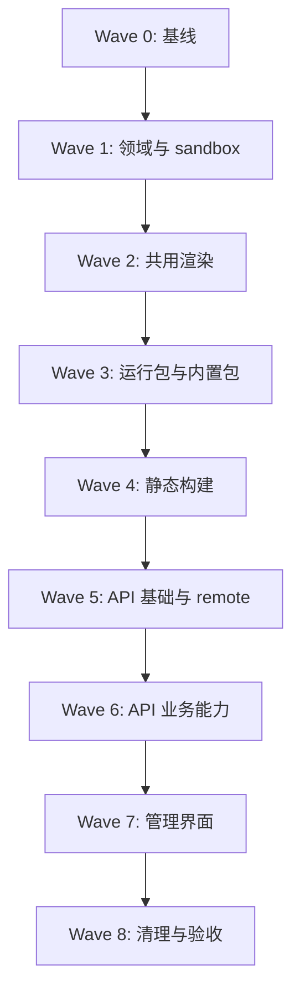

# WordPress 式 AI 原生 CMS Wave 实施计划

本计划把实施工作划分为 9 个 Wave、37 个可独立验证的 Task。

## 执行模型

- 设计依据：[领域模型](../design/domain-model.md)、[sandbox 格式](../design/sandbox-formats.md)、[API 规约](../design/api-conventions.md)、[状态模型](../design/state-models.md)、[代码处置](../design/code-disposition.md)。
- 每个 Task 只包含一个功能点，形成一个独立 commit；提交信息使用 Task 名称。
- Task 在独立 worktree 执行专项 build、typecheck、test，结果记录到 `.intermediate/tdd.md`。
- 同一 Wave 的 Task 合并到 Wave 集成分支；专项结果全部通过，并且 `npm run build && npm run typecheck && npm test` 均返回 0，才能合并到 `sean/wp-style-cms`。
- 不使用 mock。模型、数据库、远端、浏览器、连接器与发布目标使用真实服务或测试账户。
- Task 必须同时满足：规定文件已完成、规定断言全部通过、没有新增 lint 或类型错误、没有超出负责范围的改动。

## Wave 0：设计基线与现状基线

### W0-T1 固化设计文档

- 范围：`docs/design/`、[原实施计划](2026-11-19-wp-style-cms-implementation.md) 及其引用文档。
- 结果：五份详细设计进入版本历史；现有专题文档统一网站创建、知识库、整站预览、预览询盘和内容类型修改规则。
- 验证：`git diff --check` 返回 0；所有新增相对链接指向存在文件；旧单页预览、可空 `siteId`、账号级知识库只允许出现在代码处置清单的移除说明中。

### W0-T2 记录测试基线

- 范围：根目录脚本与现有全部 workspace。
- 结果：`.intermediate/tdd.md` 记录 Node、npm、PostgreSQL 版本、各包测试文件数、测试用例数、耗时和命令退出码。
- 验证：`npm ci`、`npm run build`、`npm run typecheck`、`npm test` 全部返回 0；Git 工作区除计划内文档外无变化。

### Wave 0 门禁

- 设计文档已提交；测试基线可重复执行；现有功能无失败用例。

## Wave 1：领域模型与 sandbox

### W1-T1 领域类型与 JSON Schema

- 范围：`packages/domain/`。
- 结果：新增 `content.ts`、`blocks.ts`、`media.ts`、`locales.ts`、`appearance.ts`、`plugins-config.ts`、`redirects.ts`、`publish-config.ts`、`validate.ts` 与 [Schema 清单](../design/sandbox-formats.md#16-schema-文件) 中的 19 个 Schema；保留旧导出供尚未迁移的消费者使用。
- 量化验收：19 个 Schema 各有 1 个合法、1 个缺必填字段、1 个额外字段用例，共至少 57 个；另有至少 10 个跨字段规则用例；全部通过。
- 验证：`npm run build -w @olps/domain && npm test -w @olps/domain` 返回 0。

### W1-T2 默认网站内容

- 范围：`packages/domain/src/required-pages.ts`、`collection-presets.ts`、`site-defaults.ts` 与测试 fixture。
- 结果：默认内容精确包含 2 种语言、8 个必备页面、3 个内容类型、1 个 `starter` 主题配置和 3 个内置插件配置；每个必备页面至少 1 个区块；`contact` 含询盘表单、地图、WhatsApp 区块。
- 量化验收：检查 16 个必备页面语言文件、3 个内容类型定义、角色唯一性、默认语言和全部引用；错误 fixture 至少覆盖缺页面、重复角色、空区块、失效媒体 4 类。
- 验证：domain build/test 返回 0。

### W1-T3 SyncWorkspace 新目录

- 范围：`packages/sync/src/paths.ts`、`validation.ts`、`workspace.ts`、`git-line-endings.ts` 与 fixture。
- 结果：新建 sandbox 具有完整目录、`schemaVersion`、仅含 `verifyCommand` 的 manifest 和忽略 `.olps-cache/` 的规则；二进制文件传输字节不变。
- 量化验收：新增目录结构、缺 `buildCommand`、PNG、WOFF2、MP4、PDF 六组测试；现有 sync 测试全部通过。
- 验证：`npm run build -w @olps/sync && npm test -w @olps/sync` 返回 0。

### Wave 1 门禁

- domain 与 sync 全部测试通过；根 build/typecheck/test 返回 0；sandbox fixture 经 Git bundle Push/Pull 后完整恢复。

## Wave 2：浏览器与 Node 共用渲染

### W2-T1 SiteModel、地址与引用

- 范围：新包 `packages/render` 的 `source-reader.ts`、`site-model.ts`、`urls.ts`、`links.ts`。
- 结果：测试网站含 2 种语言、8 个页面、1 个两层内容类型、4 个分组、2 个多分组条目；全部对象地址、相对链接、保留字和冲突规则可计算。fixture 位于 `packages/render/test-fixtures/sites/full-site/`，遵循 SyncWorkspace CMS 目录约定。
- 量化验收：覆盖页面、首页、404、总列表、两层分组、条目、分页 7 类地址；3 类地址冲突；4 类 `ContentRef`；`publish` 与 `preview` 两种引用规则。
- 验证：render build/test 返回 0。
- 根目录 `npm run build` / `npm test` 已纳入 `@olps/render`（位于 `@olps/domain` 之后）。

### W2-T2 Liquid 与区块渲染

- 范围：`liquid.ts`、`filters.ts`、`richtext.ts`、`blocks/`。
- 结果：8 个核心区块全部可渲染；主题与插件区块按 Schema 校验；目录越界、未知过滤器、未知变量、未知区块和非法 children 均终止。
- 量化验收：8 个核心区块各有正常用例；上述 5 类失败各有用例；TipTap 白名单覆盖 script、事件属性和安全链接 3 类。
- 验证：render build/test 返回 0。
- 状态：已在 `packages/render` 完成；依赖 `liquidjs`、`@tiptap/html`、`@tiptap/starter-kit`、`@tiptap/extension-link`；fixture 含 `test-fixtures/themes/minimal/` 与 `test-fixtures/sites/render-blocks/`。

### W2-T3 文档、SEO、导航与本地化

- 范围：`template-context.ts`、`navigation.ts`、`seo-head.ts`、`structured-data.ts`、`i18n.ts`、`render-document.ts`。
- 结果：页面、列表、分组、条目在 `canvas`、`preview`、`publish` 三种模式可渲染；Node 与 Chromium 输出一致。
- 量化验收：检查 canonical、hreflang、x-default、Open Graph、noindex、5 类 JSON-LD、面包屑、上一篇与下一篇、相关条目；同一 fixture 的 Node/Chromium 规范化 HTML 比较结果为 0 差异。
- 验证：render Node 测试和 Playwright Chromium 测试全部返回 0。
- 状态：已在 `packages/render` 完成；Chromium 用例通过 Playwright 加载 esbuild 打包的浏览器入口，对 `full-site` fixture 规范化比较差异为 0。

### Wave 2 门禁

- `@olps/render` 在 Node 与浏览器通过相同 fixture；根 build/typecheck/test 返回 0。

## Wave 3：插件、追踪、连接器与内置包

### W3-T1 plugin-runtime

- 范围：新包 `packages/plugin-runtime`。
- 结果：隔离执行 `onBuild`、`transformHtml`、`handle`，实现权限、路径、域名、时间和内存限制。
- 量化验收：正常调用 3 类；拒绝超时、超内存、未授权域名、未声明权限、越界写入、脚本异常 6 类；共至少 9 个真实 isolate 用例。
- 验证：plugin-runtime build/test 返回 0。
- 状态：已在 `packages/plugin-runtime` 完成；依赖真实 `isolated-vm`；根 `build` / `test` 已纳入该包。

### W3-T2 tracking-runtime

- 范围：新包 `packages/tracking-runtime`。
- 结果：同意管理、广告来源、标准事件和 8 个浏览器平台适配器完成。
- 量化验收：Chromium 中验证未同意、仅统计、全部同意、全部拒绝、重新设置 5 种状态；7 类点击或表单事件；9 类广告来源字段；同意前第三方请求数为 0。
- 验证：tracking-runtime build/test 和浏览器测试返回 0。

### W3-T3 connectors

- 范围：新包 `packages/connectors`。
- 结果：Google OAuth/Ads/GA4/Search Console/Site Verification、Meta OAuth/Pixel，以及 5 个 ID 型连接器完成。
- 量化验收：真实测试账户完成 2 组 OAuth、账户列表、Google 转化创建、Meta 测试事件、Google 离线转化、GA4/Search Console/Ads/Meta 每日数据读取；每项都保存服务返回的真实 ID。
- 验证：connectors build/test 返回 0；缺少任一环境变量时对应测试明确失败并指出变量名。

### W3-T4 starter 主题与内置插件

- 范围：新包 `packages/builtin-themes`、`packages/builtin-plugins`。
- 结果：`starter` 含 4 个必需模板、8 个默认页面职责所需区块；`inquiry-form`、`whatsapp`、`google-maps` 可安装并通过 Schema。
- 量化验收：1 个完整测试网站启用全部内置包后，未知区块数为 0、缺翻译键数为 0、缺模板数为 0；3 个插件各有启用和停用用例。
- 验证：两个包 build/test 返回 0。

### Wave 3 门禁

- 四个 Task 的专项测试全部通过；真实外部账户结果齐全；根 build/typecheck/test 返回 0。

## Wave 4：site-builder 静态构建

### W4-T1 整站构建与资源处理

- 范围：`packages/site-builder` 的 `load.ts`、`build.ts`、`assets.ts`、`images.ts`、`bundles.ts`、`write-public.ts`。
- 结果：使用 `@olps/render` 构建测试网站全部公开内容；图片生成 480、960、1440、1920 范围内版本；CSS/JS 文件名含内容哈希。
- 量化验收：测试网站 2 种语言至少生成 26 个 HTML；每个公开路由 1 个 HTML；同一图片第二次构建命中缓存且 `sharp` 调用数为 0。
- 验证：site-builder build/test 返回 0。

### W4-T2 隐藏文件、搜索、跳转与服务器配置

- 范围：`hidden-files.ts`、`search-index.ts`、`redirects.ts`、`not-found.ts`、`server-config.ts`。
- 结果：生成 sitemap 索引、内容 sitemap、robots、llms、Markdown、RSS、Pagefind、404、跳转页和 4 类服务器配置。
- 量化验收：规定输出文件缺失数为 0；全部 sitemap URL 返回对应文件；2 条旧地址在 `public` 与 4 类配置中均可验证；Pagefind 两种语言各返回结果。
- 验证：site-builder test 与 Chromium 页面检查返回 0。

### W4-T3 整站预览与 site-verify

- 范围：`preview.ts`、`verify.ts`、`install.ts`、CLI bundle。
- 结果：一次构建当前草稿全部内容，包含 draft 对象，不含追踪配置；`site-verify.mjs` 可在无依赖目录执行。
- 量化验收：预览 fixture 的全部站内链接返回 200；draft 路由可访问；公开构建中同一路由不存在；verify 覆盖服务器脚本、失效链接、内部地址、产物差异 4 类失败。
- 验证：`node tools/site-verify.mjs` 与 site-builder 全部测试返回 0。

### W4-T4 资源专用发布判定

- 范围：`assets-only.ts` 与产物清单。
- 结果：只有媒体文件内容变化且元数据变化限定在允许字段时返回 `assets_only`。
- 量化验收：允许情况 2 类、必须完整构建情况至少 6 类；摘要相同文件上传数为 0。
- 验证：site-builder build/test 返回 0。

### Wave 4 门禁

- fixture 产物分别从根目录和子目录提供服务，全部链接与资源返回 200；根 build/typecheck/test 返回 0。

## Wave 5：API 基础、内容与 remote

### W5-T1 数据库与网站生命周期

- 范围：`services/api/src/db.ts`、`migrate.ts`、测试 Schema。
- 结果：创建 `unpublished` 网站时同步创建成员、第一份草稿和唯一知识库；`site_drafts.site_id` 非空；新内容索引表与状态约束完成。
- 量化验收：旧库升级一次成功、第二次数据和结构无变化；所有草稿空 `site_id` 行数为 0；每个网站知识库数量恰为 1；失败事务写入行数为 0。
- 验证：API migration 专项测试、build、typecheck 返回 0。

### W5-T2 网站创建与知识库复制

- 范围：`workspace-bootstrap.ts`、`site-defaults.ts`、网站与知识库路由。
- 结果：`POST /api/sites` 创建完整默认网站；资料复制到多个目标网站后生成独立 ID，不建立自动同步。
- 量化验收：新站包含 16 个必备页面语言文件、3 个内容类型、1 个主题、3 个插件；复制到 2 个网站产生 2 个不同 `documentId`；修改来源后目标内容变化数为 0。
- 验证：真实 PostgreSQL/API 集成测试返回 0。

### W5-T3 内容文件、索引与 API

- 范围：`content-sandbox.ts`、`content-index.ts`、内容路由、revision。
- 结果：页面、总列表、分组、条目、语言文件、排序、引用、redirect 和索引事务完成。
- 量化验收：4 类内容各完成 create、read、update、delete；2 个并发 revision 请求恰有 1 个成功、1 个 409；索引失败前后四张表逐行相等；不兼容内容类型修改 4 类均返回影响清单。
- 验证：API 内容与事务集成测试返回 0。

### W5-T4 媒体、主题与插件 API

- 范围：`media-routes.ts`、`package-install.ts`、`theme-routes.ts`、`plugin-routes.ts`、`credentials.ts`。
- 结果：上传、替换、引用检查、zip 安装、权限确认和 secret 加密完成。
- 量化验收：媒体允许类型全部覆盖；被 3 个位置引用时删除返回 3 个 usage；主题和插件各覆盖合法包及路径越界、超量、非法类型、Schema 错误 4 类拒绝；密文中明文出现次数为 0。
- 验证：真实文件、PostgreSQL 与 isolate 集成测试返回 0。

### W5-T5 旧内容转换

- 范围：`content-conversion.ts`、`migration-sandbox.ts` 与迁移测试。
- 结果：旧页面、资源、settings 转为新版文件并形成单个转换 commit。
- 量化验收：旧页面数量与转换后页面数量一致；每页恰有 1 个 `core/html`；8 个职责齐全；引用资源全部登记；重复转换后 Git HEAD 不变。
- 验证：转换后完整 build 和 site-verify 返回 0。

### W5-T6 remote 产物能力

- 范围：`services/remote` 的 deploy、公开文件、zip、清单接口。
- 结果：发布版本提供 404、301、zip、单文件读取和 SHA-256 清单。
- 量化验收：不存在地址返回 404；2 条 redirect 返回 301；zip 与发布目录文件集合及 SHA-256 完全一致；未授权管理接口全部返回 401。
- 验证：remote build/test 返回 0。

### Wave 5 门禁

- 新站创建后可以经 API 写入内容、完整构建并由 remote 提供；旧库可重复升级；根 build/typecheck/test 返回 0。

## Wave 6：API 业务能力

### W6-T1 当前草稿整站预览

- 范围：preview build、capability store/serve、admin bar、预览询盘。
- 结果：`POST /api/drafts/:draftId/preview` 返回完整预览；会话、期限、权限撤销生效；预览询盘写入来源草稿。
- 量化验收：预览全部路由返回 200；admin bar 每页恰有 1 个；公开 HTML 中 admin bar 数为 0；过期、会话失效、撤权 3 类均返回 403；预览询盘外部发送记录数为 0。
- 验证：API preview 集成测试与 Chromium 测试返回 0。

### W6-T2 AI Job 与 SSE

- 范围：`jobs/runner.ts`、events 与 10 个 Job 类型。
- 结果：使用网站知识库资料、真实模型、Schema 校验、revision 和断点继续事件。
- 量化验收：10 个 Job 类型各有成功用例；模型错误、Schema 错误、revision 冲突 3 类失败内容变更文件数为 0；SSE 断开继续后事件 ID 无重复且无缺失。
- 验证：API Job 集成测试返回 0。

### W6-T3 询盘、事件与报告

- 范围：公开询盘、预览询盘、事件、报告、邮件与转化任务。
- 结果：公开询盘幂等、四状态、来源信息、全站报告完成。
- 量化验收：同一 `eventId` 提交两次只产生 1 行；第一次标记 qualified 只产生 1 个离线转化任务；preview 来源产生外部任务数为 0；报告覆盖 4 类内容和全部语言。
- 验证：API 业务集成测试与 public-inquiry E2E 返回 0。

### W6-T4 营销连接器

- 范围：授权路由、账户选择、转化发送、每日指标、publish-config。
- 结果：Google 与 Meta 完成真实授权和服务器发送，ID 型连接器写入公开配置。
- 量化验收：Google 与 Meta 各至少 1 个成功发送记录；失败记录可以重试并增加 attempts；每日同步重复执行后同日同连接器行数为 1。
- 验证：真实测试账户集成测试返回 0。

### W6-T5 发布目标与发布记录

- 范围：5 类目标、增量上传、zip、重试、IndexNow、Search Console。
- 结果：OLPS 托管成功后上传全部启用目标，单目标失败可以独立重试。
- 量化验收：5 类真实目标各完成首次、无变化、修改、删除 4 次同步；无变化上传数为 0；删除只影响 OLPS 曾上传的文件；单目标失败时其余目标成功数不变。
- 验证：发布目标集成测试返回 0。

### W6-T6 协作能力回归

- 范围：Pull、Push、continue、Agent、锁、权限、发布恢复。
- 结果：现有协作能力全部适配新版内容和网站生命周期。
- 量化验收：两个账号分别完成无冲突合并、同对象不同区块合并、同区块冲突并 continue；最后一名网站成员无法删除；远端失败重试不增加重复网站或发布记录。
- 验证：全部 API test 返回 0。

### Wave 6 门禁

- API 全部测试通过；真实模型、连接器和发布目标结果齐全；根 build/typecheck/test 返回 0。

## Wave 7：管理界面

### W7-T1 外框、我的网站与预览切换

- 范围：`apps/admin/src/App.vue`、router、SitesPage、session、guard。
- 结果：菜单、顶栏、查看网站、返回后台、切换网站、用户菜单和发布提示完成。
- 量化验收：创建未发布网站、选择草稿、打开整站预览、返回原路由、切换网站 5 条 Playwright 流程全部通过；公开页面 admin bar 数为 0。
- 验证：admin build/typecheck/test 与专项 E2E 返回 0。

### W7-T2 内容列表、树与媒体

- 范围：PagesPage、CollectionPage、MediaPage 和媒体组件。
- 结果：页面、分组树、条目多分组、列表页、媒体上传与 usage 可操作。
- 量化验收：4 类内容各完成新建、筛选、编辑入口和删除保护；两层分组拖动后顺序与 API 一致；媒体替换后引用 ID 不变。
- 验证：admin 专项组件测试与 E2E 返回 0。

### W7-T3 可视化编辑器

- 范围：`src/editor/`、pageEditSession 和 API SourceReader。
- 结果：画布、大纲、字段表单、TipTap、媒体选择、语言、revision、撤销重做、SEO 检查与 AI 区块操作完成。
- 量化验收：8 个核心字段类型、3 种画布宽度、2 种语言、revision 冲突、离开保护、50 次撤销重做序列均通过；Node 与画布渲染 HTML 规范化差异为 0。
- 验证：admin build/typecheck/test 与 Chromium 编辑流程返回 0。

### W7-T4 外观、插件与设置

- 范围：appearance、plugins、settings 页面。
- 结果：主题、定制、菜单、文字、插件、常规、搜索、内容类型、发布目标、成员均连接真实 API。
- 量化验收：所有 10 个子页面可从菜单进入；主题与插件上传、启用、停用；不兼容内容类型修改显示受影响对象；secret 不回显原值。
- 验证：admin 专项 E2E 返回 0。

### W7-T5 AI、询盘、营销与发布

- 范围：SiteBuilderPage、JobProgress、InquiriesPage、IntegrationsPage、ReportsPage、PublishDialog、发布记录。
- 结果：AI 结构树、SSE 进度、预览询盘筛选、连接器、报告、发布与 continue 完成。
- 量化验收：10 类 Job 均可发起并显示终态；SSE 重连不重复区块；一次发布显示 OLPS 托管和全部目标结果；冲突问答后同一操作继续完成。
- 验证：[MVP 流程](../flows/mvp-happy-path.md) 第 1 至 19 步全部通过。

### Wave 7 门禁

- admin build/typecheck/unit/E2E 全部返回 0；界面搜索 sandbox、commit、Job ID、文件路径和英文状态值，用户可见匹配数为 0。

## Wave 8：旧代码移除、迁移与最终验收

### W8-T1 移除旧实现

- 范围：[代码处置清单](../design/code-disposition.md) 中标记移除的文件与类型。
- 结果：旧单页 HTML 生成、旧预览、旧后台页面和临时兼容导出全部删除。
- 量化验收：搜索 `PageKind`、`PageBody`、页面 `kind`、`body.html`、`StoredPageJson`、旧预览路由，运行时代码匹配数均为 0；替代测试全部存在。
- 验证：根 build/typecheck/test 返回 0。

### W8-T2 生产迁移演练

- 范围：数据库备份恢复、schema 升级、sandbox 转换与重复执行。
- 结果：在独立数据库和 sandbox 副本完成全流程，再对原库执行。
- 量化验收：升级前后用户、网站、草稿、询盘、报告、Job 数量逐项一致；页面与媒体转换数量一致；第二次迁移数据变化行数为 0；全部网站 build/verify 失败数为 0。
- 验证：迁移记录、SQL 计数和每站验证结果写入 `.intermediate/validation/`。

### W8-T3 部署与业务验收

- 范围：nginx 根目录与子目录、IIS、`npx serve`、S3、OSS、COS、真实浏览器和营销平台。
- 结果：同一 zip 在 7 个环境提供相同行为；两个账号协作、第三方主题和插件、营销转化全部通过。
- 量化验收：7 个环境逐项检查两种语言、搜索、分页、详情、404、redirect、隐藏文件，失败项为 0；MVP 20 步通过 20/20；Google 与 Meta 测试工具可见对应事件。
- 验证：录屏、HTTP 状态清单、文件摘要和平台事件 ID 写入验收记录。

### W8-T4 文档与提交边界核对

- 范围：README、docs、各包 README、API 文档。
- 结果：文档只描述最终行为；每个 Wave 和 Task 的 commit、验证命令与结果可追踪。
- 量化验收：文档链接失效数为 0；实现中的公开路由与 API 文档差异数为 0；sandbox 文件与 Schema 清单差异数为 0；`git diff --check` 返回 0。

### Wave 8 门禁

- 所有专项与根测试通过；MVP 20/20；7 个部署环境失败项为 0；迁移第二次执行变化为 0；工作区干净。
