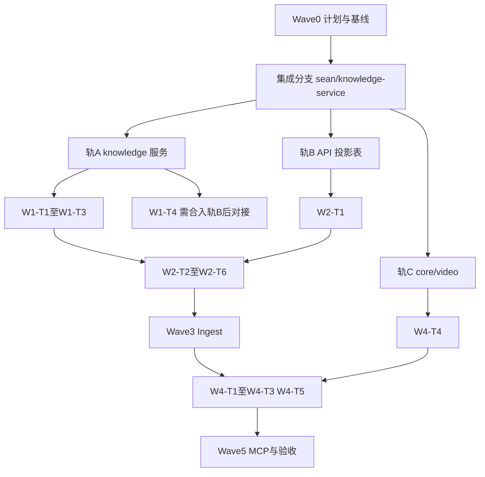
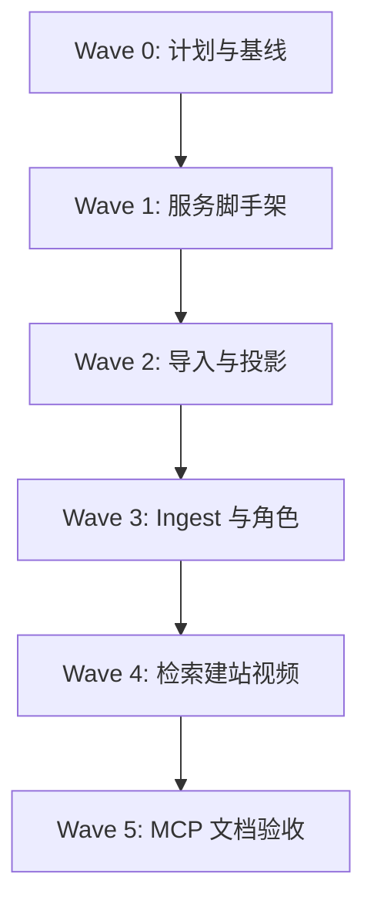

# OLPS 知识库服务 Wave 实施计划

本计划把实施工作划分为 6 个 Wave、22 个可独立验证的 Task。

## 执行模型

- 设计依据：[知识库服务设计](../design/knowledge-service.md)、[API 规约](../design/api-conventions.md)、[领域模型](../design/domain-model.md)、[状态模型](../design/state-models.md)。
- 每个 Task 只包含一个功能点，形成一个独立 commit；提交信息使用 Task 名称。
- 严格 TDD：先写失败测试，确认失败原因后写最小实现，再确认通过；禁止 mock。
- Task 在独立 worktree 执行专项 build、typecheck、test；结果记录到 `.intermediate/tdd.md` 与 SDD ledger。
- 并行轨通过 `git merge` 合入集成分支 `sean/knowledge-service`；禁止 cherry-pick。
- 同一 Wave 的 Task 全部专项通过，并且根目录 `npm run build && npm run typecheck && npm test` 均返回 0，才能合入 `sean/wp-style-cms`。
- Wiki 文件为权威；Postgres 仅投影；禁止只改投影表。
- 不拷贝上游 GPL 源码；`@olps/knowledge` 为 Node 自研。
- 改动同步更新相关文档；Wave 5 做专题文档总核对。
- Task 必须同时满足：规定文件已完成、规定断言全部通过、没有新增类型错误、没有超出负责范围的改动。

## 并行轨

| 轨 | worktree / 分支 | 首批 Task | 主要路径 | 合入顺序 |
|----|-----------------|-----------|----------|----------|
| 集成 | 主工作区 `sean/knowledge-service` | W0 | 文档、merge | 接收各轨 merge |
| A | `.worktrees/knowledge-svc` / `sean/ks-track-a` | W1-T1 → W1-T2 → W1-T3 | `services/knowledge/**`、根 `package.json` scripts | 先于需客户端的任务 |
| B | `.worktrees/knowledge-schema` / `sean/ks-track-b` | W2-T1 | `services/api/src/db-schema.ts`、migrate、schema 测试 | 可与 A 首批并行 |
| C | `.worktrees/knowledge-video` / `sean/ks-track-c` | W4-T4 | `packages/domain`、`packages/render`、admin 编辑器、`docs/page-model.md` | 可与 A/B 并行 |

冲突面：轨 A 改根 `package.json` 的 knowledge 脚本；轨 B/C 原则上不改同一行。若 merge 冲突，在集成分支手工解决后跑全量测试。

---

## Wave 0：计划固化与测试基线

### W0-T1 固化 Wave 计划与验收清单

- 范围：`docs/plans/2026-11-25-knowledge-service-wave-plan.md`、`docs/validation/knowledge-service-acceptance.md`、`docs/README.md`、`.gitignore`（忽略 `.worktrees/`）。
- 方案：按本文件写入完整范围/结果/量化验收/验证命令；验收清单为每 Task 预留提交与证据栏。
- 结果：计划与验收清单进入版本历史；文档相对链接全部有效；`.worktrees/` 被 gitignore。
- 验证：`npm run check:docs`、`git diff --check` 返回 0。

### W0-T2 记录测试基线

- 范围：根目录脚本与现有全部 workspace。
- 结果：`.intermediate/tdd.md` 记录 Node、npm、PostgreSQL 版本、各包测试文件数、用例数、耗时和命令退出码。
- 验证：`npm ci`（或现有安装方式）、`npm run build`、`npm run typecheck`、`npm test` 全部返回 0；Git 工作区除计划内文档与基线记录外无变化。

### Wave 0 门禁

- 设计与计划已提交；测试基线可重复执行；现有功能无失败用例。

---

## Wave 1：`@olps/knowledge` 脚手架与项目目录

### W1-T1 包脚手架与 health

- 范围：新建 `services/knowledge/`（`package.json` name `@olps/knowledge`）、HTTP 入口、根 `package.json` workspaces/scripts（`dev:knowledge`，build/test 纳入）。
- 方案：Hono + `@hono/node-server`；环境变量定稿：`KNOWLEDGE_SERVICE_URL`、`KNOWLEDGE_SERVICE_TOKEN`、`KNOWLEDGE_ROOT`、`KNOWLEDGE_IMPORT_MAX_BYTES`（默认 104857600）、单文件上限镜像 `MEDIA_MAX_BYTES`（默认 20971520）；鉴权为服务间令牌。
- 结果：`GET /health` 返回存活；无令牌或错误令牌返回 401。
- 量化验收：health 成功 1 例；鉴权失败至少 2 例（缺令牌、错令牌）。
- 验证：`npm run build -w @olps/knowledge && npm test -w @olps/knowledge` 返回 0。
- TDD：先写 health/鉴权测试并确认失败，再实现最小服务。

### W1-T2 站点项目目录初始化

- 范围：project 布局与 `POST /api/v1/projects/:siteId/project`、`GET /api/v1/projects`、`GET /api/v1/projects/:siteId`。
- 方案：创建 `purpose.md`、`schema.md`、`raw/sources/`、`wiki/`（含 `index.md`/`log.md`/`overview.md`/`assets-catalog.md`）、`.olps-knowledge/`（`imports/`、`fingerprints.json`、`reviews.json`）。
- 结果：幂等创建；重复调用目录与关键文件集合不变。
- 量化验收：新建后路径清单与[设计 §2.1](../design/knowledge-service.md#21-三层存储对齐-karpathy--llm_wiki)一致；二次调用文件集合 diff 为 0；非法 `siteId` 路径穿越被拒绝。
- 验证：knowledge 专项测试返回 0。

### W1-T3 文件列表与读取

- 范围：`GET /api/v1/projects/:siteId/files`、`GET /api/v1/projects/:siteId/files/content`。
- 方案：仅允许 `raw/` 与 `wiki/` 下相对路径；拒绝 `..` 与越界。
- 结果：文本可读；二进制返回元数据。
- 量化验收：合法路径至少 3 类；越界/缺文件至少 2 类失败且状态码明确。
- 验证：knowledge 专项测试返回 0。

### W1-T4 API 侧客户端与建站挂钩

- 范围：`services/api` 增加 knowledge HTTP 客户端；`site-lifecycle.ts` / 网站创建成功后调用 ensure project。
- 方案：`KNOWLEDGE_SERVICE_URL` + token；创建站点事务成功后确保 knowledge project 存在；失败 fast-fail，错误可观测；与现有 `initStatus` 语义一致时可重试，测试写明行为。
- 结果：新站创建后 knowledge 侧存在对应 `siteId` 项目目录。
- 量化验收：创建网站集成测试中 project 存在；knowledge 未启动时失败行为符合测试约定且无半初始化不可恢复脏状态。
- 验证：API 集成测试返回 0。
- 依赖：轨 A 的 W1-T1～T3 与集成分支已可启动 knowledge；建议在合入轨 A 后执行。

### Wave 1 门禁

- 第四进程可启动；站点创建可初始化空 Wiki 树；根 build/typecheck/test 返回 0。

---

## Wave 2：投影表、资料包导入、Admin 上传门面

### W2-T1 Postgres 投影表扩展

- 范围：`services/api/src/db-schema.ts`、migrate/upgrade、测试 schema。
- 方案：扩展 `knowledge_documents`（`updated_at`、`source_path`、`source_fingerprint`、`import_id`、`kind`、`wiki_path`、`asset_refs`）；新建 `knowledge_assets`、`knowledge_imports`（字段按设计 §6.1）。
- 结果：空库与旧库 upgrade 一次成功，第二次结构与数据无变化。
- 量化验收：新列/新表存在；重复 upgrade 行数与结构 diff 为 0；现有知识库 CRUD 用例仍通过。
- 验证：API schema/migration 集成测试返回 0。
- TDD：先写 upgrade 断言失败，再改 schema。

### W2-T2 导入任务创建与体积限制

- 范围：knowledge `POST /api/v1/projects/:siteId/imports`、状态查询、队列骨架；zip 解压与文件夹清单写入 `raw/sources`。
- 方案：单次合计默认 100MB、单文件 20MB；保留相对路径；写入 `.olps-knowledge/imports/<importId>`；同站串行入队。
- 结果：超限与坏 zip 立即失败；合法包文件进入 `raw/sources`。
- 量化验收：超合计、超单文件、坏路径、空包至少 4 类拒绝；合法 zip 与多文件文件夹各 1 例成功且相对路径保留。
- 验证：knowledge 导入专项测试返回 0。

### W2-T3 源文件分类与文本抽取（尚无 AI Ingest）

- 范围：解析器模块（docx/xlsx/pdf/txt/md/csv）；图片/视频登记资产元数据；不支持类型记 skipped。
- 方案：使用成熟 Node 库抽取文本；指纹 SHA256 写入 `fingerprints.json`；相同指纹跳过重复写入；禁止手写二进制格式 parser。
- 结果：文字源有抽出文本；媒体有 mime/尺寸（视频可先记 mime 与大小）；skipped 不中断整包。
- 量化验收：设计表中每类扩展名至少 1 个 fixture；混合包含 1 个未知扩展名时 skipped≥1 且其它文件成功；指纹未变二次处理跳过数≥1。
- 验证：knowledge 解析测试返回 0。

### W2-T4 投影同步

- 范围：knowledge → Postgres 投影写入。
- 方案：knowledge 服务持有投影写连接（`DATABASE_URL`）；导入完成后重建受影响 `knowledge_documents` / `knowledge_assets` / `knowledge_imports` 行；只改 Postgres 后触发重建可恢复与 Wiki 一致。
- 结果：导入完成后 Admin 现有文档列表可读到投影行（含 `kind`/`source_path`）。
- 量化验收：手工只改投影正文后重建，正文与 Wiki/源一致；导入统计与投影行数一致。
- 验证：API+knowledge 集成测试返回 0。

### W2-T5 手工资料门面改为经 knowledge 写入

- 范围：`cms-management-routes.ts` 文档 POST/PUT/DELETE；跨站 copy（`cms-sites.ts`）。
- 方案：写路径改为 knowledge `pages/write` 或等价手工源写入 → 再投影；读仍来自投影；copy 复制必要 raw/wiki 子树后投影并生成新 id。
- 结果：禁止出现「只改 Postgres」的成功写路径。
- 量化验收：创建/更新/删除后 Wiki 与投影一致；复制到 2 站产生 2 个不同 `documentId`，改来源后目标变化数为 0。
- 验证：API 知识库集成测试返回 0。

### W2-T6 Admin 资料包导入 UI

- 范围：`apps/admin/src/pages/CmsKnowledgePage.vue`、API 转发 `imports` 与进度（经 API 代理 SSE）。
- 方案：zip 与文件夹（`webkitRelativePath`）；进度与结果摘要（文档数、skipped、错误）；现有标题+正文表单保留。
- 结果：运营可上传资料包并看到完成状态。
- 量化验收：上传测试 zip 后列表出现对应文档标题；超限显示明确错误文案。
- 验证：admin 相关测试与 API 代理测试返回 0。

### Wave 2 门禁

- 资料包可入库到 raw + 投影；Admin 可上传；根 build/typecheck/test 返回 0。

---

## Wave 3：两步 Ingest、素材角色、reviews

### W3-T1 两步 Ingest 流水线

- 范围：knowledge Ingest Step1 分析 / Step2 生成；更新 `wiki/` 页、`index.md`、`log.md`、`overview.md`。
- 方案：真实模型；源指纹未变跳过；崩溃后续跑同一 `importId`；产出结构化分析再写页。
- 结果：文字源形成来源摘要 Wiki 页并投影为 `imported_text`/`wiki_page`。
- 量化验收：fixture「产品1」类（docx+xlsx）导入后 Wiki 来源页数≥文字文件数；中断后续跑不重复生成指纹未变页。
- 验证：knowledge Ingest 集成测试（真实模型）返回 0。

### W3-T2 素材角色识别与 assets-catalog

- 范围：角色枚举写入资产元数据与 `wiki/assets-catalog.md`；低置信进 reviews。
- 方案：依据路径/文件名/同包文字；阈值 0.55；低于阈值记 `other` 并进 `reviews.json`。
- 结果：产品图等角色可查询；Admin 可后续修正。
- 量化验收：多 jpg fixture 中至少 1 个得到非 `other` 角色或进入 review；`GET .../assets?role=` 过滤正确。
- 验证：knowledge 资产测试返回 0。

### W3-T3 再次导入 create/update/skip

- 范围：对照已有 Wiki/投影的 AI 判定；素材指纹/路径规则按设计 §5。
- 方案：`update` 必须指向已存在对象；主题无关时拒绝 update 并记 review，同时允许 create 新页。
- 结果：微调 docx 更新原页；相同指纹素材不复制文件。
- 量化验收：二次导入微调正文 → update 且文档 id 不变；相同图片指纹 → 新文件字节副本数为 0；无关主题强制 update 被拒绝并进入 stats/review。
- 验证：knowledge 二次导入测试返回 0。

### W3-T4 Reviews API 与 Admin 处理

- 范围：`GET/POST .../reviews`；Admin 待审列表与解决动作；`PATCH .../assets/:assetId` 改角色。
- 结果：人工修正后投影与 catalog 同步。
- 量化验收：resolve 后待审列表减少 1；改角色后 `role` 与投影一致。
- 验证：API+Admin 集成测试返回 0。

### Wave 3 门禁

- Ingest 与角色识别可用；二次导入行为符合设计；根 build/typecheck/test 返回 0。

---

## Wave 4：检索、AI 建站素材提升、`core/video`

### W4-T1 关键词检索 API

- 范围：`POST /api/v1/projects/:siteId/search`。
- 方案：首期关键词 + 角色/路径过滤；不引入向量库；接口形状预留后续扩展字段但不实现 embed。
- 结果：Job 可取片段，避免整库正文进 prompt。
- 量化验收：已知标题命中≥1；按 `role` 过滤只返回该类资产；空查询返回明确校验错误。
- 验证：knowledge search 测试返回 0。

### W4-T2 Job 注入 knowledgeAssets

- 范围：`services/api/src/jobs/runner.ts` 快照与系统提示。
- 方案：选中文档附带关联资产（`assetId`/`role`/`sourcePath`/`mimeType`/`caption`/宽高）；提示：媒体字段只能引用清单；禁止误用角色（如 `qr_code` 当产品主图）。
- 结果：生成中间态允许 `{ assetId }` 或已有 `{ mediaId }`。
- 量化验收：快照中资产数与投影 `asset_refs` 一致；未选资料时不读库（现有语义保持）。
- 验证：Job 集成测试返回 0。

### W4-T3 promoteKnowledgeAssets

- 范围：API 保存前提升逻辑；读 knowledge 二进制 → 现有 `uploadMedia` → `promoted_media[draftId]` → props 改为 `{ mediaId }`。
- 方案：页面 JSON 只存 `mediaId`；公开路径仍由渲染层解析。
- 结果：sandbox 出现 uploads 与 `source/media/*.json`。
- 量化验收：含 image 与 video 的生成结果保存后 props 中 `assetId` 出现次数为 0；同一资产二次提升复用已有 `mediaId`（`promoted_media` 命中）。
- 验证：API promote 集成测试返回 0。

### W4-T4 新增 `core/video`

- 范围：domain 区块定义、`packages/render/src/blocks/core/`、编辑器媒体选择器、`docs/page-model.md`。
- 方案：字段 `video`（必填 media）、`poster`（可选）、`caption`（可翻译）、`autoplay`/`muted`/`controls`；`prepareProps` → `src`/`posterSrc`；选择器过滤 mp4/webm。
- 结果：编辑器可插入；Node/Chromium 可渲染。
- 量化验收：正常渲染 1 例；缺 `video` 校验失败 1 例；非视频 mime 拒绝 1 例。
- 验证：domain/render/admin 相关测试返回 0。
- TDD：先写渲染与校验失败测试，再实现区块。

### W4-T5 AI 建站页素材统计展示

- 范围：`apps/admin/src/pages/CmsAiPage.vue` 选资料时展示关联素材统计。
- 结果：运营可见所选资料附带的素材数量/角色分布摘要。
- 量化验收：无资料时统计为 0；有关联资产的资料显示数量≥1。
- 验证：admin 测试返回 0。

### Wave 4 门禁

- 建站链路可从知识库素材落到草稿 mediaId；`core/video` 可用；根 build/typecheck/test 返回 0。

---

## Wave 5：MCP、Skill、文档联动与总验收

### W5-T1 MCP 服务子集

- 范围：`services/knowledge/mcp-server`；工具名 `olps_knowledge_*`；仅调本服务 HTTP。
- 方案：首期覆盖与设计 §2.3 对应的工具子集；不做 chat/graph/embed。
- 结果：服务启动后 MCP 可检索与读文件。
- 量化验收：`olps_knowledge_search` 与读文件各至少 1 个成功用例；未启动 HTTP 时工具失败信息明确。
- 验证：MCP 专项测试返回 0。

### W5-T2 Agent Skill 说明包

- 范围：Skill 文档（安装方式、对某 `siteId` 入库/检索/读 catalog/处理 review）。
- 结果：文档可按步骤操作；不内嵌第二套解析逻辑。
- 验证：`npm run check:docs` 返回 0；链接目标存在。

### W5-T3 专题文档联动

- 范围：`docs/services.md`、`docs/storage.md`、`docs/admin.md`、`docs/ai-generation.md`、`docs/design/domain-model.md`、`docs/page-model.md`、`docs/design/api-conventions.md`、根 README 启动方式。
- 结果：与实现一致；去掉环境变量「草案」表述。
- 验证：`npm run check:docs` 返回 0。

### W5-T4 设计 §11 总验收用例

- 范围：端到端脚本或集成套件，覆盖设计测试要点 1–7。
- 结果：zip 产品包、文件夹路径、二次导入、promote、超限错误、投影重建、MCP 七类全部有自动化证据。
- 量化验收：七点各至少 1 条断言通过；记录写入 [knowledge-service-acceptance.md](../validation/knowledge-service-acceptance.md)。
- 验证：对应 test 命令返回 0；根 build/typecheck/test 返回 0。

### Wave 5 门禁

- 独立知识库服务、Admin 导入、建站提升、MCP 与文档全部可验收通过。

---

## 协调职责

| 角色 | 职责 |
|------|------|
| 主会话（计划与验证） | 维护计划/ledger、开 worktree、派发与回收 agent、跑门禁、执行 `git merge`、更新验收证据 |
| 实现 agent | 单 Task 范围编码、严格 TDD、单元/专项测试、单 Task commit、同步该 Task 触及的文档 |
| 评审 agent | 对照计划量化验收与设计做任务级审查 |

## 控制器裁定（开跑前）

| 项 | 裁定 |
|----|------|
| 投影写入归属 | knowledge 进程持有 `DATABASE_URL` 写投影 |
| Admin 进度通道 | 经 `@olps/api` 代理 SSE |
| 主题无关 update | 拒绝 update，记 review，允许 create 新页 |
| 合入方式 | 仅 `git merge`；禁止 cherry-pick |
| 首批并行 | W1-T1（轨 A）、W2-T1（轨 B）、W4-T4（轨 C） |
