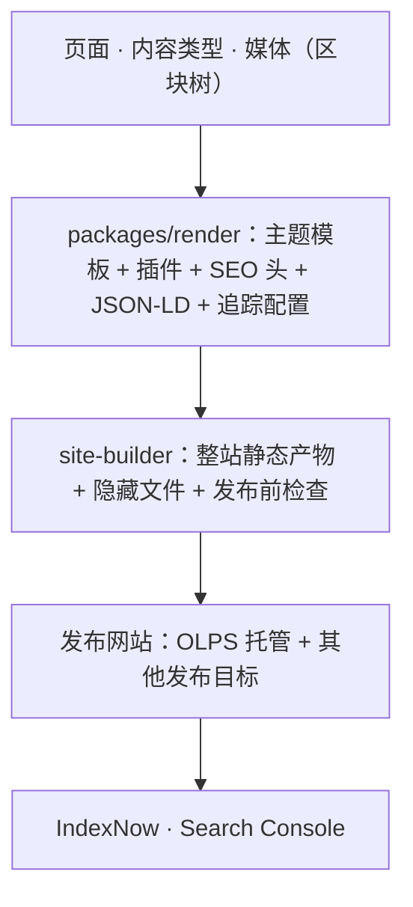

# 平台能力：SEO、GEO 与三端适配

> OLPS 定位：AI 原生的网站管理系统，基于 AI 生成网站 + 静态页面管理；在提供好用的 AI 原生 CMS 的同时，尽可能降低服务器的资源使用，并生成搜索引擎友好 + AI 搜索友好的网站。

SEO、GEO、三端适配由系统自动完成，运营只需要在「设置 → 搜索引擎」里控制几个开关。多语言见 [localization.md](localization.md)；地图、WhatsApp 由内置插件提供，见 [plugins.md](plugins.md)；产物与隐藏文件见 [static-output.md](static-output.md)。

## 1. 每个页面的 SEO

| 项目 | 规则 |
|------|------|
| 搜索结果标题与摘要 | AI 生成内容时填写；没有填写时由标题和摘要生成 |
| `canonical` | 当前语言版本的绝对地址 |
| `hreflang` | 全部已发布语言版本，`x-default` 指向默认语言 |
| Open Graph / Twitter 卡片 | `og:title`、`og:description`、`og:url`、`og:image`、`og:locale`；分享图依次取 `seo.ogImage`、封面、网站图标 |
| 语义 HTML | 页面只有一个 `h1`，标题层级连续；主题模板使用 `header`、`nav`、`main`、`article`、`footer` |
| 图片 | 替代文字来自媒体库；输出 WebP、`srcset`、`width`、`height`、`loading="lazy"` |
| `noindex` | 询盘提交成功页、404 页、预览页面；关闭「允许搜索引擎收录」时所有页面 |

## 2. 结构化数据（JSON-LD）

| 页面 | 类型 |
|------|------|
| 全站 | `Organization`（公司信息、Logo、`sameAs` 社交账号）、`WebSite`（含 Pagefind 搜索的 `SearchAction`） |
| 联系我们 | `LocalBusiness`（地址、电话、邮箱） |
| 内容类型详情页 | 定义里的 `structuredData`，例如 `Product`、`NewsArticle`、`Service`；字段映射由内容类型预设提供 |
| 列表页 | `ItemList` |
| 有面包屑的页面 | `BreadcrumbList` |
| 含常见问题区块的页面 | `FAQPage` |

结构化数据由 `packages/render` 生成，构建时按 schema.org 的必需属性检查，缺少时构建报错并指出页面和属性。

## 3. GEO（便于 AI 搜索理解和引用）

- 输出 `llms.txt`、`llms-full.txt` 和每个页面的 `index.md`。
- 所有正文都在静态 HTML 里。
- 公司实体信息全站统一，来自「设置 → 常规」。
- 页面显示更新日期，`article:modified_time` 和结构化数据的 `dateModified` 使用同一个时间。
- AI 生成内容时遵守 [ai-generation.md](ai-generation.md) 第 5 节的写作规则。

## 4. `robots.txt`

由「设置 → 搜索引擎」的三个开关决定：

| 开关 | 默认 | 打开时 | 关闭时 |
|------|------|--------|--------|
| 允许搜索引擎收录 | 开 | 允许全部爬虫，受下面两个开关限制 | 全部 `Disallow: /`，所有页面加 `noindex` |
| 允许 AI 搜索引用 | 开 | 允许 `OAI-SearchBot`、`ChatGPT-User`、`PerplexityBot`、`Claude-SearchBot` | 禁止这些爬虫 |
| 允许 AI 训练使用 | 关 | 允许 `GPTBot`、`ClaudeBot`、`Google-Extended`、`CCBot`、`Applebot-Extended` | 禁止这些爬虫 |

文件末尾写入 `Sitemap` 地址。草稿预览不使用这些文件。

## 5. Sitemap

- 只收录已发布的页面、列表页、分组、条目，不收录询盘提交成功页和 404 页。
- `lastmod` 使用内容的更新时间。
- 用 `xhtml:link` 写入各语言版本的对应关系，用 `image:image` 写入页面里的图片。
- 发布后通过 IndexNow 和 Search Console 通知搜索引擎，见 [static-output.md](static-output.md)。

## 6. SEO 检查

- **编辑器检查清单**：搜索结果标题和摘要的长度、主标题数量、标题层级、图片替代文字、和其他页面的标题重复、内容过少。问题只作提示，不阻止保存。
- **构建检查**：地址重复、站内引用失效、结构化数据缺少必需属性时，构建报错终止。
- **全站体检**：「工具 → 报告」对全部页面执行上述检查，并检查页面之间的内部链接，按页面列出问题和修改建议。

## 7. 三端适配

| 项目 | 规则 |
|------|------|
| 响应式 | 主题模板和区块默认覆盖手机、平板、电脑三种宽度 |
| 断点 | 主题至少提供三档：手机 &lt;768、平板 &lt;1024、电脑 ≥1024 |
| 交互 | 表单与按钮在窄屏可以点击和滚动，不依赖鼠标悬停 |
| 编辑器 | 画布提供三种宽度切换 |

## 8. 能力之间的关系

