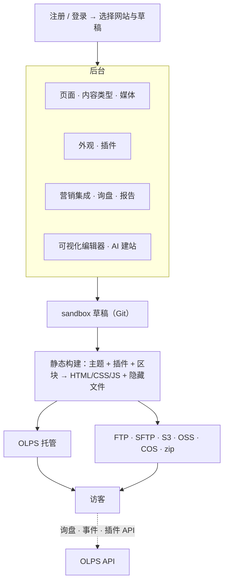

# 产品愿景与取舍

## 1. 要解决什么

AI 原生的网站管理系统：基于 AI 生成网站 + 静态页面管理，在提供好用的 AI 原生 CMS 的同时，尽可能降低服务器的资源使用，并生成搜索引擎友好 + AI 搜索友好的网站。

运营登录后选择草稿，在 WordPress 式的后台里管理页面、内容类型、媒体、外观、插件、营销集成和设置；用 AI 建站和可视化编辑器制作网站；点击「发布网站」得到可以放在任何 Web 服务器上的静态网站。

使用方是负责网站和推广的运营。后台的模块入口和固定操作路径是产品交互的依据，不显示技术细节。对话不作为管理网站的主路径。

## 2. 明确不做

| 不做 | 原因 |
|------|------|
| 以对话配置整站或在对话里猜草稿 | 运营负担大；草稿必须在登录后明确选择 |
| 依赖服务器运行环境的网站产物 | 网站必须是纯静态文件，部署到任何 Web 服务器 |
| 没有 SEO、只有一种语言、只适配电脑、没有 sitemap 的页面 | 不符合营销网站的质量要求 |
| 定期巡检策略、企业知识库设置区块 | 评价走报告，知识库在流程里选择 |

## 3. 要保留和建设的能力

- **用户账号 + 多用户所有权**：登录 → 选草稿 → accessToken 调管理 API；成员可以分别编辑，发布时自动合并
- **内容模型**：页面（含八个必备页面）、树形内容类型、媒体
- **可视化编辑**：区块式编辑器；AI 建站、AI 修改、AI 重写单个区块
- **扩展**：Liquid 主题；带隔离服务器代码的插件；zip 安装
- **营销集成**：Google、Meta 授权连接，标准事件，服务器端转化，广告来源，投放数据
- **SEO 与 GEO**：结构化数据、hreflang、sitemap、robots、llms.txt
- **多语言**：中英文内置，可以添加任意语言，AI 翻译
- **纯静态发布**：OLPS 托管、FTP/SFTP/S3/OSS/COS、zip 下载、只发布静态资源
- **知识库**（流程中选择）、**报告**、**询盘**

## 4. 产品形态

能力经 HTTP API 暴露；命令行与外部系统调用同一套 API。

## 5. 成功标准

1. 登录后能新建网站，八个必备页面和三个预设内容类型自动就绪。
2. 用 AI 建站生成整站，在可视化编辑器里修改，结果在画布上实时显示。
3. 上传媒体、切换主题、自定义外观、启用插件都能在后台完成。
4. 连接 Google 和 Meta 后，询盘能带上广告来源，并在平台上记为转化。
5. 发布后的网站放在普通静态文件服务器上完整可用：页面、多语言、搜索、跳转、404、sitemap、robots、llms.txt。
6. 中英文网站内容都能编辑和翻译，可以添加第三种语言。

主流程验收见 [flows/mvp-happy-path.md](flows/mvp-happy-path.md)。
